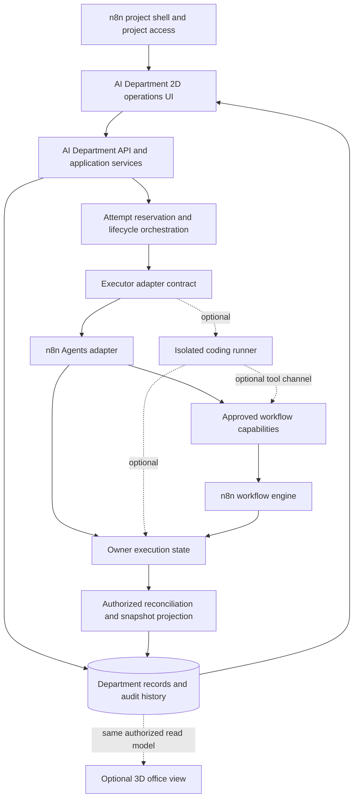

# CLAUDE.md — AI Department Development Guide

@AGENTS.md

## Product Summary

Build an AI Department that organizes AI members, goals, assignments, attempts, and
results. Members call authorized n8n workflows as tools. A member's identity is separate
from an executor binding. Existing n8n Agents and external coding runtimes are executor
options after their contracts are verified.

The current hosting proposal uses this n8n repository and project shell. The shared
2D interface leads the product. External runtime and 3D views are optional integrations.

### Read First

1. `AGENTS.md`: repository policy, package conventions, and AI Department rules.
2. `.specify/memory/constitution.md`: the sole Spec Kit constitution.
3. `specs/AI-DEPARTMENT-ROADMAP.md`: vocabulary, dependencies, and delivery slices.
4. `specs/AI-DEPARTMENT-DESIGN.md`: navigation, hierarchy, states, and interaction rules.
5. The active feature's spec, plan, research, data model, contracts, tasks, quickstart, and requirements checklist.
6. The owning package instructions and relevant current source before edits.

## System Architecture



The product uses the n8n project shell, project access, and modular monolith. The
department owns stable member identities, goals, work, attempts, business reviews, and
safe history. The attempt service reserves work before it calls an executor. An Agents
adapter or an enabled external runner owns execution. The owner keeps prompts, credentials,
runtime payloads, and execution details. The department stores owner references and
authorized summaries. Reconciliation updates department state from owner snapshots.

n8n remains the workflow and integration engine. Members call approved n8n workflows as
tools through existing execution and credential policy. The department does not add a
second workflow engine. The optional coding runner runs as an isolated process outside
the n8n server. It does not receive a generic shell or credential bypass. The optional
3D office reads the same authorized department state as the 2D UI. It does not own work
state or authorize actions.

### Component Boundaries

| Component | Responsibility | Source or stage |
|---|---|---|
| Project shell and access | Project identity, membership, and route scopes | Existing n8n project services |
| Department domain | Departments, member roles, goals, work, attempts, review, and history | `packages/cli/src/modules/ai-department/`; Specs 002–003 |
| Shared API types | Validated request and response contracts | `packages/@n8n/api-types/src/ai-department/` |
| Persistence | Department entities, transactions, receipts, migrations, and projections | Module persistence plus `@n8n/db` migrations |
| Executor adapter | Resolve current access, dispatch, lookup, stop, and snapshot | Agents-owned contract in `packages/cli/src/modules/agents/` |
| Workflow capability bridge | Allow selected workflows through existing n8n policy and correlate child runs | Spec 004; n8n owns workflow execution |
| Coding runner | Run coding tasks in an isolated workspace and report safe outcomes | Optional Spec 005; separate process |
| Operations UI | Directory, queue, work detail, review, and activity | One frontend module; Spec 006 |
| Office view | Optional spatial view of authorized members and work | Lazy 3D feature; Spec 007 |

### Request and Execution Flow

1. A coordinator creates work and assigns a stable department member.
2. The backend checks project access, member binding, current executor access, and work version.
3. The backend stores an attempt and dispatch intent before it contacts the executor.
4. The executor accepts the correlated request or returns a definite rejection. An unknown response stays reserved until reconciliation.
5. The executor owns runtime state. The department polls an authorized snapshot and records safe state changes and receipts.
6. A reviewer accepts or returns a successful result. This business decision does not grant a tool permission.
7. The 2D UI and optional office read the authorized department projection.

Use a 2D interface as the product baseline. Keep the office optional. Keep external coding
runtime optional. Enable live work only after one executor passes real-owner recovery and
access checks.

### Ownership and Integration

| Concern | Owner and rule |
|---|---|
| Department, member, goal, work, business review | Department domain under existing project access |
| Executor binding | Reference to permitted runtime configuration, fixed for an active attempt |
| Agent or provider execution | Its owning runtime through a verified adapter contract |
| Workflow tools and credentials | Existing n8n workflow services and credential policy |
| Tool approval | Existing Agent controls or an approved provider contract |
| 2D UI and optional office | Authorized department projections and permitted commands |

## Repository and Document Structure

```text
AGENTS.md                         Agent policy and operating rules
CLAUDE.md                         Architecture and development workflow
.specify/memory/constitution.md   Canonical product and engineering principles
.specify/templates/               Spec Kit templates
specs/AI-DEPARTMENT-ROADMAP.md     Delivery order and vocabulary
specs/AI-DEPARTMENT-DESIGN.md      Shared interface
specs/ai-department-research.md    Source findings and current proposal
specs/002-... through 007-.../     Spec, research, model, contracts, plan, tasks, quickstart
packages/                        Existing n8n source; proposed paths stay in plans
```

Do not create parallel root files for Agent guidance or a second constitution. Do not
claim that a proposed source path or service contract already exists.

## Architecture Decisions and Open Gates

The department member is a stable identity. Executor changes affect future attempts.
Work review is a business decision. Tool approval authorizes a proposed action in an
active attempt. Work and attempt history survive retries, cancellation, and archiving.

The roadmap selects one CLI-local backend, one frontend module, existing project scopes,
owner-side execution/correlation adapters, an optional Claude Agent SDK runner, and an
optional lazy Three.js office. Paperclip informs department governance and work history.
Orca informs isolated runner boundaries. 3D Claude Hub Remote informs session and
permission interactions. My Office informs the optional spatial view. These references
do not replace n8n owners or contracts. Real-owner recovery, the pinned provider matrix,
and measured scene budgets remain enablement gates. Keep their evidence in the stage
documents. Create an ADR only when requested.

## Development Workflow

Research → spec → requirements checklist → plan Phase 0 → plan Phase 1 → tasks →
implementation → verification → review.

A spec describes user behavior, edge cases, and measurable outcomes. A plan describes
source contracts, persistence, interfaces, risks, and checks. Phase 0 records decisions
and source evidence in `research.md`. Phase 1 produces the applicable data model,
contracts, and quickstart. Pending gates block tasks for the affected slice.

The roadmap brings 006A forward after 002 and 003. It does not require external runtime
005. Live 006B requires one working executor; fixtures are not proof of execution.
Office 007 follows live operations and remains optional.

### Spec Kit Use

Use the repository's `.specify/commands` and available Spec Kit skills. Current helper
scripts are under `.specify/scripts/bash/`. Inspect arguments and pointer effects before
running setup scripts. Review multiple draft features by explicit path; do not overwrite
`.specify/feature.json` to simulate six active features. Branch names and feature IDs
are independent. Cross-artifact analysis requires a complete `tasks.md`.

## Engineering and Validation

Follow root/package AGENTS, use pnpm, keep TypeORM in persistence, reuse shared helpers,
and follow approved backend/frontend module boundaries. New UI uses current design-system
components, token variables, and i18n. Check project authorization on backend actions and
on event delivery. Hidden controls are not enforcement.

Implement the accepted slice. Add meaningful behavior and boundary coverage where
required by repository policy. Use focused checks with one test worker. Documentation
revisions require diff, structure, and link review; skip code tests when behavior did not
change. Preserve unrelated changes in the shared workspace.

## Reference Concepts

| Reference | Use in this system | Boundary |
|---|---|---|
| Paperclip | Department hierarchy, goals, assignment, business review, and audit history | Reimplement those domain behaviors in the n8n module. Do not embed its app or persistence stack. |
| Orca | Provider adapters and isolated coding workspaces | Use as guidance for optional Spec 005. Do not embed its Electron application. |
| 3D Claude Hub Remote | Session status and permission interaction patterns | Keep provider and session details behind the executor contract. |
| My Office | Spatial office presentation and member presence | Use only for optional Spec 007. The scene reads department state and never owns it. |
| n8n | Workflow building, integrations, credentials, execution, and existing Agents | Keep workflow execution and credential policy inside n8n. Do not build a second workflow engine. |

Source and asset reuse require file-level provenance and license checks before copying.

## Patterns to Avoid

- Equating every department member with a saved n8n Agent.
- Blocking the 2D product on external runtime or 3D integration.
- Treating a lost connection or stop request as confirmed completion.
- Dispatching again after an uncertain acknowledgment without reconciliation.
- Allowing late results to rewrite a terminal or later attempt.
- Treating a business review as tool permission.
- Storing secrets or raw runtime payloads in general activity.
- Marking a draft plan or document checklist as implemented behavior.

<!-- gitnexus:start -->
# GitNexus — Code Intelligence

This project is indexed by GitNexus as **Nexora** (354232 symbols, 727278 relationships, 300 execution flows). Use the GitNexus MCP tools to understand code, assess impact, and navigate safely.

> If any GitNexus tool warns the index is stale, run `npx gitnexus analyze` in terminal first.

## Always Do

- **MUST run impact analysis before editing any symbol.** Before modifying a function, class, or method, run `gitnexus_impact({target: "symbolName", direction: "upstream"})` and report the blast radius (direct callers, affected processes, risk level) to the user.
- **MUST run `gitnexus_detect_changes()` before committing** to verify your changes only affect expected symbols and execution flows.
- **MUST warn the user** if impact analysis returns HIGH or CRITICAL risk before proceeding with edits.
- When exploring unfamiliar code, use `gitnexus_query({query: "concept"})` to find execution flows instead of grepping. It returns process-grouped results ranked by relevance.
- When you need full context on a specific symbol — callers, callees, which execution flows it participates in — use `gitnexus_context({name: "symbolName"})`.

## Never Do

- NEVER edit a function, class, or method without first running `gitnexus_impact` on it.
- NEVER ignore HIGH or CRITICAL risk warnings from impact analysis.
- NEVER rename symbols with find-and-replace — use `gitnexus_rename` which understands the call graph.
- NEVER commit changes without running `gitnexus_detect_changes()` to check affected scope.

## Resources

| Resource | Use for |
|----------|---------|
| `gitnexus://repo/Nexora/context` | Codebase overview, check index freshness |
| `gitnexus://repo/Nexora/clusters` | All functional areas |
| `gitnexus://repo/Nexora/processes` | All execution flows |
| `gitnexus://repo/Nexora/process/{name}` | Step-by-step execution trace |

## CLI

| Task | Read this skill file |
|------|---------------------|
| Understand architecture / "How does X work?" | `.claude/skills/gitnexus/gitnexus-exploring/SKILL.md` |
| Blast radius / "What breaks if I change X?" | `.claude/skills/gitnexus/gitnexus-impact-analysis/SKILL.md` |
| Trace bugs / "Why is X failing?" | `.claude/skills/gitnexus/gitnexus-debugging/SKILL.md` |
| Rename / extract / split / refactor | `.claude/skills/gitnexus/gitnexus-refactoring/SKILL.md` |
| Tools, resources, schema reference | `.claude/skills/gitnexus/gitnexus-guide/SKILL.md` |
| Index, status, clean, wiki CLI commands | `.claude/skills/gitnexus/gitnexus-cli/SKILL.md` |

<!-- gitnexus:end -->
