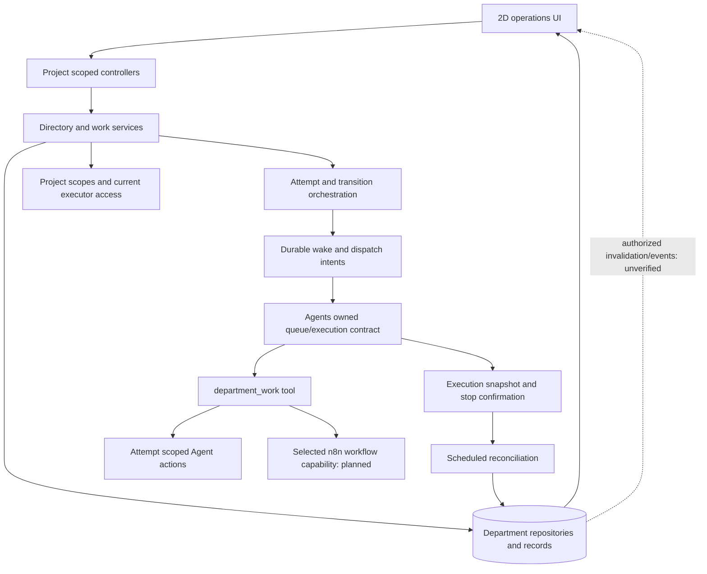
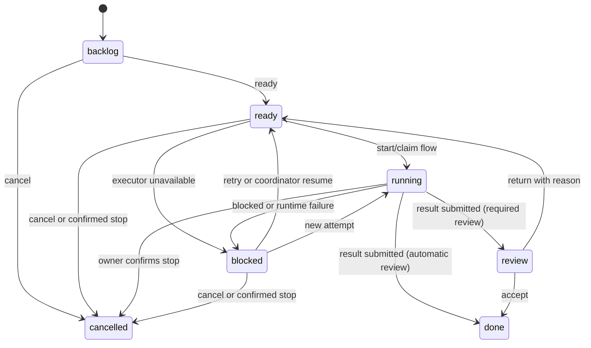

# AI Department Business Capabilities: Source Analysis

**Status:** Analysis only. This document records observed source behavior and open design questions. It is not an accepted Feature Contract and does not authorize implementation.

**Scope:** The nine capability groups in the user request: directory, goals/work, Agent pickup, execution/reporting, coordination/recovery, business review, workflow calls, operations UI, and authorization/live updates. The comparison target is selected Paperclip behavior from the pinned review in `specs/AI-DEPARTMENT-PAPERCLIP-PARITY-REVIEW.md`. Do not copy Paperclip's persistence, server framework, execution runtime, or permission model.

**Paperclip source basis updated 2026-11-03:** I verified the IDE workspace at `/Users/haison/Documents/GitHub/paperclip`, branch `master`, commit `fea61638114a041ffe60cba178f2438bbb06e57b`. This differs from the older parity review's pinned commit `8ea240218dc1d3a94afea1294b377021045dd9c9` and its `/tmp/paperclip-source-light` checkout. Findings below cite the current open checkout. The checkout was clean when inspected. No code in that repository was changed.

## Business behavior

1. A project coordinator creates a department, members, role and manager relationships, and optional executor bindings. A member identity exists independently of its executor.
2. A coordinator creates goals and work, assigns a member, sets priority, due date and review policy, and relates work through parent/child or blocker edges.
3. Work becomes ready only when blockers are resolved. A durable wake intent can notify the bound Agent. The Agent must inspect and claim work before it acts.
4. An active attempt authorizes progress, comment, block, resume, claim renewal/release, and result submission. Runtime success alone does not complete business work.
5. The department records business transitions and review decisions. Runtime execution, prompt, credentials, checkpoints, and detailed execution data stay with the owning Agent/runtime.
6. A reviewer accepts or returns the current result. Return requires a reason. Work/attempt history and safe activity are available to authorized project users.
7. An Agent may call only explicitly permitted n8n workflow capabilities, through existing n8n execution and credential policy. Child workflow states remain distinct from the parent business result.
8. Operators use the 2D UI to find ready, blocked, running, cancelled, and review work and inspect history. Optional 3D views do not own state or permissions.

The observed implementation is a partial product. In particular, workflow capabilities, full Agent inbox/coalescing, complete handoff, staged reviews, and authorized live delivery are not confirmed as implemented.

## Entry points and source references

| Surface | Observed entry points | Evidence |
|---|---|---|
| Frontend module | `AiDepartmentModule`, `AiDepartmentHomeView`, Pinia store, REST client | `packages/modules/ai-department/frontend/src/ai-department.module.ts`; `views/AiDepartmentHomeView.vue`; `ai-department.store.ts`; `ai-department.api.ts` |
| Directory API | `/projects/:projectId/ai-departments`; `/members`; executor-binding read/set/clear; department/member CRUD/archive | `packages/cli/src/modules/ai-department/department.controller.ts`; `member.controller.ts` |
| Goals and work API | `/goals`, `/work`, `/activity`, `/relationships`, `/ready`, `/start`, `/retry`, `/cancel`, `/review`, `/history`, `/attempts` | `packages/cli/src/modules/ai-department/work/work.controller.ts` |
| Domain services | Directory/member lifecycle; goal/work CRUD, transitions, dispatch/reconciliation; Agent actions | `department.service.ts`; `member.service.ts`; `work/work.service.ts`; `work/work-coordination.service.ts` |
| Agent tool | `department_work` derives attempt and execution identity from host metadata and tool-call ID | `packages/cli/src/modules/agents/tools/department-work.tool.ts`; registration and runtime reconstruction in `packages/cli/src/modules/agents/` |
| Executor boundary | `DepartmentExecutor`: resolve, verify run, dispatch/lookup, stop, snapshot | `packages/cli/src/modules/agents/agent-department-execution.contracts.ts` |
| Native Agent adapter | Resolves project Agent/access; queues a correlated message; verifies execution; requests stop; reads snapshots | `packages/cli/src/modules/agents/agent-department-execution.adapter.ts` |
| Background work | Cluster scheduled reconciliation every 30 seconds | `packages/cli/src/modules/ai-department/work/work-reconciliation.task.ts`; registration in `ai-department.module.ts` |
| Persistence | Department/member/binding, goal/work, attempt/claim/wake/dispatch, transitions, review, activity, receipt, relationships and admission fence entities | `packages/cli/src/modules/ai-department/database/entities/`; repositories in `database/repositories/`; migrations under `packages/@n8n/db/src/migrations/common/1793204018116-*` and `179361732*` |
| Workflow bridge | Spec and proposed contract only; no implemented workflow-capability module is confirmed by the inspected source inventory | `specs/004-ai-department-workflows/{spec,plan,data-model,contracts/service-api,tasks}.md` |

The UI currently exposes overview, work, people and activity sections, and has initial create, binding, ready and review actions. Its source does not show a complete organization tree, full relationship editor, Agent inbox/claim surface, staged review, or live update channel. Verify the exact visible controls against the active 006 design before treating any view as accepted.

## Dependency graph

### Dependency classification

| # | Dependency | Class | Reason / boundary |
|---:|---|---|---|
| 1 | Project identity, membership and `agent:*` scopes | REQUIRED + REUSE_N8N | Existing project authorization is the access boundary. Enforce it on every read, command, executor resolution, and event delivery. |
| 2 | Department/member/goals/work domain and its transactions | REQUIRED | Own stable identity, relationships, business status and review. Keep TypeORM behind named repository operations. |
| 3 | Durable attempt, dispatch/wake intent, idempotency and recovery | REQUIRED | Needed to prevent duplicate active work and recover uncertain dispatch after retries or process restart. |
| 4 | Agent execution, queue, approval, stop and snapshot ownership | REQUIRED + ADAPT + REUSE_N8N | Agent module owns execution. Use an Agents-owned contract; current adapter has internal repository coupling that is not a stable public contract. |
| 5 | `department_work` authenticated action context and claim lease | REQUIRED + ADAPT | Bind every action to current attempt, execution, member, binding version and assignment. Tool call identity is used for idempotent command receipt. |
| 6 | Goal/work relationships and blocker readiness checks | REQUIRED | Parent and blocker semantics affect valid work planning and readiness. Cycle and same-department checks are required. |
| 7 | Append-only business transitions, decisions, activity and safe summaries | REQUIRED | Required for audit, operator review and recovery. Never expose raw prompt, credentials or unrestricted tool arguments. |
| 8 | Explicit workflow capability selection, invocation correlation and child outcomes | REQUIRED for capability group 7; ADAPT + REUSE_N8N | The feature is required to satisfy workflow invocation, but its implementation is pending Spec 004. n8n owns workflow runs and credentials. |
| 9 | 2D operations UI and localized states/actions | REQUIRED | Core operations must be possible without 3D. Current module is partial. |
| 10 | Realtime push/invalidation and reconnect protocol | OPTIONAL for initial correctness; REQUIRED for live-update acceptance | Poll/refresh can preserve correctness first. Push delivery must recheck project access and clear stale data after access loss. Current delivery mechanism is UNKNOWN. |
| 11 | External runtime bridge | OPTIONAL + ADAPT | Spec 005; do not require it for native n8n Agent support. |
| 12 | 3D office | OPTIONAL | Spec 007 reads shared authorized state and must have a complete 2D fallback. |
| 13 | Paperclip company membership/grants, server framework, database schema and heartbeat runtime | EXCLUDE | Translate user-visible behavior to n8n project access and owned Agent contracts. Do not port these implementation dependencies. |
| 14 | Cross-project administration, copied credentials, second workflow engine, autonomous budgets | EXCLUDE | Outside the current product boundary in the constitution and feature specs. |

**Count:** 9 dependencies are REQUIRED for the complete nine-group product scope (items 1–9). Items 1, 4, 5, 8 and 10 also identify reuse/adapter boundaries. If the first release defers workflow calls, item 8 is a later-slice requirement, not a prerequisite to the 2D directory/work baseline.

## Data model

| Record | Observed responsibility |
|---|---|
| Department | Project-owned group with archive state and version/history. |
| Member | Stable identity, department role, manager reference, archive state. |
| Executor binding + revision | Provider/executor reference and version. Active attempts pin the binding version. |
| Goal | Department goal with owner, parent, state and version. |
| Work item | Instruction, goal, assignee, priority, due date, review policy, business state, expected version/current attempt. |
| Work relationship | Parent/child or blocker edge, constrained to department; cycle and duplicate checks. |
| Attempt | One reserved execution attempt, initiating user, member/executor/binding snapshot, dispatch key, owner reference, runtime and outcome fields. |
| Wake/dispatch intent | Durable request identity/state for delivery and reconciliation. |
| Claim | Attempt/execution ownership with lease and release metadata. |
| Transition | Actor, time, prior/new state and reason for a business transition. |
| Review decision | Reviewer decision for a specific current result/version; return reason recorded. |
| Activity | Safe progress, comments and result activity with scoped pagination. |
| Command receipt | Idempotency identity, payload hash and stored response. |
| Owner-event receipt | Deduplicates owner notifications/events. |
| Admission fence | Serializes sensitive department operations such as archive against active attempts. |

The current coordination migration is `1793617324000-CreateAiDepartmentWorkCoordination.ts`; schema docs were recently generated in the shared workspace but may not represent a validated final migration set. Workflow capability and invocation records are proposed in Spec 004, not observed implementation. Review stages/participants also lack confirmed persistence records.

## State machine

Observed work states and transitions in `work/work-lifecycle.ts`:

This is business work state. Attempt execution phase is separately active, suspended, terminal or unknown in the owner snapshot contract. Claim state has a lease and release time. Do not equate a successful runtime snapshot with a submitted business result. Handoff/destination reassignment, staged review transitions and live availability states are not established by this state machine.

## Permission rules

- Controllers use `@ProjectScope` with `agent:list`, `agent:read`, `agent:create`, or `agent:update`. Start/retry additionally check `agent:execute` for the target executor. See `work.controller.ts` and directory controllers.
- Mutations record the authenticated user as actor. Services scope record lookup by project and department; expected versions reject stale writes.
- Agent actions derive identity from host execution metadata and tool-call ID; caller input does not select the attempt. The service verifies attempt/executor, current department/member/binding and binding version, current work assignment/current attempt, and owner run identity.
- A stale binding, archived member/department, changed assignment, unauthorized execution or missing claim prevents action. Native tool approval stays in the Agent runtime and is not the business review decision.
- The executor must not exceed the initiating user's current project policy. Exact revocation behavior for already-running workflow children is UNKNOWN and requires a contract decision.
- Live event authorization and access-loss clearing are not implemented/verified in the inspected sources.

## Execution side effects

1. A user command reserves attempt and dispatch identity in department persistence before dispatching to the Agent owner.
2. The owner queues and accepts a correlated Agent message. A timeout/unknown response retains reservation for lookup; it must not trigger a blind duplicate execution.
3. The Agent tool may mutate claim, lease, progress, comment, block/resume, or submit result. Command receipts make retries idempotent and reject reuse of the same identity with changed content.
4. The reconciliation task polls owner snapshots and resolves accepted, terminal, cancellation and unknown states. Cancellation remains pending until owner confirmation.
5. Workflow invocation side effects are not implemented. Spec 004 requires revalidation of workflow status/access before start, correlation to work/attempt, distinct waiting/retry/failure/cancel/success child states, and idempotent invocation records. Exactly-once external side effects cannot be guaranteed.
6. Audit/activity writes must be atomic with business state changes where possible. Push notification, if added, is a derived invalidation; it must not become the source of truth.

## Failure and recovery cases

| Failure | Required behavior | Evidence/status |
|---|---|---|
| Executor unavailable before dispatch | Do not dispatch; retain work for recovery and record a blocked reason. | Present in service behavior; fresh final checks are not established. |
| Dispatch response unknown | Keep attempt reserved; lookup by stable dispatch key; redispatch only under authoritative absence and same identity. | Contract and controlled integration cases exist; current revision needs fresh verification. |
| Duplicate start/command | Return stored result for same identity and payload; reject changed payload. | Receipts and controlled tests exist. |
| Competing claim | Only one active claim/attempt owns work; reject stale expected version. | Claim/admission fence exists; latest full acceptance is UNKNOWN. |
| Lease expiry | Reclaim only after confirming prior owner execution stopped. | Contract exists; newest reclaim case not rerun per progress report. |
| Process restart | Scheduled reconciliation resumes durable intents and owner lookup. | 30-second scheduled task exists; end-to-end restart validation UNKNOWN. |
| Runtime succeeds without submit | Do not mark business work successful; leave recoverable/blocked state. | Controlled case reported passed in progress report; no real-model proof. |
| Cancel requested while queued/running | Keep pending until owner confirms; late/mismatched owner events cannot rewrite a newer attempt. | Owner contract and controlled coverage exist; live provider coverage open. |
| Review race or stale result | Review only current successful result and expected work version; reject stale or active attempt. | Basic review path observed; stages and expanded policies missing. |
| Workflow deleted/disabled/access revoked/invalid input | Reject before starting child execution and return a safe correction/access message. | Spec 004 requirement; implementation UNKNOWN. |
| Workflow wait/retry/failure/cancel | Preserve child state independently; never imply parent work is done. | Spec 004 requirement; implementation UNKNOWN. |
| Lost project access/reconnect | Clear protected UI state and refetch authorized data; reject further commands/events. | Backend request scopes exist; push/reconnect behavior UNKNOWN. |

## Audit requirements

- Record actor, time, previous and new business state, attempt identity, and reason for each transition.
- Record claim acquisition/renewal/release and result/review decisions with the current attempt and version.
- Persist command receipts and owner-event receipts for deduplication and forensic ordering.
- Keep comments/progress/result summaries safe for department history. Keep raw prompts, full tool inputs, credentials, checkpoints, and unrestricted workflow outputs with the owning runtime.
- Record workflow capability selection/version and correlated child execution reference/outcome when Spec 004 is implemented.
- Reauthorize every event delivery and detail read. Audit failed authorization only through existing n8n security/audit policy; exact event taxonomy is UNKNOWN.

## Mapping to n8n backend

| Product behavior | n8n owner / adaptation |
|---|---|
| Department and membership | CLI-local `ai-department` module, project-scoped controllers, directory repositories/entities. |
| Goals, work, blockers, transitions | Department `WorkService`, `WorkRepository`, API types and common DB migrations. |
| Project access | Existing project scopes and RBAC. Do not import Paperclip company grants. |
| Native Agent execution | `DepartmentExecutor` owner contract in Agents; replace private-table coupling with a stable Agents-owned service boundary before treating as durable architecture. |
| Agent work actions | Native `department_work` tool calls a Department action contract with host-derived execution context. Preserve approval/resume metadata through runtime reconstruction. |
| Queue, cancellation, snapshots | Agent message queue/execution owner APIs, with durable department dispatch identity and reconciliation. |
| Workflow calls | Spec 004 Agents-owned bridge to existing n8n workflow execution, publication and credential authorization. No second workflow engine or credential copy. |
| UI | Frontend module inside project shell; use current i18n, design-system and project permission capabilities. Complete core actions in 2D. |
| Live state | Add authorized invalidation/event delivery only after defining access recheck, sequence/freshness, reconnect, and access-loss behavior. Polling remains a possible initial fallback. |
| External provider | Optional Spec 005 adapter outside server process; same owner contract and isolation requirements. |
| 3D | Optional Spec 007 renderer of the same authorized read model. |

## Acceptance criteria

These criteria describe the integrated behavior target. They are not claims that checks passed.

1. A project user with the matching scope can manage departments, members, goals and work; a user outside that project cannot read or mutate them.
2. Directory members remain stable when executor bindings change. An active attempt remains bound to its recorded executor/version.
3. Parent/child and blocker relationships reject cross-department edges and cycles. Blocking work cannot be made ready or submit a result until blockers resolve.
4. Repeated dispatch and Agent commands are idempotent. Unknown owner outcomes recover using the same attempt and dispatch key.
5. Two Agents cannot hold active claims for the same work. Expired claims cannot be reassigned until the prior execution is confirmed stopped.
6. Every Agent action requires current execution, attempt, binding, assignment and version authority. Native Agent approval resume preserves that context.
7. A runtime success without an explicit result does not complete work. Submit, review accept, review return and cancellation have distinct business outcomes and audit records.
8. Work history exposes safe activity and paginated attempts/results to authorized project users; secrets and raw prompts are absent.
9. Selected workflow calls use existing n8n access and credentials, correlate child executions to the active attempt, preserve waiting and terminal outcomes, and cannot bypass business review.
10. The 2D UI supports directory, goals, work relationships, inbox/claim, activity, review, recovery and clear loading/error/stale/disconnected states in supported locales and keyboard flows.
11. If live updates are enabled, events are project-authorized, ordered or invalidated safely, reconnect refreshes state, and access loss clears protected data.
12. Restart/reconciliation, cancellation, real Agent execution and browser acceptance pass in the owning packages/environments before claiming operational readiness.

## Required, optional and excluded scope

- **Required for full requested scope:** project authorization; department records and audit; work/goal graph; durable attempts, wake, claim and recovery; verified Agent owner contract; Agent work tool; review; 2D operations UI; workflow capability bridge for group 7.
- **Optional/deferable:** push updates after safe polling/invalidation; external runtime (005); 3D office (007); broad comparative performance benchmarking.
- **Excluded:** Paperclip's company membership system, database/framework/runtime copy, second workflow engine, copied credentials, cross-project administration, unrestricted server-side shell, and autonomous organization-wide budget management.

## Unresolved questions

| Question | Why it matters | Current status |
|---|---|---|
| What is the canonical Agent inbox contract and what wakes an Agent: assignment, ready transition, explicit command, or a coalesced batch? | Determines scheduling, fairness, and whether one wake can surface several assigned items. | UNKNOWN; existing wake intent and tool do not prove full Agent-wide inbox/coalescing. |
| What exact identity/authentication represents an Agent action after native approval resume or process restart? | Prevents context loss or confused execution authority. | Host metadata/tool-call derivation is implemented; full resume/restart proof is UNKNOWN. |
| What does handoff mean: release to coordinator, transfer assignee, or assign a destination and wake them? | Changes assignment history, active attempt and idempotency rules. | UNKNOWN; current release is recovery-oriented, not a verified handoff contract. |
| What review stage model and participant policy are in first release? | Defines serial/parallel decisions, quorum, creator exclusion and human-only enforcement. | UNKNOWN; current policy is only `required`/`automatic`, basic reviewer authorization. |
| Which workflow node/workflow versions and input/output schemas can be exposed as capabilities? | Defines safe selection, validation, upgrade/revocation and output retention. | Spec 004 outlines capability selection; concrete compatibility contract is UNKNOWN. |
| How are child workflow permissions rechecked and existing child executions handled after access revocation? | Avoids privilege continuation and ambiguous cancellation. | UNKNOWN; must be decided in Spec 004 owner contract. |
| Which event transport, ordering token and reconnect cursor will serve live UI updates? | Needed for stale data, missed events and access-loss handling. | UNKNOWN; no confirmed Department event channel in inspected source. |
| Are due dates timezone-aware and do they trigger notification/wake behavior? | Impacts scheduling and user expectations. | Data fields exist in work contract; scheduling semantics are UNKNOWN. |
| Which terminal/archived states permit late result or audit append? | Avoids late runtime events rewriting business decisions. | Some guards/receipts exist; complete policy needs explicit contract and acceptance. |
| Which schema migrations and generated docs are final for this workspace? | Current worktree contains recent uncommitted migrations and generated schema output. | UNKNOWN pending migration/schema check; analysis did not run validation. |

## Recommended implementation order

1. Close source/contract gates for current 002/003 behavior: verify directory archive fencing, inbox/wake coalescing, claim/reclaim, handoff semantics, and stable Agent owner API.
2. Finish and verify Spec 003 durable coordination and its audit/data model. Resolve restart, cancellation, late event and concurrency acceptance before enabling autonomous pickup.
3. Complete Spec 006A 2D operations: org tree, goal/work detail and relationships, Agent inbox/claim, recovery and complete core actions. Use polling until live delivery contract is ready.
4. Implement Spec 004 workflow capability bridge after Agent owner and attempt identity contracts are stable; validate n8n policy, correlation, child outcomes and revocation behavior.
5. Define staged review and reviewer rules as an explicit feature contract, then implement transitions and authenticated decision policies.
6. Add authorized live invalidation/reconnect behavior and complete browser/access-loss acceptance.
7. Run real-Agent acceptance across pickup, workflow call, progress, blocker, submit, review, cancel and recovery; then measure broader performance.
8. Consider optional Spec 005 runtime and Spec 007 office only after the 2D/native path is complete.

## Paperclip architecture deep dive: current open checkout

This section records direct source findings from the IDE workspace. It supersedes older comparisons where the older pinned checkout differs. It is still a bounded review of the requested feature paths, not a review of all Paperclip product features.

### Architecture and ownership

- Paperclip is a TypeScript monorepo. The relevant path is React UI → Express route handlers → service factories → Drizzle/PostgreSQL tables. Shared contracts and validators live in `packages/shared`; runtime adapters and runner packages own provider-specific execution.
- The company is the organizational/security root. Agents have role/title and `reportsTo` relationships. Paperclip has no first-class department record matching the n8n Department; an AI Department should keep its own department/member concepts.
- Paperclip owns the heartbeat runtime itself. `heartbeat_runs`, `agent_wakeup_requests`, run event/log records, execution workspaces, and provider/session state form a larger control plane than the n8n adapter should copy. For n8n, retain only the department attempt/claim and safe owner references; use the Agents-owned execution contract.
- Issue routes are concentrated in the large `server/src/routes/issues.ts`, with helper routes, services and policies factored beside it. Route code performs access checks, calls services, writes activity records, and requests wakes. This concentration is a maintenance observation, not a design to reproduce.

### Traced business flow

1. **Organization:** `server/src/routes/agents.ts` creates and updates company-scoped Agent records; the `agents` table stores `reportsTo` and lifecycle/configuration. The Org Chart UI renders that hierarchy. Company and Agent permissions are broader concepts than the n8n project plus Department Member.
2. **Goal/work planning:** `server/src/routes/goals.ts` validates and scopes goal operations, calls `goalService`, and logs `goal.created`/`goal.updated`. `packages/db/src/schema/goals.ts` stores parent and owner references. `issues.ts` is the task/work aggregate: assignee, parent, status, execution/review policies, and execution ownership live in `issues`; blockers and related artifacts have supporting tables/services.
3. **Assignment and wake:** `POST /issues/:id/checkout` checks accessible issue, project pause, acting Agent identity, assignment authority and run identity. `issueService.checkout()` checks Agent assignability, active subtree holds, and unresolved blockers, then conditionally updates the issue in a DB transaction. The conditional update pins assignee, checkout run and execution run and moves the issue to `in_progress`; its predicates reject stale status, a different assignee or a competing execution run.
4. **Wake delivery:** after checkout, the route writes `issue.checked_out` activity and calls `heartbeat.wakeup()` asynchronously when `shouldWakeAssigneeOnCheckout()` says this is a new assignment. Agent self-checkout on the current run does not create a redundant assignment wake. Wake intent is persisted in `agent_wakeup_requests`, with status, actor, payload, idempotency key, run reference and coalesced count. Heartbeat queue/scheduling creates or attaches the runtime run, and handles queued, claimed, deferred, coalesced, failed and terminal outcomes. Assignment wake is one trigger among on-demand, timer, retry, recovery, monitor and interaction wakes.
5. **Agent work and release:** Agent API identity includes Agent and run context. Checkout is the atomic ownership/claim operation; there is no separate Department-style claim entity in this path. `POST /issues/:id/release` validates issue mutation authority and the authenticated run. The service locks the issue row. An assignee cannot release another Agent's issue; a live different run cannot release it. An unfinished `in_progress` issue returns to `todo` and clears assignment/runtime locks. Terminal cleanup keeps the terminal assignee for history.
6. **Execution/recovery:** the heartbeat owner maintains run lifecycle, queue, retry, cancellation, runtime/session, event and recovery state. Worktree and execution control are coordinated with issue status. Reconciliation and cleanup tasks can act on wake/run state; a successful runner process is not automatically equivalent to an issue business decision. The exact accepted completion path depends on execution/review policy and the route transition chosen.
7. **Review:** `issue-review-policy.ts` enforces `anyone`, `human_only`, and `not_creator` for authenticated review verdict actors. `not_creator` resolves the actor who requested review and rejects the same actor. The issue routes also protect sensitive review-policy changes and verdict paths. Paperclip has richer approval/participant machinery than the simple 003 review implementation; do not infer that every Paperclip approval is a work-result review.
8. **Live operations:** UI `LiveUpdatesProvider` subscribes to company-scoped WebSocket events, invalidates React Query caches for issues, goals, Agents, runs and activity, and reconnects with backoff. Its source explicitly treats events as non-replayed and reconciles missed changes by refetching after reconnect. Thus events are an invalidation signal; API reads remain authoritative.

### Important Paperclip data and policy distinctions

| Concern | Paperclip source behavior | n8n transfer implication |
|---|---|---|
| Organizational identity | Company → Agent records; manager is an Agent relation (`reportsTo`). | Keep Department and Member as first-class domain records; binding to an n8n Agent is a replaceable executor relation. |
| Assignment vs execution | Issue assignee plus `checkoutRunId`/`executionRunId` separately pins work ownership and the active heartbeat run. | Keep member assignment, claim, attempt and owner execution reference distinct. |
| Readiness | Checkout rejects unresolved blockers and active subtree pause holds; it also honors project pause. | Recheck blockers and admission/archive fences atomically before dispatch/claim. Map subtree pause only if product needs it. |
| Concurrency | Conditional issue update uses expected statuses, same-assignee/run allowance and execution-run lock. Release takes a row lock and checks run ownership. | Use transaction/unique admission rules and owner-confirmed stop before reclaim. Do not rely only on UI versions. |
| Wake delivery | Wake request is durable and correlated to agent, reason, caller, context and run; queue can defer/coalesce and record outcome. A scheduler handles timer/retry/recovery as well as assignment triggers. | Reuse n8n durable scheduler/queue primitives where suitable, but keep a Department wake intent and stable Agent owner contract. Define whether wake informs one work item or an inbox batch. |
| Review authority | `anyone`, `human_only`, and `not_creator` are checked against authenticated actor identity and issue write authority. | Adopt the behavior only after explicit reviewer policy contract; current `required`/`automatic` is not equivalent. |
| Audit | Mutating route paths append company-scoped `activity_log` entries with actor type/id and action-specific details. Runtime events are separately sequenced in heartbeat event records. | Keep business transition/audit and runtime owner history separate; expose only authorized safe projections. |
| Live updates | WebSocket events are company-scoped invalidations; reconnect backoff is followed by refetch because the stream does not replay missed events. | Build authorized project-scoped invalidation and refetch. Do not make push events the source of truth. |

### Paperclip source references inspected

All paths below are relative to `/Users/haison/Documents/GitHub/paperclip` at commit `fea61638114a041ffe60cba178f2438bbb06e57b`:

- Organization and route entry points: `server/src/routes/agents.ts`; `packages/db/src/schema/agents.ts`; `ui/src/pages/OrgChart.tsx` and `OrgChart.production.tsx`.
- Goals: `server/src/routes/goals.ts`; `server/src/services/goals.ts`; `packages/db/src/schema/goals.ts`; `ui/src/pages/Goals.tsx` and `GoalDetail.tsx`.
- Work routes and assignment: `server/src/routes/issues.ts` (checkout around line 16285, release around 16439); `server/src/routes/issues-checkout-wakeup.ts`; `server/src/services/issues.ts` (`checkout` around 12150, `release` around 12581); `packages/db/src/schema/issues.ts`.
- Wake and execution: `server/src/services/heartbeat.ts`; `server/src/services/heartbeat/queue.ts` (`enqueueWakeup`); `server/src/services/heartbeat/scheduling.ts`; `server/src/services/execution-control-work.ts`; `packages/db/src/schema/agent_wakeup_requests.ts`; `packages/db/src/schema/heartbeat_runs.ts`.
- Review and permissions: `server/src/services/issue-review-policy.ts`; `server/src/services/issue-execution-policy.ts`; `server/src/routes/authz.ts`; relevant mutation and verdict paths in `server/src/routes/issues.ts`.
- UI operations/live events: `ui/src/pages/WhatNeedsMe.tsx`; `ui/src/pages/IssueDetail.tsx`; `ui/src/pages/DashboardLive.tsx`; `ui/src/context/LiveUpdatesProvider.tsx`.

### Revised comparison conclusions

- The old parity review statement that the n8n adapter lacks Agent claim/heartbeat coordination applied to the earlier n8n implementation and to the older Paperclip comparison. The current n8n workspace now has explicit Department wake intents, claims, a `department_work` tool, and an Agents adapter, but its progress report still marks inbox-wide coalescing, handoff, real-model acceptance and parts of recovery as incomplete. Keep that distinction in future parity claims.
- Paperclip checkout is tightly coupled to an issue status update and heartbeat run ID, while current AI Department reserves an attempt before dispatch and exposes claim as an Agent action. These are different ownership protocols. Compare user outcomes and invariants, not endpoint equivalence.
- Paperclip has many adjacent systems (company grants, projects, budget hard stops, execution workspaces, documents, integrations, team/skill management, telemetry and runner configuration). They are not all dependencies for the nine requested capabilities. Include only a specific behavior when a Feature Contract selects it.
- Current source confirms core architecture and several invariants. It does not by itself prove reliability under runtime conditions, complete Paperclip parity, or that every adjacent route/policy has been exhaustively traced.

## Evidence limits

This is source analysis, not runtime validation. The workspace has uncommitted changes. The latest progress report says focused logs cover earlier revisions and several new tests/edits need reruns. No test or build was run for this document. Consult `specs/AI-DEPARTMENT-PROGRESS-REPORT-2026-11-03.md` and the feature tasks for current check evidence; do not infer parity or production readiness from source presence.

## Proposed Feature Contract v1 — 2026-11-03

See the [dependency-ordered contract package](../../specs/feature-contracts/ai-department/README.md).
It records proposed decisions, requirements, model/API deltas, acceptance, and evidence
for Specs 002–006. Approval and owner gates remain open. It does not generate tasks
or certify runtime acceptance.

## Approved Feature Contract v1 — 2026-11-03

The analysis remains source comparison. Product decisions D1–D9 are recorded in the
[approved Feature Contract](../../specs/feature-contracts/ai-department/README.md). C1 is
the first task slice. G1–G2 remain open for coordination and execution. Acceptance checks
that lack current-revision evidence remain open.
