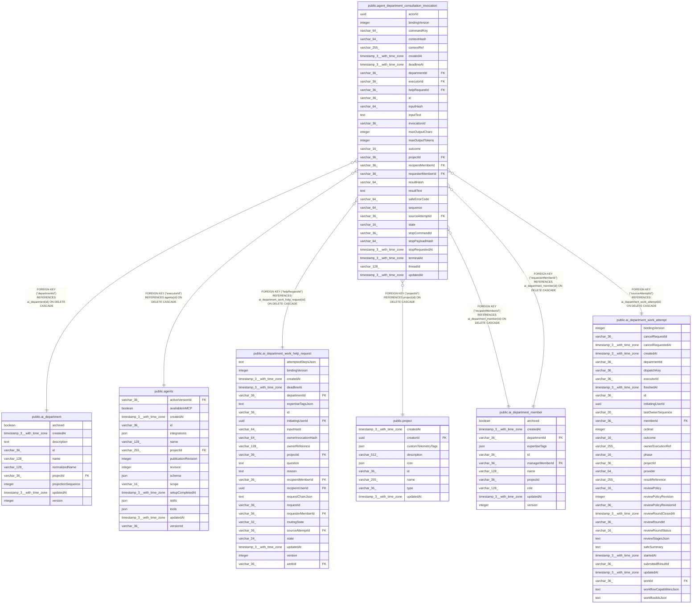

# public.agent_department_consultation_invocation

## Columns

| Name | Type | Default | Nullable | Children | Parents | Comment |
| ---- | ---- | ------- | -------- | -------- | ------- | ------- |
| actorId | uuid |  | false |  |  |  |
| bindingVersion | integer |  | false |  |  |  |
| commandKey | varchar(64) |  | false |  |  |  |
| contextHash | varchar(64) |  | false |  |  | Hash of the owner-resolved context. |
| contextRef | varchar(255) |  | false |  |  |  |
| createdAt | timestamp(3) with time zone |  | false |  |  |  |
| deadlineAt | timestamp(3) with time zone |  | false |  |  | UTC consultation deadline. |
| departmentId | varchar(36) |  | false |  | [public.ai_department](public.ai_department.md) |  |
| executorId | varchar(36) |  | false |  | [public.agents](public.agents.md) |  |
| helpRequestId | varchar(36) |  | false |  | [public.ai_department_work_help_request](public.ai_department_work_help_request.md) |  |
| id | varchar(36) |  | false |  |  |  |
| inputHash | varchar(64) |  | false |  |  |  |
| inputText | text |  | false |  |  |  |
| invocationId | varchar(36) |  | false |  |  |  |
| maxOutputChars | integer |  | false |  |  |  |
| maxOutputTokens | integer |  | false |  |  |  |
| outcome | varchar(16) |  | true |  |  | Terminal consultation outcome. |
| projectId | varchar(36) |  | false |  | [public.project](public.project.md) |  |
| recipientMemberId | varchar(36) |  | false |  | [public.ai_department_member](public.ai_department_member.md) |  |
| requesterMemberId | varchar(36) |  | false |  | [public.ai_department_member](public.ai_department_member.md) |  |
| resultHash | varchar(64) |  | true |  |  |  |
| resultText | text |  | true |  |  |  |
| safeErrorCode | varchar(64) |  | true |  |  |  |
| sequence | varchar(64) | '0'::character varying | false |  |  | Monotonic owner sequence. |
| sourceAttemptId | varchar(36) |  | false |  | [public.ai_department_work_attempt](public.ai_department_work_attempt.md) |  |
| state | varchar(16) | 'reserved'::character varying | false |  |  | Consultation owner lifecycle state. |
| stopCommandId | varchar(36) |  | true |  |  |  |
| stopPayloadHash | varchar(64) |  | true |  |  |  |
| stopRequestedAt | timestamp(3) with time zone |  | true |  |  |  |
| terminalAt | timestamp(3) with time zone |  | true |  |  |  |
| threadId | varchar(128) |  | false |  |  |  |
| updatedAt | timestamp(3) with time zone |  | false |  |  |  |

## Constraints

| Name | Type | Definition |
| ---- | ---- | ---------- |
| CHK_agent_department_consultation_invocation_outcome | CHECK | CHECK (((outcome)::text = ANY ((ARRAY['succeeded'::character varying, 'failed'::character varying, 'cancelled'::character varying])::text[]))) |
| CHK_agent_department_consultation_invocation_state | CHECK | CHECK (((state)::text = ANY ((ARRAY['reserved'::character varying, 'accepted'::character varying, 'running'::character varying, 'stopping'::character varying, 'unknown'::character varying, 'terminal'::character varying])::text[]))) |
| FK_328da9a2af891fb8268d81a0266 | FOREIGN KEY | FOREIGN KEY ("requesterMemberId") REFERENCES ai_department_member(id) ON DELETE CASCADE |
| FK_46e1ae4526d1c01f442e243e888 | FOREIGN KEY | FOREIGN KEY ("projectId") REFERENCES project(id) ON DELETE CASCADE |
| FK_a8b584491424b0120b4ba26fe18 | FOREIGN KEY | FOREIGN KEY ("sourceAttemptId") REFERENCES ai_department_work_attempt(id) ON DELETE CASCADE |
| FK_ab82c09fef2d5816e43aabf4d84 | FOREIGN KEY | FOREIGN KEY ("departmentId") REFERENCES ai_department(id) ON DELETE CASCADE |
| FK_b2ed8531e39fb0681f461d3b8e6 | FOREIGN KEY | FOREIGN KEY ("recipientMemberId") REFERENCES ai_department_member(id) ON DELETE CASCADE |
| FK_cd27dd3ac6f933a28901758ac1f | FOREIGN KEY | FOREIGN KEY ("helpRequestId") REFERENCES ai_department_work_help_request(id) ON DELETE CASCADE |
| FK_f9dae826874fe11f1e690c88377 | FOREIGN KEY | FOREIGN KEY ("executorId") REFERENCES agents(id) ON DELETE CASCADE |
| PK_1fe99cc58e58e53ccb908d693d9 | PRIMARY KEY | PRIMARY KEY (id) |
| agent_department_consultation_invoca_recipientMemberId_not_null | n | NOT NULL "recipientMemberId" |
| agent_department_consultation_invoca_requesterMemberId_not_null | n | NOT NULL "requesterMemberId" |
| agent_department_consultation_invocati_maxOutputTokens_not_null | n | NOT NULL "maxOutputTokens" |
| agent_department_consultation_invocati_sourceAttemptId_not_null | n | NOT NULL "sourceAttemptId" |
| agent_department_consultation_invocatio_bindingVersion_not_null | n | NOT NULL "bindingVersion" |
| agent_department_consultation_invocatio_maxOutputChars_not_null | n | NOT NULL "maxOutputChars" |
| agent_department_consultation_invocation_actorId_not_null | n | NOT NULL "actorId" |
| agent_department_consultation_invocation_commandKey_not_null | n | NOT NULL "commandKey" |
| agent_department_consultation_invocation_contextHash_not_null | n | NOT NULL "contextHash" |
| agent_department_consultation_invocation_contextRef_not_null | n | NOT NULL "contextRef" |
| agent_department_consultation_invocation_createdAt_not_null | n | NOT NULL "createdAt" |
| agent_department_consultation_invocation_deadlineAt_not_null | n | NOT NULL "deadlineAt" |
| agent_department_consultation_invocation_departmentId_not_null | n | NOT NULL "departmentId" |
| agent_department_consultation_invocation_executorId_not_null | n | NOT NULL "executorId" |
| agent_department_consultation_invocation_helpRequestId_not_null | n | NOT NULL "helpRequestId" |
| agent_department_consultation_invocation_id_not_null | n | NOT NULL id |
| agent_department_consultation_invocation_inputHash_not_null | n | NOT NULL "inputHash" |
| agent_department_consultation_invocation_inputText_not_null | n | NOT NULL "inputText" |
| agent_department_consultation_invocation_invocationId_not_null | n | NOT NULL "invocationId" |
| agent_department_consultation_invocation_projectId_not_null | n | NOT NULL "projectId" |
| agent_department_consultation_invocation_sequence_not_null | n | NOT NULL sequence |
| agent_department_consultation_invocation_state_not_null | n | NOT NULL state |
| agent_department_consultation_invocation_threadId_not_null | n | NOT NULL "threadId" |
| agent_department_consultation_invocation_updatedAt_not_null | n | NOT NULL "updatedAt" |

## Indexes

| Name | Definition |
| ---- | ---------- |
| IDX_agent_department_consultation_invocation_projectId_commandK | CREATE UNIQUE INDEX "IDX_agent_department_consultation_invocation_projectId_commandK" ON public.agent_department_consultation_invocation USING btree ("projectId", "commandKey") |
| IDX_agent_department_consultation_invocation_projectId_departme | CREATE INDEX "IDX_agent_department_consultation_invocation_projectId_departme" ON public.agent_department_consultation_invocation USING btree ("projectId", "departmentId", state) |
| IDX_agent_department_consultation_invocation_projectId_helpRequ | CREATE UNIQUE INDEX "IDX_agent_department_consultation_invocation_projectId_helpRequ" ON public.agent_department_consultation_invocation USING btree ("projectId", "helpRequestId") |
| IDX_agent_dept_consult_inv_id | CREATE UNIQUE INDEX "IDX_agent_dept_consult_inv_id" ON public.agent_department_consultation_invocation USING btree ("projectId", "invocationId") |
| PK_1fe99cc58e58e53ccb908d693d9 | CREATE UNIQUE INDEX "PK_1fe99cc58e58e53ccb908d693d9" ON public.agent_department_consultation_invocation USING btree (id) |

## Relations

---

> Generated by [tbls](https://github.com/k1LoW/tbls)
