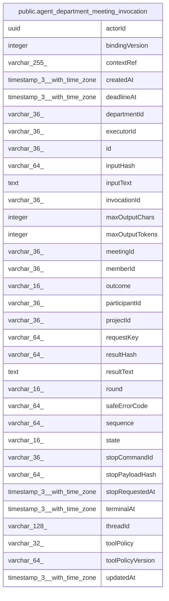

# public.agent_department_meeting_invocation

## Columns

| Name | Type | Default | Nullable | Children | Parents | Comment |
| ---- | ---- | ------- | -------- | -------- | ------- | ------- |
| actorId | uuid |  | false |  |  |  |
| bindingVersion | integer |  | false |  |  |  |
| contextRef | varchar(255) |  | false |  |  |  |
| createdAt | timestamp(3) with time zone |  | false |  |  |  |
| deadlineAt | timestamp(3) with time zone |  | true |  |  |  |
| departmentId | varchar(36) |  | false |  |  |  |
| executorId | varchar(36) |  | false |  |  |  |
| id | varchar(36) |  | false |  |  |  |
| inputHash | varchar(64) |  | false |  |  |  |
| inputText | text |  | false |  |  |  |
| invocationId | varchar(36) |  | false |  |  |  |
| maxOutputChars | integer |  | false |  |  |  |
| maxOutputTokens | integer |  | false |  |  |  |
| meetingId | varchar(36) |  | false |  |  |  |
| memberId | varchar(36) |  | false |  |  |  |
| outcome | varchar(16) |  | true |  |  |  |
| participantId | varchar(36) |  | false |  |  |  |
| projectId | varchar(36) |  | false |  |  |  |
| requestKey | varchar(64) |  | false |  |  |  |
| resultHash | varchar(64) |  | true |  |  |  |
| resultText | text |  | true |  |  |  |
| round | varchar(16) |  | false |  |  |  |
| safeErrorCode | varchar(64) |  | true |  |  |  |
| sequence | varchar(64) | '0'::character varying | false |  |  |  |
| state | varchar(16) | 'reserved'::character varying | false |  |  |  |
| stopCommandId | varchar(36) |  | true |  |  |  |
| stopPayloadHash | varchar(64) |  | true |  |  |  |
| stopRequestedAt | timestamp(3) with time zone |  | true |  |  |  |
| terminalAt | timestamp(3) with time zone |  | true |  |  |  |
| threadId | varchar(128) |  | false |  |  |  |
| toolPolicy | varchar(32) |  | false |  |  |  |
| toolPolicyVersion | varchar(64) |  | true |  |  |  |
| updatedAt | timestamp(3) with time zone |  | false |  |  |  |

## Constraints

| Name | Type | Definition |
| ---- | ---- | ---------- |
| CHK_agent_department_meeting_invocation_outcome | CHECK | CHECK (((outcome)::text = ANY ((ARRAY['succeeded'::character varying, 'failed'::character varying, 'cancelled'::character varying])::text[]))) |
| CHK_agent_department_meeting_invocation_round | CHECK | CHECK (((round)::text = ANY ((ARRAY['contribution'::character varying, 'synthesis'::character varying])::text[]))) |
| CHK_agent_department_meeting_invocation_state | CHECK | CHECK (((state)::text = ANY ((ARRAY['reserved'::character varying, 'accepted'::character varying, 'running'::character varying, 'stopping'::character varying, 'unknown'::character varying, 'terminal'::character varying])::text[]))) |
| PK_2d8e765ba3ccc7a5c441d9d5218 | PRIMARY KEY | PRIMARY KEY (id) |
| agent_department_meeting_invocation_actorId_not_null | n | NOT NULL "actorId" |
| agent_department_meeting_invocation_bindingVersion_not_null | n | NOT NULL "bindingVersion" |
| agent_department_meeting_invocation_contextRef_not_null | n | NOT NULL "contextRef" |
| agent_department_meeting_invocation_createdAt_not_null | n | NOT NULL "createdAt" |
| agent_department_meeting_invocation_departmentId_not_null | n | NOT NULL "departmentId" |
| agent_department_meeting_invocation_executorId_not_null | n | NOT NULL "executorId" |
| agent_department_meeting_invocation_id_not_null | n | NOT NULL id |
| agent_department_meeting_invocation_inputHash_not_null | n | NOT NULL "inputHash" |
| agent_department_meeting_invocation_inputText_not_null | n | NOT NULL "inputText" |
| agent_department_meeting_invocation_invocationId_not_null | n | NOT NULL "invocationId" |
| agent_department_meeting_invocation_maxOutputChars_not_null | n | NOT NULL "maxOutputChars" |
| agent_department_meeting_invocation_maxOutputTokens_not_null | n | NOT NULL "maxOutputTokens" |
| agent_department_meeting_invocation_meetingId_not_null | n | NOT NULL "meetingId" |
| agent_department_meeting_invocation_memberId_not_null | n | NOT NULL "memberId" |
| agent_department_meeting_invocation_participantId_not_null | n | NOT NULL "participantId" |
| agent_department_meeting_invocation_projectId_not_null | n | NOT NULL "projectId" |
| agent_department_meeting_invocation_requestKey_not_null | n | NOT NULL "requestKey" |
| agent_department_meeting_invocation_round_not_null | n | NOT NULL round |
| agent_department_meeting_invocation_sequence_not_null | n | NOT NULL sequence |
| agent_department_meeting_invocation_state_not_null | n | NOT NULL state |
| agent_department_meeting_invocation_threadId_not_null | n | NOT NULL "threadId" |
| agent_department_meeting_invocation_toolPolicy_not_null | n | NOT NULL "toolPolicy" |
| agent_department_meeting_invocation_updatedAt_not_null | n | NOT NULL "updatedAt" |

## Indexes

| Name | Definition |
| ---- | ---------- |
| IDX_agent_department_meeting_invocation_projectId_meetingId_sta | CREATE INDEX "IDX_agent_department_meeting_invocation_projectId_meetingId_sta" ON public.agent_department_meeting_invocation USING btree ("projectId", "meetingId", state) |
| IDX_agent_dept_meeting_inv_id | CREATE UNIQUE INDEX "IDX_agent_dept_meeting_inv_id" ON public.agent_department_meeting_invocation USING btree ("projectId", "invocationId") |
| IDX_agent_dept_meeting_inv_request | CREATE UNIQUE INDEX "IDX_agent_dept_meeting_inv_request" ON public.agent_department_meeting_invocation USING btree ("projectId", "requestKey") |
| PK_2d8e765ba3ccc7a5c441d9d5218 | CREATE UNIQUE INDEX "PK_2d8e765ba3ccc7a5c441d9d5218" ON public.agent_department_meeting_invocation USING btree (id) |

## Relations

---

> Generated by [tbls](https://github.com/k1LoW/tbls)
