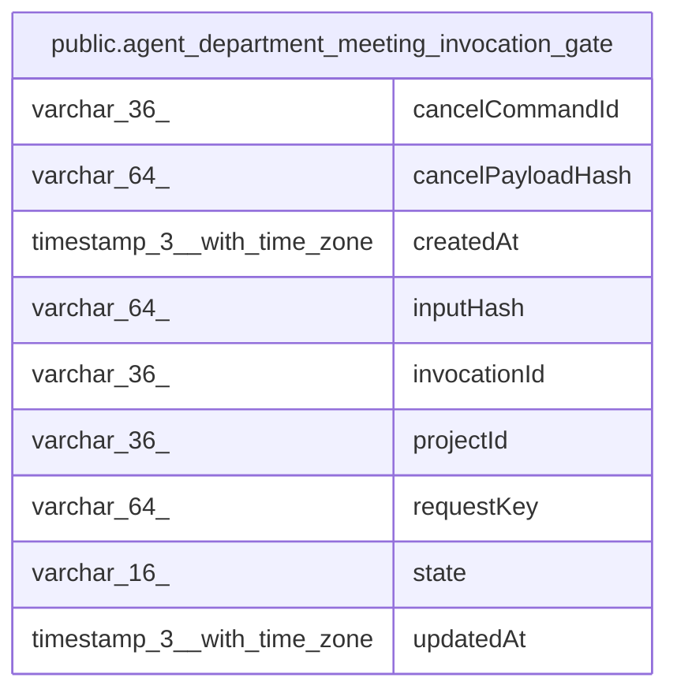

# public.agent_department_meeting_invocation_gate

## Columns

| Name | Type | Default | Nullable | Children | Parents | Comment |
| ---- | ---- | ------- | -------- | -------- | ------- | ------- |
| cancelCommandId | varchar(36) |  | true |  |  |  |
| cancelPayloadHash | varchar(64) |  | true |  |  |  |
| createdAt | timestamp(3) with time zone |  | false |  |  |  |
| inputHash | varchar(64) |  | false |  |  |  |
| invocationId | varchar(36) |  | false |  |  |  |
| projectId | varchar(36) |  | false |  |  |  |
| requestKey | varchar(64) |  | false |  |  |  |
| state | varchar(16) | 'open'::character varying | false |  |  |  |
| updatedAt | timestamp(3) with time zone |  | false |  |  |  |

## Constraints

| Name | Type | Definition |
| ---- | ---- | ---------- |
| CHK_agent_department_meeting_invocation_gate_state | CHECK | CHECK (((state)::text = ANY ((ARRAY['open'::character varying, 'cancelled'::character varying])::text[]))) |
| PK_3b103d6944f5e186a8640a100db | PRIMARY KEY | PRIMARY KEY ("projectId", "invocationId") |
| agent_department_meeting_invocation_gate_createdAt_not_null | n | NOT NULL "createdAt" |
| agent_department_meeting_invocation_gate_inputHash_not_null | n | NOT NULL "inputHash" |
| agent_department_meeting_invocation_gate_invocationId_not_null | n | NOT NULL "invocationId" |
| agent_department_meeting_invocation_gate_projectId_not_null | n | NOT NULL "projectId" |
| agent_department_meeting_invocation_gate_requestKey_not_null | n | NOT NULL "requestKey" |
| agent_department_meeting_invocation_gate_state_not_null | n | NOT NULL state |
| agent_department_meeting_invocation_gate_updatedAt_not_null | n | NOT NULL "updatedAt" |

## Indexes

| Name | Definition |
| ---- | ---------- |
| IDX_agent_dept_meeting_gate_request | CREATE UNIQUE INDEX "IDX_agent_dept_meeting_gate_request" ON public.agent_department_meeting_invocation_gate USING btree ("projectId", "requestKey") |
| PK_3b103d6944f5e186a8640a100db | CREATE UNIQUE INDEX "PK_3b103d6944f5e186a8640a100db" ON public.agent_department_meeting_invocation_gate USING btree ("projectId", "invocationId") |

## Relations

---

> Generated by [tbls](https://github.com/k1LoW/tbls)
