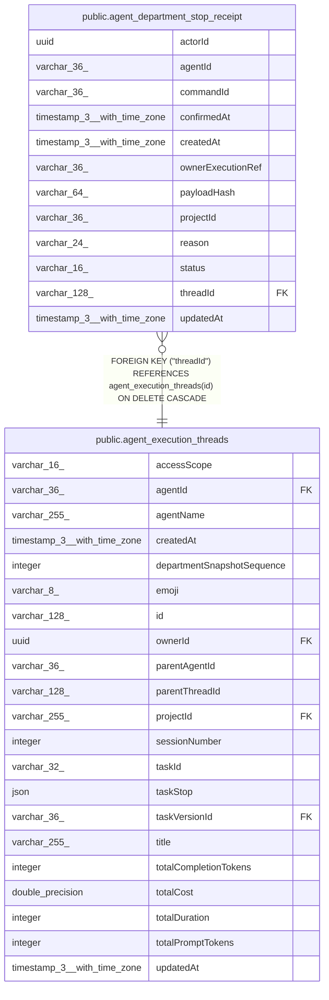

# public.agent_department_stop_receipt

## Columns

| Name | Type | Default | Nullable | Children | Parents | Comment |
| ---- | ---- | ------- | -------- | -------- | ------- | ------- |
| actorId | uuid |  | false |  |  |  |
| agentId | varchar(36) |  | false |  |  |  |
| commandId | varchar(36) |  | false |  |  |  |
| confirmedAt | timestamp(3) with time zone |  | true |  |  |  |
| createdAt | timestamp(3) with time zone |  | false |  |  |  |
| ownerExecutionRef | varchar(36) |  | false |  |  |  |
| payloadHash | varchar(64) |  | false |  |  |  |
| projectId | varchar(36) |  | false |  |  |  |
| reason | varchar(24) |  | false |  |  |  |
| status | varchar(16) |  | false |  |  |  |
| threadId | varchar(128) |  | false |  | [public.agent_execution_threads](public.agent_execution_threads.md) |  |
| updatedAt | timestamp(3) with time zone |  | false |  |  |  |

## Constraints

| Name | Type | Definition |
| ---- | ---- | ---------- |
| CHK_agent_department_stop_receipt_reason | CHECK | CHECK (((reason)::text = ANY ((ARRAY['cancel'::character varying, 'handoff'::character varying, 'release'::character varying, 'authority-revoked'::character varying])::text[]))) |
| CHK_agent_department_stop_receipt_status | CHECK | CHECK (((status)::text = ANY ((ARRAY['pending'::character varying, 'confirmed'::character varying])::text[]))) |
| FK_9c6d49c8607a13b46bb97491bf8 | FOREIGN KEY | FOREIGN KEY ("threadId") REFERENCES agent_execution_threads(id) ON DELETE CASCADE |
| PK_fd52f98c99ffd567783d9514b8c | PRIMARY KEY | PRIMARY KEY ("commandId") |
| agent_department_stop_receipt_actorId_not_null | n | NOT NULL "actorId" |
| agent_department_stop_receipt_agentId_not_null | n | NOT NULL "agentId" |
| agent_department_stop_receipt_commandId_not_null | n | NOT NULL "commandId" |
| agent_department_stop_receipt_createdAt_not_null | n | NOT NULL "createdAt" |
| agent_department_stop_receipt_ownerExecutionRef_not_null | n | NOT NULL "ownerExecutionRef" |
| agent_department_stop_receipt_payloadHash_not_null | n | NOT NULL "payloadHash" |
| agent_department_stop_receipt_projectId_not_null | n | NOT NULL "projectId" |
| agent_department_stop_receipt_reason_not_null | n | NOT NULL reason |
| agent_department_stop_receipt_status_not_null | n | NOT NULL status |
| agent_department_stop_receipt_threadId_not_null | n | NOT NULL "threadId" |
| agent_department_stop_receipt_updatedAt_not_null | n | NOT NULL "updatedAt" |

## Indexes

| Name | Definition |
| ---- | ---------- |
| IDX_agent_department_stop_receipt_projectId_ownerExecutionRef | CREATE INDEX "IDX_agent_department_stop_receipt_projectId_ownerExecutionRef" ON public.agent_department_stop_receipt USING btree ("projectId", "ownerExecutionRef") |
| IDX_agent_department_stop_receipt_projectId_threadId_status | CREATE INDEX "IDX_agent_department_stop_receipt_projectId_threadId_status" ON public.agent_department_stop_receipt USING btree ("projectId", "threadId", status) |
| PK_fd52f98c99ffd567783d9514b8c | CREATE UNIQUE INDEX "PK_fd52f98c99ffd567783d9514b8c" ON public.agent_department_stop_receipt USING btree ("commandId") |

## Relations

---

> Generated by [tbls](https://github.com/k1LoW/tbls)
