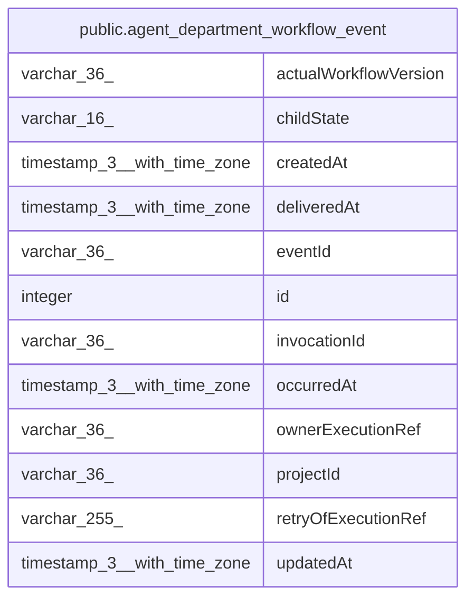

# public.agent_department_workflow_event

## Columns

| Name | Type | Default | Nullable | Children | Parents | Comment |
| ---- | ---- | ------- | -------- | -------- | ------- | ------- |
| actualWorkflowVersion | varchar(36) |  | false |  |  |  |
| childState | varchar(16) |  | false |  |  |  |
| createdAt | timestamp(3) with time zone |  | false |  |  |  |
| deliveredAt | timestamp(3) with time zone |  | true |  |  |  |
| eventId | varchar(36) |  | false |  |  |  |
| id | integer |  | false |  |  |  |
| invocationId | varchar(36) |  | false |  |  |  |
| occurredAt | timestamp(3) with time zone |  | false |  |  |  |
| ownerExecutionRef | varchar(36) |  | false |  |  |  |
| projectId | varchar(36) |  | false |  |  |  |
| retryOfExecutionRef | varchar(255) |  | true |  |  |  |
| updatedAt | timestamp(3) with time zone |  | false |  |  |  |

## Constraints

| Name | Type | Definition |
| ---- | ---- | ---------- |
| CHK_agent_department_workflow_event_childState | CHECK | CHECK ((("childState")::text = ANY ((ARRAY['running'::character varying, 'waiting'::character varying, 'retrying'::character varying, 'succeeded'::character varying, 'failed'::character varying, 'cancelled'::character varying, 'unknown'::character varying])::text[]))) |
| PK_6a1f13e33af35b68838874c67dc | PRIMARY KEY | PRIMARY KEY (id) |
| agent_department_workflow_event_actualWorkflowVersion_not_null | n | NOT NULL "actualWorkflowVersion" |
| agent_department_workflow_event_childState_not_null | n | NOT NULL "childState" |
| agent_department_workflow_event_createdAt_not_null | n | NOT NULL "createdAt" |
| agent_department_workflow_event_eventId_not_null | n | NOT NULL "eventId" |
| agent_department_workflow_event_id_not_null | n | NOT NULL id |
| agent_department_workflow_event_invocationId_not_null | n | NOT NULL "invocationId" |
| agent_department_workflow_event_occurredAt_not_null | n | NOT NULL "occurredAt" |
| agent_department_workflow_event_ownerExecutionRef_not_null | n | NOT NULL "ownerExecutionRef" |
| agent_department_workflow_event_projectId_not_null | n | NOT NULL "projectId" |
| agent_department_workflow_event_updatedAt_not_null | n | NOT NULL "updatedAt" |

## Indexes

| Name | Definition |
| ---- | ---------- |
| IDX_agent_department_workflow_event_eventId | CREATE UNIQUE INDEX "IDX_agent_department_workflow_event_eventId" ON public.agent_department_workflow_event USING btree ("eventId") |
| IDX_agent_department_workflow_event_invocationId_id | CREATE INDEX "IDX_agent_department_workflow_event_invocationId_id" ON public.agent_department_workflow_event USING btree ("invocationId", id) |
| IDX_agent_department_workflow_event_pending | CREATE INDEX "IDX_agent_department_workflow_event_pending" ON public.agent_department_workflow_event USING btree ("deliveredAt", id) WHERE ("deliveredAt" IS NULL) |
| PK_6a1f13e33af35b68838874c67dc | CREATE UNIQUE INDEX "PK_6a1f13e33af35b68838874c67dc" ON public.agent_department_workflow_event USING btree (id) |

## Relations

---

> Generated by [tbls](https://github.com/k1LoW/tbls)
