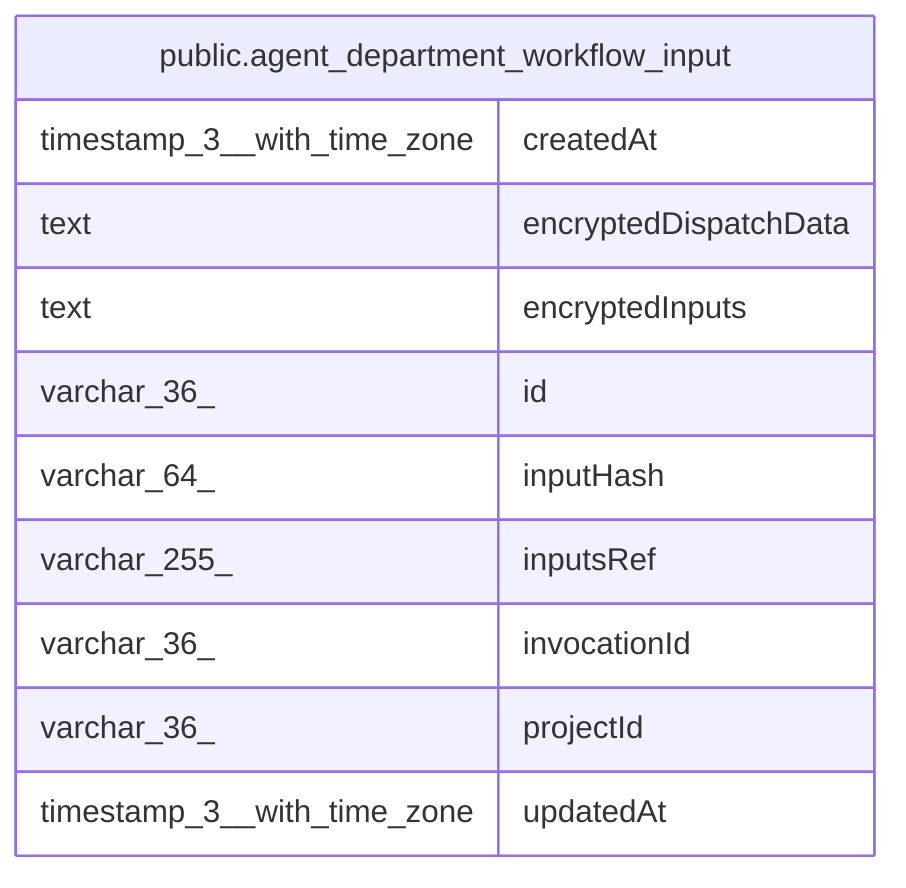

# public.agent_department_workflow_input

## Columns

| Name | Type | Default | Nullable | Children | Parents | Comment |
| ---- | ---- | ------- | -------- | -------- | ------- | ------- |
| createdAt | timestamp(3) with time zone |  | false |  |  |  |
| encryptedDispatchData | text |  | true |  |  | Encrypted immutable request used to recover a reserved child before native persistence |
| encryptedInputs | text |  | false |  |  |  |
| id | varchar(36) |  | false |  |  |  |
| inputHash | varchar(64) |  | false |  |  |  |
| inputsRef | varchar(255) |  | false |  |  |  |
| invocationId | varchar(36) |  | false |  |  |  |
| projectId | varchar(36) |  | false |  |  |  |
| updatedAt | timestamp(3) with time zone |  | false |  |  |  |

## Constraints

| Name | Type | Definition |
| ---- | ---- | ---------- |
| PK_4852cb5e357f99c88c7db482cf0 | PRIMARY KEY | PRIMARY KEY (id) |
| agent_department_workflow_input_createdAt_not_null | n | NOT NULL "createdAt" |
| agent_department_workflow_input_encryptedInputs_not_null | n | NOT NULL "encryptedInputs" |
| agent_department_workflow_input_id_not_null | n | NOT NULL id |
| agent_department_workflow_input_inputHash_not_null | n | NOT NULL "inputHash" |
| agent_department_workflow_input_inputsRef_not_null | n | NOT NULL "inputsRef" |
| agent_department_workflow_input_invocationId_not_null | n | NOT NULL "invocationId" |
| agent_department_workflow_input_projectId_not_null | n | NOT NULL "projectId" |
| agent_department_workflow_input_updatedAt_not_null | n | NOT NULL "updatedAt" |

## Indexes

| Name | Definition |
| ---- | ---------- |
| IDX_agent_department_workflow_input_invocation | CREATE UNIQUE INDEX "IDX_agent_department_workflow_input_invocation" ON public.agent_department_workflow_input USING btree ("projectId", "invocationId") |
| IDX_agent_department_workflow_input_ref | CREATE UNIQUE INDEX "IDX_agent_department_workflow_input_ref" ON public.agent_department_workflow_input USING btree ("projectId", "inputsRef") |
| PK_4852cb5e357f99c88c7db482cf0 | CREATE UNIQUE INDEX "PK_4852cb5e357f99c88c7db482cf0" ON public.agent_department_workflow_input USING btree (id) |

## Relations

---

> Generated by [tbls](https://github.com/k1LoW/tbls)
