# public.ai_department

## Columns

| Name | Type | Default | Nullable | Children | Parents | Comment |
| ---- | ---- | ------- | -------- | -------- | ------- | ------- |
| archived | boolean | false | false |  |  |  |
| createdAt | timestamp(3) with time zone | CURRENT_TIMESTAMP(3) | false |  |  |  |
| description | text |  | true |  |  |  |
| id | varchar(36) |  | false | [public.agent_department_consultation_invocation](public.agent_department_consultation_invocation.md) [public.ai_department_admission_fence](public.ai_department_admission_fence.md) [public.ai_department_goal](public.ai_department_goal.md) [public.ai_department_meeting](public.ai_department_meeting.md) [public.ai_department_meeting_context](public.ai_department_meeting_context.md) [public.ai_department_meeting_source](public.ai_department_meeting_source.md) [public.ai_department_member](public.ai_department_member.md) [public.ai_department_work_help_request](public.ai_department_work_help_request.md) [public.ai_department_work_help_response](public.ai_department_work_help_response.md) [public.ai_department_work_item](public.ai_department_work_item.md) [public.ai_department_work_relationship](public.ai_department_work_relationship.md) [public.ai_department_workflow_capability](public.ai_department_workflow_capability.md) |  |  |
| name | varchar(128) |  | false |  |  |  |
| normalizedName | varchar(128) |  | false |  |  |  |
| projectId | varchar(36) |  | false |  | [public.project](public.project.md) |  |
| projectionSequence | integer | 0 | false |  |  |  |
| updatedAt | timestamp(3) with time zone | CURRENT_TIMESTAMP(3) | false |  |  |  |
| version | integer | 1 | false |  |  |  |

## Constraints

| Name | Type | Definition |
| ---- | ---- | ---------- |
| FK_00e31fe48fbfd3220de087cc1c6 | FOREIGN KEY | FOREIGN KEY ("projectId") REFERENCES project(id) ON DELETE CASCADE |
| PK_e7fda9d0237799ee101a79b8b1e | PRIMARY KEY | PRIMARY KEY (id) |
| ai_department_archived_not_null | n | NOT NULL archived |
| ai_department_createdAt_not_null | n | NOT NULL "createdAt" |
| ai_department_id_not_null | n | NOT NULL id |
| ai_department_name_not_null | n | NOT NULL name |
| ai_department_normalizedName_not_null | n | NOT NULL "normalizedName" |
| ai_department_projectId_not_null | n | NOT NULL "projectId" |
| ai_department_projectionSequence_not_null | n | NOT NULL "projectionSequence" |
| ai_department_updatedAt_not_null | n | NOT NULL "updatedAt" |
| ai_department_version_not_null | n | NOT NULL version |

## Indexes

| Name | Definition |
| ---- | ---------- |
| IDX_ai_department_projectId_normalizedName | CREATE UNIQUE INDEX "IDX_ai_department_projectId_normalizedName" ON public.ai_department USING btree ("projectId", "normalizedName") WHERE (archived = false) |
| PK_e7fda9d0237799ee101a79b8b1e | CREATE UNIQUE INDEX "PK_e7fda9d0237799ee101a79b8b1e" ON public.ai_department USING btree (id) |

## Relations

```mermaid
erDiagram

"public.agent_department_consultation_invocation" }o--|| "public.ai_department" : "FOREIGN KEY (#quot;departmentId#quot;) REFERENCES ai_department(id) ON DELETE CASCADE"
"public.ai_department_admission_fence" |o--|| "public.ai_department" : "FOREIGN KEY (#quot;departmentId#quot;) REFERENCES ai_department(id) ON DELETE CASCADE"
"public.ai_department_goal" }o--|| "public.ai_department" : "FOREIGN KEY (#quot;departmentId#quot;) REFERENCES ai_department(id) ON DELETE CASCADE"
"public.ai_department_meeting" }o--|| "public.ai_department" : "FOREIGN KEY (#quot;departmentId#quot;) REFERENCES ai_department(id) ON DELETE CASCADE"
"public.ai_department_meeting_context" }o--|| "public.ai_department" : "FOREIGN KEY (#quot;departmentId#quot;) REFERENCES ai_department(id) ON DELETE CASCADE"
"public.ai_department_meeting_source" }o--|| "public.ai_department" : "FOREIGN KEY (#quot;departmentId#quot;) REFERENCES ai_department(id) ON DELETE CASCADE"
"public.ai_department_member" }o--|| "public.ai_department" : "FOREIGN KEY (#quot;departmentId#quot;) REFERENCES ai_department(id) ON DELETE CASCADE"
"public.ai_department_work_help_request" }o--|| "public.ai_department" : "FOREIGN KEY (#quot;departmentId#quot;) REFERENCES ai_department(id) ON DELETE CASCADE"
"public.ai_department_work_help_response" }o--|| "public.ai_department" : "FOREIGN KEY (#quot;departmentId#quot;) REFERENCES ai_department(id) ON DELETE CASCADE"
"public.ai_department_work_item" }o--|| "public.ai_department" : "FOREIGN KEY (#quot;departmentId#quot;) REFERENCES ai_department(id) ON DELETE CASCADE"
"public.ai_department_work_relationship" }o--|| "public.ai_department" : "FOREIGN KEY (#quot;departmentId#quot;) REFERENCES ai_department(id) ON DELETE CASCADE"
"public.ai_department_workflow_capability" }o--|| "public.ai_department" : "FOREIGN KEY (#quot;departmentId#quot;) REFERENCES ai_department(id) ON DELETE CASCADE"
"public.ai_department" }o--|| "public.project" : "FOREIGN KEY (#quot;projectId#quot;) REFERENCES project(id) ON DELETE CASCADE"

"public.ai_department" {
  boolean archived
  timestamp_3__with_time_zone createdAt
  text description
  varchar_36_ id
  varchar_128_ name
  varchar_128_ normalizedName
  varchar_36_ projectId FK
  integer projectionSequence
  timestamp_3__with_time_zone updatedAt
  integer version
}
"public.agent_department_consultation_invocation" {
  uuid actorId
  integer bindingVersion
  varchar_64_ commandKey
  varchar_64_ contextHash
  varchar_255_ contextRef
  timestamp_3__with_time_zone createdAt
  timestamp_3__with_time_zone deadlineAt
  varchar_36_ departmentId FK
  varchar_36_ executorId FK
  varchar_36_ helpRequestId FK
  varchar_36_ id
  varchar_64_ inputHash
  text inputText
  varchar_36_ invocationId
  integer maxOutputChars
  integer maxOutputTokens
  varchar_16_ outcome
  varchar_36_ projectId FK
  varchar_36_ recipientMemberId FK
  varchar_36_ requesterMemberId FK
  varchar_64_ resultHash
  text resultText
  varchar_64_ safeErrorCode
  varchar_64_ sequence
  varchar_36_ sourceAttemptId FK
  varchar_16_ state
  varchar_36_ stopCommandId
  varchar_64_ stopPayloadHash
  timestamp_3__with_time_zone stopRequestedAt
  timestamp_3__with_time_zone terminalAt
  varchar_128_ threadId
  timestamp_3__with_time_zone updatedAt
}
"public.ai_department_admission_fence" {
  timestamp_3__with_time_zone createdAt
  varchar_36_ departmentId FK
  varchar_36_ projectId
  integer sequence
  timestamp_3__with_time_zone updatedAt
}
"public.ai_department_goal" {
  timestamp_3__with_time_zone createdAt
  varchar_36_ departmentId FK
  timestamp_3__with_time_zone dueAt
  varchar_36_ id
  varchar_36_ ownerMemberId FK
  varchar_36_ parentId FK
  varchar_36_ projectId
  varchar_16_ state
  text successCriteria
  varchar_256_ title
  timestamp_3__with_time_zone updatedAt
  integer version
}
"public.ai_department_meeting" {
  json absenceSnapshots
  varchar_16_ collectionCloseReason
  timestamp_3__with_time_zone collectionClosedAt
  timestamp_3__with_time_zone collectionDeadlineAt
  timestamp_3__with_time_zone completedAt
  timestamp_3__with_time_zone createdAt
  uuid createdBy
  varchar_36_ departmentId FK
  text desiredOutcome
  uuid executionActorId
  varchar_36_ facilitatorMemberId FK
  json frozenContributionIds
  varchar_36_ goalId
  varchar_36_ id
  varchar_36_ projectId FK
  varchar_16_ purpose
  json referencedWorkIds
  timestamp_3__with_time_zone startedAt
  varchar_16_ state
  varchar_256_ topic
  timestamp_3__with_time_zone updatedAt
  integer version
}
"public.ai_department_meeting_context" {
  varchar_64_ briefingHash
  timestamp_3__with_time_zone capturedAt
  timestamp_3__with_time_zone createdAt
  varchar_36_ departmentId FK
  varchar_36_ id
  varchar_36_ meetingId FK
  varchar_36_ projectId
  varchar_255_ snapshotRef
  varchar_32_ toolPolicy
  varchar_64_ toolPolicyVersion
}
"public.ai_department_meeting_source" {
  varchar_16_ accessState
  varchar_64_ contentHash
  timestamp_3__with_time_zone createdAt
  varchar_36_ departmentId FK
  varchar_36_ id
  varchar_256_ labelSnapshot
  varchar_36_ meetingId FK
  varchar_36_ projectId
  varchar_255_ snapshotRef
  varchar_36_ sourceId
  varchar_16_ sourceKind
  varchar_64_ sourceVersion
}
"public.ai_department_member" {
  boolean archived
  timestamp_3__with_time_zone createdAt
  varchar_36_ departmentId FK
  json expertiseTags
  varchar_36_ id
  varchar_36_ managerMemberId FK
  varchar_128_ name
  varchar_36_ projectId
  varchar_128_ role
  timestamp_3__with_time_zone updatedAt
  integer version
}
"public.ai_department_work_help_request" {
  text attemptedStepsJson
  integer bindingVersion
  timestamp_3__with_time_zone createdAt
  timestamp_3__with_time_zone deadlineAt
  varchar_36_ departmentId FK
  text expertiseTagsJson
  varchar_36_ id
  uuid initiatingUserId FK
  varchar_64_ inputHash
  varchar_64_ ownerInvocationHash
  varchar_128_ ownerReference
  varchar_36_ projectId FK
  text question
  text reason
  varchar_36_ recipientMemberId FK
  uuid recipientUserId FK
  text requestChainJson
  varchar_36_ requestId
  varchar_36_ requesterMemberId FK
  varchar_32_ routingState
  varchar_36_ sourceAttemptId FK
  varchar_24_ state
  timestamp_3__with_time_zone updatedAt
  integer version
  varchar_36_ workId FK
}
"public.ai_department_work_help_response" {
  varchar_36_ activityId FK
  text answer
  varchar_64_ answerHash
  timestamp_3__with_time_zone createdAt
  varchar_36_ departmentId FK
  varchar_36_ helpRequestId FK
  varchar_36_ id
  varchar_128_ ownerInvocationRef
  integer ownerSequence
  varchar_36_ projectId FK
  varchar_16_ responderKind
  varchar_36_ responderMemberId FK
  uuid responderUserId FK
  varchar_36_ sourceAttemptId FK
  varchar_36_ workId FK
}
"public.ai_department_work_item" {
  uuid assignedByUserId FK
  varchar_36_ assigneeMemberId FK
  timestamp_3__with_time_zone createdAt
  varchar_36_ currentAttemptId FK
  integer currentReviewStageIndex
  varchar_36_ departmentId FK
  timestamp_3__with_time_zone dueAt
  varchar_36_ goalId FK
  varchar_36_ id
  text instruction
  varchar_16_ priority
  varchar_36_ projectId
  varchar_16_ reviewPolicy
  integer reviewPolicyRevision
  varchar_36_ reviewPolicyRevisionId
  text reviewStagesJson
  varchar_24_ state
  timestamp_3__with_time_zone updatedAt
  integer version
}
"public.ai_department_work_relationship" {
  timestamp_3__with_time_zone createdAt
  varchar_36_ departmentId FK
  varchar_36_ id
  varchar_16_ kind
  varchar_36_ projectId
  varchar_36_ relatedWorkId FK
  timestamp_3__with_time_zone updatedAt
  varchar_36_ workId FK
}
"public.ai_department_workflow_capability" {
  timestamp_3__with_time_zone createdAt
  varchar_36_ departmentId FK
  boolean enabled
  varchar_36_ id
  varchar_128_ inputSchemaFingerprint
  varchar_36_ memberId FK
  varchar_36_ projectId
  varchar_36_ publishedVersionRef
  text purpose
  varchar_128_ triggerCompatibilityRef
  timestamp_3__with_time_zone updatedAt
  integer version
  varchar_36_ workflowId
}
"public.project" {
  timestamp_3__with_time_zone createdAt
  uuid creatorId FK
  json customTelemetryTags
  varchar_512_ description
  json icon
  varchar_36_ id
  varchar_255_ name
  varchar_36_ type
  timestamp_3__with_time_zone updatedAt
}
```

---

> Generated by [tbls](https://github.com/k1LoW/tbls)
