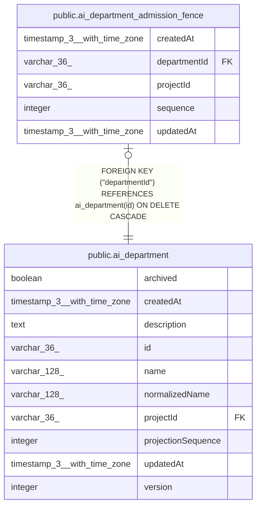

# public.ai_department_admission_fence

## Columns

| Name | Type | Default | Nullable | Children | Parents | Comment |
| ---- | ---- | ------- | -------- | -------- | ------- | ------- |
| createdAt | timestamp(3) with time zone | CURRENT_TIMESTAMP(3) | false |  |  |  |
| departmentId | varchar(36) |  | false |  | [public.ai_department](public.ai_department.md) |  |
| projectId | varchar(36) |  | false |  |  |  |
| sequence | integer | 0 | false |  |  |  |
| updatedAt | timestamp(3) with time zone | CURRENT_TIMESTAMP(3) | false |  |  |  |

## Constraints

| Name | Type | Definition |
| ---- | ---- | ---------- |
| FK_849414c58e75c8e78d9da9f3a0d | FOREIGN KEY | FOREIGN KEY ("departmentId") REFERENCES ai_department(id) ON DELETE CASCADE |
| PK_849414c58e75c8e78d9da9f3a0d | PRIMARY KEY | PRIMARY KEY ("departmentId") |
| ai_department_admission_fence_createdAt_not_null | n | NOT NULL "createdAt" |
| ai_department_admission_fence_departmentId_not_null | n | NOT NULL "departmentId" |
| ai_department_admission_fence_projectId_not_null | n | NOT NULL "projectId" |
| ai_department_admission_fence_sequence_not_null | n | NOT NULL sequence |
| ai_department_admission_fence_updatedAt_not_null | n | NOT NULL "updatedAt" |

## Indexes

| Name | Definition |
| ---- | ---------- |
| IDX_ai_department_admission_fence_projectId_departmentId | CREATE UNIQUE INDEX "IDX_ai_department_admission_fence_projectId_departmentId" ON public.ai_department_admission_fence USING btree ("projectId", "departmentId") |
| PK_849414c58e75c8e78d9da9f3a0d | CREATE UNIQUE INDEX "PK_849414c58e75c8e78d9da9f3a0d" ON public.ai_department_admission_fence USING btree ("departmentId") |

## Relations

---

> Generated by [tbls](https://github.com/k1LoW/tbls)
