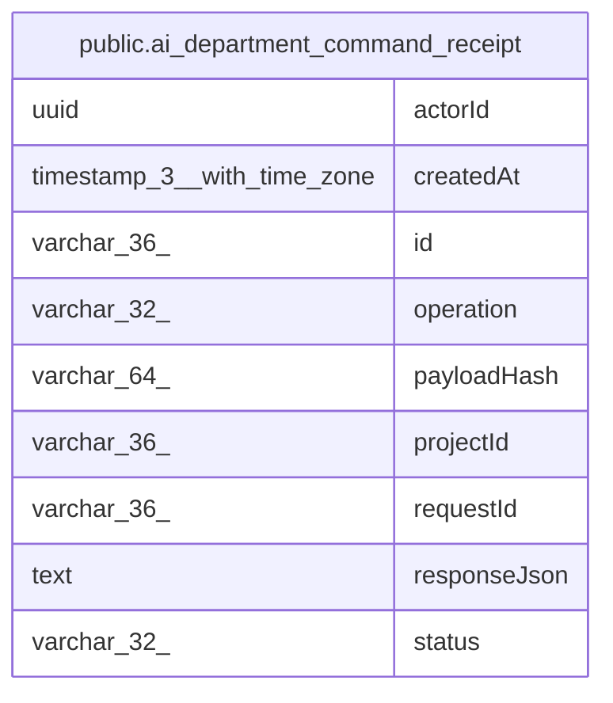

# public.ai_department_command_receipt

## Columns

| Name | Type | Default | Nullable | Children | Parents | Comment |
| ---- | ---- | ------- | -------- | -------- | ------- | ------- |
| actorId | uuid |  | false |  |  |  |
| createdAt | timestamp(3) with time zone |  | false |  |  |  |
| id | varchar(36) |  | false |  |  |  |
| operation | varchar(32) |  | false |  |  |  |
| payloadHash | varchar(64) |  | false |  |  |  |
| projectId | varchar(36) |  | false |  |  |  |
| requestId | varchar(36) |  | false |  |  |  |
| responseJson | text |  | true |  |  |  |
| status | varchar(32) |  | false |  |  |  |

## Constraints

| Name | Type | Definition |
| ---- | ---- | ---------- |
| PK_a58483e61f45d50dffc79585c48 | PRIMARY KEY | PRIMARY KEY (id) |
| ai_department_command_receipt_actorId_not_null | n | NOT NULL "actorId" |
| ai_department_command_receipt_createdAt_not_null | n | NOT NULL "createdAt" |
| ai_department_command_receipt_id_not_null | n | NOT NULL id |
| ai_department_command_receipt_operation_not_null | n | NOT NULL operation |
| ai_department_command_receipt_payloadHash_not_null | n | NOT NULL "payloadHash" |
| ai_department_command_receipt_projectId_not_null | n | NOT NULL "projectId" |
| ai_department_command_receipt_requestId_not_null | n | NOT NULL "requestId" |
| ai_department_command_receipt_status_not_null | n | NOT NULL status |

## Indexes

| Name | Definition |
| ---- | ---------- |
| IDX_f09cfc5ea90ad3f4e9999b792b | CREATE UNIQUE INDEX "IDX_f09cfc5ea90ad3f4e9999b792b" ON public.ai_department_command_receipt USING btree ("projectId", "actorId", "requestId") |
| PK_a58483e61f45d50dffc79585c48 | CREATE UNIQUE INDEX "PK_a58483e61f45d50dffc79585c48" ON public.ai_department_command_receipt USING btree (id) |

## Relations

---

> Generated by [tbls](https://github.com/k1LoW/tbls)
