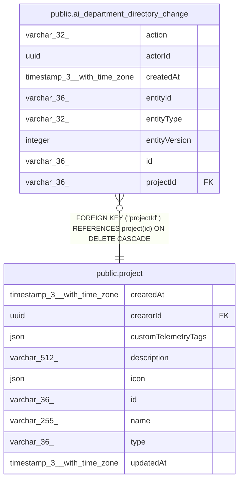

# public.ai_department_directory_change

## Columns

| Name | Type | Default | Nullable | Children | Parents | Comment |
| ---- | ---- | ------- | -------- | -------- | ------- | ------- |
| action | varchar(32) |  | false |  |  |  |
| actorId | uuid |  | false |  |  |  |
| createdAt | timestamp(3) with time zone |  | false |  |  |  |
| entityId | varchar(36) |  | false |  |  |  |
| entityType | varchar(32) |  | false |  |  |  |
| entityVersion | integer |  | false |  |  |  |
| id | varchar(36) |  | false |  |  |  |
| projectId | varchar(36) |  | false |  | [public.project](public.project.md) |  |

## Constraints

| Name | Type | Definition |
| ---- | ---- | ---------- |
| FK_e06f8cbd81c41cba5cb42022a8c | FOREIGN KEY | FOREIGN KEY ("projectId") REFERENCES project(id) ON DELETE CASCADE |
| PK_27dec3e265d8db48dbbf8c7f37b | PRIMARY KEY | PRIMARY KEY (id) |
| ai_department_directory_change_action_not_null | n | NOT NULL action |
| ai_department_directory_change_actorId_not_null | n | NOT NULL "actorId" |
| ai_department_directory_change_createdAt_not_null | n | NOT NULL "createdAt" |
| ai_department_directory_change_entityId_not_null | n | NOT NULL "entityId" |
| ai_department_directory_change_entityType_not_null | n | NOT NULL "entityType" |
| ai_department_directory_change_entityVersion_not_null | n | NOT NULL "entityVersion" |
| ai_department_directory_change_id_not_null | n | NOT NULL id |
| ai_department_directory_change_projectId_not_null | n | NOT NULL "projectId" |

## Indexes

| Name | Definition |
| ---- | ---------- |
| IDX_59f9c321133e60930d1cab0729 | CREATE INDEX "IDX_59f9c321133e60930d1cab0729" ON public.ai_department_directory_change USING btree ("projectId", "createdAt") |
| PK_27dec3e265d8db48dbbf8c7f37b | CREATE UNIQUE INDEX "PK_27dec3e265d8db48dbbf8c7f37b" ON public.ai_department_directory_change USING btree (id) |

## Relations

---

> Generated by [tbls](https://github.com/k1LoW/tbls)
