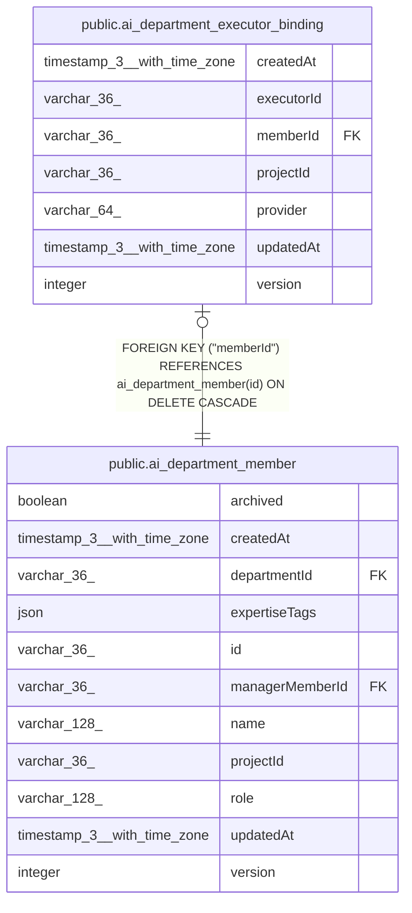

# public.ai_department_executor_binding

## Columns

| Name | Type | Default | Nullable | Children | Parents | Comment |
| ---- | ---- | ------- | -------- | -------- | ------- | ------- |
| createdAt | timestamp(3) with time zone | CURRENT_TIMESTAMP(3) | false |  |  |  |
| executorId | varchar(36) |  | false |  |  |  |
| memberId | varchar(36) |  | false |  | [public.ai_department_member](public.ai_department_member.md) |  |
| projectId | varchar(36) |  | false |  |  |  |
| provider | varchar(64) |  | false |  |  |  |
| updatedAt | timestamp(3) with time zone | CURRENT_TIMESTAMP(3) | false |  |  |  |
| version | integer | 1 | false |  |  |  |

## Constraints

| Name | Type | Definition |
| ---- | ---- | ---------- |
| FK_90aa8e6894c252838848a808083 | FOREIGN KEY | FOREIGN KEY ("memberId") REFERENCES ai_department_member(id) ON DELETE CASCADE |
| PK_90aa8e6894c252838848a808083 | PRIMARY KEY | PRIMARY KEY ("memberId") |
| ai_department_executor_binding_createdAt_not_null | n | NOT NULL "createdAt" |
| ai_department_executor_binding_executorId_not_null | n | NOT NULL "executorId" |
| ai_department_executor_binding_memberId_not_null | n | NOT NULL "memberId" |
| ai_department_executor_binding_projectId_not_null | n | NOT NULL "projectId" |
| ai_department_executor_binding_provider_not_null | n | NOT NULL provider |
| ai_department_executor_binding_updatedAt_not_null | n | NOT NULL "updatedAt" |
| ai_department_executor_binding_version_not_null | n | NOT NULL version |

## Indexes

| Name | Definition |
| ---- | ---------- |
| PK_90aa8e6894c252838848a808083 | CREATE UNIQUE INDEX "PK_90aa8e6894c252838848a808083" ON public.ai_department_executor_binding USING btree ("memberId") |

## Relations

---

> Generated by [tbls](https://github.com/k1LoW/tbls)
