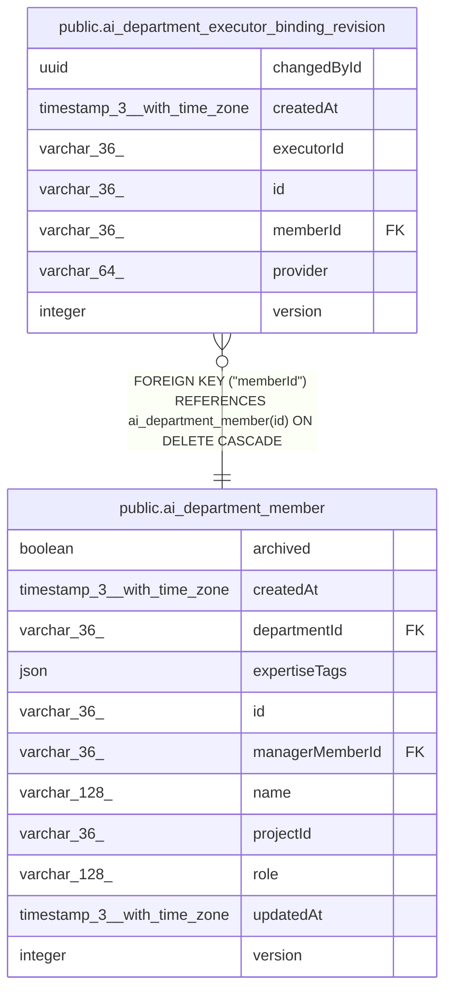

# public.ai_department_executor_binding_revision

## Columns

| Name | Type | Default | Nullable | Children | Parents | Comment |
| ---- | ---- | ------- | -------- | -------- | ------- | ------- |
| changedById | uuid |  | false |  |  |  |
| createdAt | timestamp(3) with time zone |  | false |  |  |  |
| executorId | varchar(36) |  | false |  |  |  |
| id | varchar(36) |  | false |  |  |  |
| memberId | varchar(36) |  | false |  | [public.ai_department_member](public.ai_department_member.md) |  |
| provider | varchar(64) |  | false |  |  |  |
| version | integer |  | false |  |  |  |

## Constraints

| Name | Type | Definition |
| ---- | ---- | ---------- |
| FK_487f0479b3843eee5b5fe6ad1b6 | FOREIGN KEY | FOREIGN KEY ("memberId") REFERENCES ai_department_member(id) ON DELETE CASCADE |
| PK_263cc6a36a0712a38d4c13e3f40 | PRIMARY KEY | PRIMARY KEY (id) |
| ai_department_executor_binding_revision_changedById_not_null | n | NOT NULL "changedById" |
| ai_department_executor_binding_revision_createdAt_not_null | n | NOT NULL "createdAt" |
| ai_department_executor_binding_revision_executorId_not_null | n | NOT NULL "executorId" |
| ai_department_executor_binding_revision_id_not_null | n | NOT NULL id |
| ai_department_executor_binding_revision_memberId_not_null | n | NOT NULL "memberId" |
| ai_department_executor_binding_revision_provider_not_null | n | NOT NULL provider |
| ai_department_executor_binding_revision_version_not_null | n | NOT NULL version |

## Indexes

| Name | Definition |
| ---- | ---------- |
| IDX_1cac7eeb51d2b236058691e339 | CREATE UNIQUE INDEX "IDX_1cac7eeb51d2b236058691e339" ON public.ai_department_executor_binding_revision USING btree ("memberId", version) |
| PK_263cc6a36a0712a38d4c13e3f40 | CREATE UNIQUE INDEX "PK_263cc6a36a0712a38d4c13e3f40" ON public.ai_department_executor_binding_revision USING btree (id) |

## Relations

---

> Generated by [tbls](https://github.com/k1LoW/tbls)
