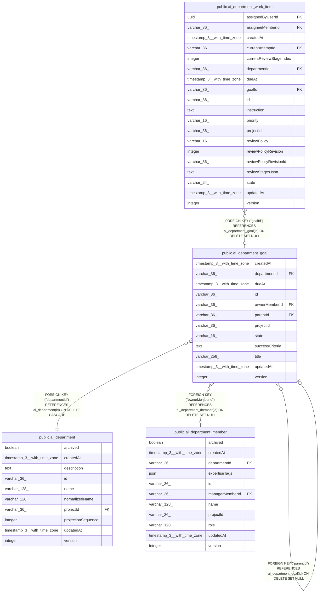

# public.ai_department_goal

## Columns

| Name | Type | Default | Nullable | Children | Parents | Comment |
| ---- | ---- | ------- | -------- | -------- | ------- | ------- |
| createdAt | timestamp(3) with time zone | CURRENT_TIMESTAMP(3) | false |  |  |  |
| departmentId | varchar(36) |  | false |  | [public.ai_department](public.ai_department.md) |  |
| dueAt | timestamp(3) with time zone |  | true |  |  |  |
| id | varchar(36) |  | false | [public.ai_department_goal](public.ai_department_goal.md) [public.ai_department_work_item](public.ai_department_work_item.md) |  |  |
| ownerMemberId | varchar(36) |  | true |  | [public.ai_department_member](public.ai_department_member.md) |  |
| parentId | varchar(36) |  | true |  | [public.ai_department_goal](public.ai_department_goal.md) |  |
| projectId | varchar(36) |  | false |  |  |  |
| state | varchar(16) | 'active'::character varying | false |  |  |  |
| successCriteria | text |  | true |  |  |  |
| title | varchar(256) |  | false |  |  |  |
| updatedAt | timestamp(3) with time zone | CURRENT_TIMESTAMP(3) | false |  |  |  |
| version | integer | 1 | false |  |  |  |

## Constraints

| Name | Type | Definition |
| ---- | ---- | ---------- |
| FK_68387991320409a956f3ae9bce0 | FOREIGN KEY | FOREIGN KEY ("departmentId") REFERENCES ai_department(id) ON DELETE CASCADE |
| FK_c4d22c0f1b852dddf259971d2c9 | FOREIGN KEY | FOREIGN KEY ("parentId") REFERENCES ai_department_goal(id) ON DELETE SET NULL |
| FK_f5b5966dc88b988471e15dcff89 | FOREIGN KEY | FOREIGN KEY ("ownerMemberId") REFERENCES ai_department_member(id) ON DELETE SET NULL |
| PK_efd8f7c6274a00101a012dddd50 | PRIMARY KEY | PRIMARY KEY (id) |
| ai_department_goal_createdAt_not_null | n | NOT NULL "createdAt" |
| ai_department_goal_departmentId_not_null | n | NOT NULL "departmentId" |
| ai_department_goal_id_not_null | n | NOT NULL id |
| ai_department_goal_projectId_not_null | n | NOT NULL "projectId" |
| ai_department_goal_state_not_null | n | NOT NULL state |
| ai_department_goal_title_not_null | n | NOT NULL title |
| ai_department_goal_updatedAt_not_null | n | NOT NULL "updatedAt" |
| ai_department_goal_version_not_null | n | NOT NULL version |

## Indexes

| Name | Definition |
| ---- | ---------- |
| IDX_4a426d6c3706582f61dd95e802 | CREATE INDEX "IDX_4a426d6c3706582f61dd95e802" ON public.ai_department_goal USING btree ("departmentId", "parentId") |
| IDX_ab7604d426b6cd2941d34f1ab2 | CREATE INDEX "IDX_ab7604d426b6cd2941d34f1ab2" ON public.ai_department_goal USING btree ("projectId", "departmentId", state) |
| PK_efd8f7c6274a00101a012dddd50 | CREATE UNIQUE INDEX "PK_efd8f7c6274a00101a012dddd50" ON public.ai_department_goal USING btree (id) |

## Relations

---

> Generated by [tbls](https://github.com/k1LoW/tbls)
