# public.ai_department_meeting

## Columns

| Name | Type | Default | Nullable | Children | Parents | Comment |
| ---- | ---- | ------- | -------- | -------- | ------- | ------- |
| absenceSnapshots | json |  | true |  |  |  |
| collectionCloseReason | varchar(16) |  | true |  |  |  |
| collectionClosedAt | timestamp(3) with time zone |  | true |  |  |  |
| collectionDeadlineAt | timestamp(3) with time zone |  | true |  |  |  |
| completedAt | timestamp(3) with time zone |  | true |  |  |  |
| createdAt | timestamp(3) with time zone | CURRENT_TIMESTAMP(3) | false |  |  |  |
| createdBy | uuid |  | false |  |  |  |
| departmentId | varchar(36) |  | false |  | [public.ai_department](public.ai_department.md) |  |
| desiredOutcome | text |  | false |  |  |  |
| executionActorId | uuid |  | false |  |  |  |
| facilitatorMemberId | varchar(36) |  | false |  | [public.ai_department_member](public.ai_department_member.md) |  |
| frozenContributionIds | json |  | true |  |  |  |
| goalId | varchar(36) |  | true |  |  | Optional goal ID owned by the Work service |
| id | varchar(36) |  | false | [public.ai_department_meeting_action_item](public.ai_department_meeting_action_item.md) [public.ai_department_meeting_activity](public.ai_department_meeting_activity.md) [public.ai_department_meeting_context](public.ai_department_meeting_context.md) [public.ai_department_meeting_contribution](public.ai_department_meeting_contribution.md) [public.ai_department_meeting_decision](public.ai_department_meeting_decision.md) [public.ai_department_meeting_invocation](public.ai_department_meeting_invocation.md) [public.ai_department_meeting_minutes](public.ai_department_meeting_minutes.md) [public.ai_department_meeting_participant](public.ai_department_meeting_participant.md) [public.ai_department_meeting_source](public.ai_department_meeting_source.md) |  |  |
| projectId | varchar(36) |  | false |  | [public.project](public.project.md) |  |
| purpose | varchar(16) | 'decision'::character varying | false |  |  |  |
| referencedWorkIds | json |  | false |  |  | Referenced work item IDs |
| startedAt | timestamp(3) with time zone |  | true |  |  |  |
| state | varchar(16) | 'draft'::character varying | false |  |  | The business lifecycle state of the meeting |
| topic | varchar(256) |  | false |  |  |  |
| updatedAt | timestamp(3) with time zone | CURRENT_TIMESTAMP(3) | false |  |  |  |
| version | integer | 1 | false |  |  |  |

## Constraints

| Name | Type | Definition |
| ---- | ---- | ---------- |
| CHK_ai_department_meeting_collectionCloseReason | CHECK | CHECK ((("collectionCloseReason")::text = ANY ((ARRAY['quorum'::character varying, 'deadline'::character varying])::text[]))) |
| CHK_ai_department_meeting_purpose | CHECK | CHECK (((purpose)::text = ANY ((ARRAY['decision'::character varying, 'risk-review'::character varying, 'ideation'::character varying])::text[]))) |
| CHK_ai_department_meeting_state | CHECK | CHECK (((state)::text = ANY ((ARRAY['draft'::character varying, 'collecting'::character varying, 'synthesizing'::character varying, 'review'::character varying, 'approved'::character varying, 'completed'::character varying, 'cancelling'::character varying, 'cancelled'::character varying])::text[]))) |
| FK_8a447ace0cb35f0ed190362e861 | FOREIGN KEY | FOREIGN KEY ("facilitatorMemberId") REFERENCES ai_department_member(id) ON DELETE RESTRICT |
| FK_b28238adaf018e5cbe0d08a2906 | FOREIGN KEY | FOREIGN KEY ("projectId") REFERENCES project(id) ON DELETE CASCADE |
| FK_d213566e93880cba2656e4ae3a2 | FOREIGN KEY | FOREIGN KEY ("departmentId") REFERENCES ai_department(id) ON DELETE CASCADE |
| PK_03e676f986a4970b1805c26fd71 | PRIMARY KEY | PRIMARY KEY (id) |
| ai_department_meeting_createdAt_not_null | n | NOT NULL "createdAt" |
| ai_department_meeting_createdBy_not_null | n | NOT NULL "createdBy" |
| ai_department_meeting_departmentId_not_null | n | NOT NULL "departmentId" |
| ai_department_meeting_desiredOutcome_not_null | n | NOT NULL "desiredOutcome" |
| ai_department_meeting_executionActorId_not_null | n | NOT NULL "executionActorId" |
| ai_department_meeting_facilitatorMemberId_not_null | n | NOT NULL "facilitatorMemberId" |
| ai_department_meeting_id_not_null | n | NOT NULL id |
| ai_department_meeting_projectId_not_null | n | NOT NULL "projectId" |
| ai_department_meeting_purpose_not_null | n | NOT NULL purpose |
| ai_department_meeting_referencedWorkIds_not_null | n | NOT NULL "referencedWorkIds" |
| ai_department_meeting_state_not_null | n | NOT NULL state |
| ai_department_meeting_topic_not_null | n | NOT NULL topic |
| ai_department_meeting_updatedAt_not_null | n | NOT NULL "updatedAt" |
| ai_department_meeting_version_not_null | n | NOT NULL version |

## Indexes

| Name | Definition |
| ---- | ---------- |
| IDX_b8f5cf8595888d82cd522285a3 | CREATE INDEX "IDX_b8f5cf8595888d82cd522285a3" ON public.ai_department_meeting USING btree ("projectId", "departmentId", state, "updatedAt") |
| PK_03e676f986a4970b1805c26fd71 | CREATE UNIQUE INDEX "PK_03e676f986a4970b1805c26fd71" ON public.ai_department_meeting USING btree (id) |

## Relations

```mermaid
erDiagram

"public.ai_department_meeting" }o--|| "public.ai_department" : "FOREIGN KEY (#quot;departmentId#quot;) REFERENCES ai_department(id) ON DELETE CASCADE"
"public.ai_department_meeting" }o--|| "public.ai_department_member" : "FOREIGN KEY (#quot;facilitatorMemberId#quot;) REFERENCES ai_department_member(id) ON DELETE RESTRICT"
"public.ai_department_meeting_action_item" }o--|| "public.ai_department_meeting" : "FOREIGN KEY (#quot;meetingId#quot;) REFERENCES ai_department_meeting(id) ON DELETE CASCADE"
"public.ai_department_meeting_activity" }o--|| "public.ai_department_meeting" : "FOREIGN KEY (#quot;meetingId#quot;) REFERENCES ai_department_meeting(id) ON DELETE CASCADE"
"public.ai_department_meeting_context" }o--|| "public.ai_department_meeting" : "FOREIGN KEY (#quot;meetingId#quot;) REFERENCES ai_department_meeting(id) ON DELETE CASCADE"
"public.ai_department_meeting_contribution" }o--|| "public.ai_department_meeting" : "FOREIGN KEY (#quot;meetingId#quot;) REFERENCES ai_department_meeting(id) ON DELETE CASCADE"
"public.ai_department_meeting_decision" }o--|| "public.ai_department_meeting" : "FOREIGN KEY (#quot;meetingId#quot;) REFERENCES ai_department_meeting(id) ON DELETE CASCADE"
"public.ai_department_meeting_invocation" }o--|| "public.ai_department_meeting" : "FOREIGN KEY (#quot;meetingId#quot;) REFERENCES ai_department_meeting(id) ON DELETE CASCADE"
"public.ai_department_meeting_minutes" }o--|| "public.ai_department_meeting" : "FOREIGN KEY (#quot;meetingId#quot;) REFERENCES ai_department_meeting(id) ON DELETE CASCADE"
"public.ai_department_meeting_participant" }o--|| "public.ai_department_meeting" : "FOREIGN KEY (#quot;meetingId#quot;) REFERENCES ai_department_meeting(id) ON DELETE CASCADE"
"public.ai_department_meeting_source" }o--|| "public.ai_department_meeting" : "FOREIGN KEY (#quot;meetingId#quot;) REFERENCES ai_department_meeting(id) ON DELETE CASCADE"
"public.ai_department_meeting" }o--|| "public.project" : "FOREIGN KEY (#quot;projectId#quot;) REFERENCES project(id) ON DELETE CASCADE"

"public.ai_department_meeting" {
  json absenceSnapshots
  varchar_16_ collectionCloseReason
  timestamp_3__with_time_zone collectionClosedAt
  timestamp_3__with_time_zone collectionDeadlineAt
  timestamp_3__with_time_zone completedAt
  timestamp_3__with_time_zone createdAt
  uuid createdBy
  varchar_36_ departmentId FK
  text desiredOutcome
  uuid executionActorId
  varchar_36_ facilitatorMemberId FK
  json frozenContributionIds
  varchar_36_ goalId
  varchar_36_ id
  varchar_36_ projectId FK
  varchar_16_ purpose
  json referencedWorkIds
  timestamp_3__with_time_zone startedAt
  varchar_16_ state
  varchar_256_ topic
  timestamp_3__with_time_zone updatedAt
  integer version
}
"public.ai_department" {
  boolean archived
  timestamp_3__with_time_zone createdAt
  text description
  varchar_36_ id
  varchar_128_ name
  varchar_128_ normalizedName
  varchar_36_ projectId FK
  integer projectionSequence
  timestamp_3__with_time_zone updatedAt
  integer version
}
"public.ai_department_member" {
  boolean archived
  timestamp_3__with_time_zone createdAt
  varchar_36_ departmentId FK
  json expertiseTags
  varchar_36_ id
  varchar_36_ managerMemberId FK
  varchar_128_ name
  varchar_36_ projectId
  varchar_128_ role
  timestamp_3__with_time_zone updatedAt
  integer version
}
"public.ai_department_meeting_action_item" {
  timestamp_3__with_time_zone approvedAt
  uuid approvedBy
  varchar_36_ assigneeMemberId FK
  varchar_36_ conversionRequestId
  timestamp_3__with_time_zone createdAt
  varchar_36_ departmentId
  text description
  varchar_36_ id
  varchar_36_ meetingId FK
  varchar_36_ minutesId FK
  varchar_64_ payloadHash
  varchar_36_ projectId
  text resolutionReason
  timestamp_3__with_time_zone resolvedAt
  json sourceContributionIds
  varchar_24_ state
  varchar_256_ title
  timestamp_3__with_time_zone updatedAt
  varchar_36_ workId
}
"public.ai_department_meeting_activity" {
  varchar_128_ action
  uuid actorId
  timestamp_3__with_time_zone createdAt
  varchar_36_ departmentId
  varchar_36_ id
  varchar_36_ meetingId FK
  integer meetingVersion
  varchar_36_ projectId
  varchar_64_ state
  varchar_512_ summary
  varchar_36_ targetId
}
"public.ai_department_meeting_context" {
  varchar_64_ briefingHash
  timestamp_3__with_time_zone capturedAt
  timestamp_3__with_time_zone createdAt
  varchar_36_ departmentId FK
  varchar_36_ id
  varchar_36_ meetingId FK
  varchar_36_ projectId
  varchar_255_ snapshotRef
  varchar_32_ toolPolicy
  varchar_64_ toolPolicyVersion
}
"public.ai_department_meeting_contribution" {
  timestamp_3__with_time_zone acceptedAt
  json contribution
  timestamp_3__with_time_zone createdAt
  varchar_36_ departmentId
  varchar_36_ id
  varchar_36_ invocationId FK
  varchar_36_ meetingId FK
  varchar_36_ participantId FK
  varchar_36_ projectId
  json sourceContributionIds
}
"public.ai_department_meeting_decision" {
  timestamp_3__with_time_zone approvedAt
  uuid approvedBy
  timestamp_3__with_time_zone createdAt
  varchar_36_ departmentId
  varchar_36_ id
  varchar_36_ meetingId FK
  varchar_36_ minutesId FK
  varchar_36_ projectId
  json sourceContributionIds
  varchar_16_ state
  text text
  timestamp_3__with_time_zone updatedAt
}
"public.ai_department_meeting_invocation" {
  uuid actorId
  integer bindingVersion
  varchar_255_ contextRef
  timestamp_3__with_time_zone createdAt
  timestamp_3__with_time_zone deadlineAt
  varchar_36_ departmentId
  varchar_36_ executorId
  varchar_36_ id
  varchar_64_ inputHash
  varchar_16_ kind
  varchar_36_ meetingId FK
  varchar_36_ memberId FK
  varchar_255_ ownerInvocationRef
  varchar_64_ ownerSequence
  varchar_36_ participantId FK
  varchar_36_ projectId
  varchar_64_ requestKey
  varchar_36_ retryOfInvocationId FK
  varchar_64_ safeFailureCode
  varchar_512_ safeFailureSummary
  varchar_16_ state
  varchar_36_ stopCommandId
  timestamp_3__with_time_zone terminalAt
  timestamp_3__with_time_zone updatedAt
}
"public.ai_department_meeting_minutes" {
  timestamp_3__with_time_zone approvedAt
  uuid approvedBy
  uuid authoredBy
  timestamp_3__with_time_zone createdAt
  varchar_36_ departmentId
  json disagreements
  varchar_36_ id
  varchar_36_ meetingId FK
  varchar_36_ projectId
  integer revision
  json sourceContributionIds
  varchar_16_ state
  text summary
  timestamp_3__with_time_zone updatedAt
}
"public.ai_department_meeting_participant" {
  integer bindingVersion
  timestamp_3__with_time_zone createdAt
  varchar_36_ departmentId
  text exclusionReason
  varchar_36_ executorId
  boolean facilitator
  varchar_36_ id
  varchar_36_ meetingId FK
  varchar_36_ memberId FK
  varchar_128_ memberNameSnapshot
  varchar_36_ projectId
  varchar_16_ responseState
  varchar_128_ roleSnapshot
  timestamp_3__with_time_zone updatedAt
  integer version
}
"public.ai_department_meeting_source" {
  varchar_16_ accessState
  varchar_64_ contentHash
  timestamp_3__with_time_zone createdAt
  varchar_36_ departmentId FK
  varchar_36_ id
  varchar_256_ labelSnapshot
  varchar_36_ meetingId FK
  varchar_36_ projectId
  varchar_255_ snapshotRef
  varchar_36_ sourceId
  varchar_16_ sourceKind
  varchar_64_ sourceVersion
}
"public.project" {
  timestamp_3__with_time_zone createdAt
  uuid creatorId FK
  json customTelemetryTags
  varchar_512_ description
  json icon
  varchar_36_ id
  varchar_255_ name
  varchar_36_ type
  timestamp_3__with_time_zone updatedAt
}
```

---

> Generated by [tbls](https://github.com/k1LoW/tbls)
