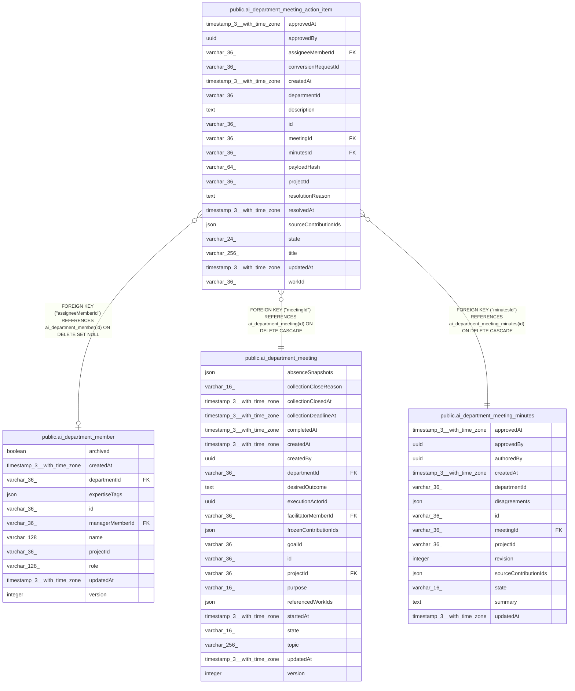

# public.ai_department_meeting_action_item

## Columns

| Name | Type | Default | Nullable | Children | Parents | Comment |
| ---- | ---- | ------- | -------- | -------- | ------- | ------- |
| approvedAt | timestamp(3) with time zone |  | true |  |  |  |
| approvedBy | uuid |  | true |  |  |  |
| assigneeMemberId | varchar(36) |  | true |  | [public.ai_department_member](public.ai_department_member.md) |  |
| conversionRequestId | varchar(36) |  | true |  |  | Stable request ID used with the Work service |
| createdAt | timestamp(3) with time zone | CURRENT_TIMESTAMP(3) | false |  |  |  |
| departmentId | varchar(36) |  | false |  |  |  |
| description | text |  | true |  |  |  |
| id | varchar(36) |  | false |  |  |  |
| meetingId | varchar(36) |  | false |  | [public.ai_department_meeting](public.ai_department_meeting.md) |  |
| minutesId | varchar(36) |  | false |  | [public.ai_department_meeting_minutes](public.ai_department_meeting_minutes.md) |  |
| payloadHash | varchar(64) |  | true |  |  | Hash bound to the Work create request |
| projectId | varchar(36) |  | false |  |  |  |
| resolutionReason | text |  | true |  |  |  |
| resolvedAt | timestamp(3) with time zone |  | true |  |  |  |
| sourceContributionIds | json |  | false |  |  | Contribution references supporting the action item |
| state | varchar(24) | 'proposed'::character varying | false |  |  | The coordinator-reviewed resolution state of the action item |
| title | varchar(256) |  | false |  |  |  |
| updatedAt | timestamp(3) with time zone | CURRENT_TIMESTAMP(3) | false |  |  |  |
| workId | varchar(36) |  | true |  |  | Backlog work ID owned by the Work service |

## Constraints

| Name | Type | Definition |
| ---- | ---- | ---------- |
| CHK_ai_department_meeting_action_item_state | CHECK | CHECK (((state)::text = ANY ((ARRAY['proposed'::character varying, 'approved'::character varying, 'conversion_pending'::character varying, 'converted'::character varying, 'declined'::character varying])::text[]))) |
| FK_d7dbebdc920ee0b5031e1285da5 | FOREIGN KEY | FOREIGN KEY ("minutesId") REFERENCES ai_department_meeting_minutes(id) ON DELETE CASCADE |
| FK_de62a86eb2086db0b0a2e0b8dc4 | FOREIGN KEY | FOREIGN KEY ("assigneeMemberId") REFERENCES ai_department_member(id) ON DELETE SET NULL |
| FK_e7c5e9dcfe47bdc427a6920312e | FOREIGN KEY | FOREIGN KEY ("meetingId") REFERENCES ai_department_meeting(id) ON DELETE CASCADE |
| PK_e71f4e78008558b0f1003e48316 | PRIMARY KEY | PRIMARY KEY (id) |
| ai_department_meeting_action_ite_sourceContributionIds_not_null | n | NOT NULL "sourceContributionIds" |
| ai_department_meeting_action_item_createdAt_not_null | n | NOT NULL "createdAt" |
| ai_department_meeting_action_item_departmentId_not_null | n | NOT NULL "departmentId" |
| ai_department_meeting_action_item_id_not_null | n | NOT NULL id |
| ai_department_meeting_action_item_meetingId_not_null | n | NOT NULL "meetingId" |
| ai_department_meeting_action_item_minutesId_not_null | n | NOT NULL "minutesId" |
| ai_department_meeting_action_item_projectId_not_null | n | NOT NULL "projectId" |
| ai_department_meeting_action_item_state_not_null | n | NOT NULL state |
| ai_department_meeting_action_item_title_not_null | n | NOT NULL title |
| ai_department_meeting_action_item_updatedAt_not_null | n | NOT NULL "updatedAt" |

## Indexes

| Name | Definition |
| ---- | ---------- |
| IDX_ai_department_meeting_action_item_workId | CREATE UNIQUE INDEX "IDX_ai_department_meeting_action_item_workId" ON public.ai_department_meeting_action_item USING btree ("workId") WHERE ("workId" IS NOT NULL) |
| IDX_d7dbebdc920ee0b5031e1285da | CREATE INDEX "IDX_d7dbebdc920ee0b5031e1285da" ON public.ai_department_meeting_action_item USING btree ("minutesId") |
| IDX_f0a9ca85997547e5d8436a72c3 | CREATE INDEX "IDX_f0a9ca85997547e5d8436a72c3" ON public.ai_department_meeting_action_item USING btree ("projectId", "meetingId", state) |
| PK_e71f4e78008558b0f1003e48316 | CREATE UNIQUE INDEX "PK_e71f4e78008558b0f1003e48316" ON public.ai_department_meeting_action_item USING btree (id) |

## Relations

---

> Generated by [tbls](https://github.com/k1LoW/tbls)
