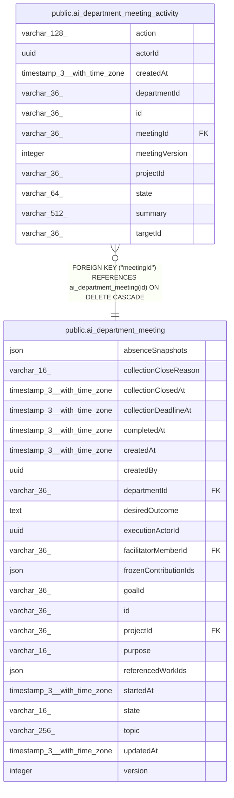

# public.ai_department_meeting_activity

## Columns

| Name | Type | Default | Nullable | Children | Parents | Comment |
| ---- | ---- | ------- | -------- | -------- | ------- | ------- |
| action | varchar(128) |  | false |  |  |  |
| actorId | uuid |  | true |  |  |  |
| createdAt | timestamp(3) with time zone | CURRENT_TIMESTAMP(3) | false |  |  |  |
| departmentId | varchar(36) |  | false |  |  |  |
| id | varchar(36) |  | false |  |  |  |
| meetingId | varchar(36) |  | false |  | [public.ai_department_meeting](public.ai_department_meeting.md) |  |
| meetingVersion | integer |  | false |  |  |  |
| projectId | varchar(36) |  | false |  |  |  |
| state | varchar(64) |  | false |  |  |  |
| summary | varchar(512) |  | false |  |  |  |
| targetId | varchar(36) |  | true |  |  |  |

## Constraints

| Name | Type | Definition |
| ---- | ---- | ---------- |
| FK_a2cb0ead197e3d86ef53b69ddee | FOREIGN KEY | FOREIGN KEY ("meetingId") REFERENCES ai_department_meeting(id) ON DELETE CASCADE |
| PK_1636ed6eae1fbf7b6f9269538b5 | PRIMARY KEY | PRIMARY KEY (id) |
| ai_department_meeting_activity_action_not_null | n | NOT NULL action |
| ai_department_meeting_activity_createdAt_not_null | n | NOT NULL "createdAt" |
| ai_department_meeting_activity_departmentId_not_null | n | NOT NULL "departmentId" |
| ai_department_meeting_activity_id_not_null | n | NOT NULL id |
| ai_department_meeting_activity_meetingId_not_null | n | NOT NULL "meetingId" |
| ai_department_meeting_activity_meetingVersion_not_null | n | NOT NULL "meetingVersion" |
| ai_department_meeting_activity_projectId_not_null | n | NOT NULL "projectId" |
| ai_department_meeting_activity_state_not_null | n | NOT NULL state |
| ai_department_meeting_activity_summary_not_null | n | NOT NULL summary |

## Indexes

| Name | Definition |
| ---- | ---------- |
| IDX_1cb766695f833cd4f671283b1b | CREATE INDEX "IDX_1cb766695f833cd4f671283b1b" ON public.ai_department_meeting_activity USING btree ("projectId", "meetingId", "createdAt") |
| PK_1636ed6eae1fbf7b6f9269538b5 | CREATE UNIQUE INDEX "PK_1636ed6eae1fbf7b6f9269538b5" ON public.ai_department_meeting_activity USING btree (id) |

## Relations

---

> Generated by [tbls](https://github.com/k1LoW/tbls)
