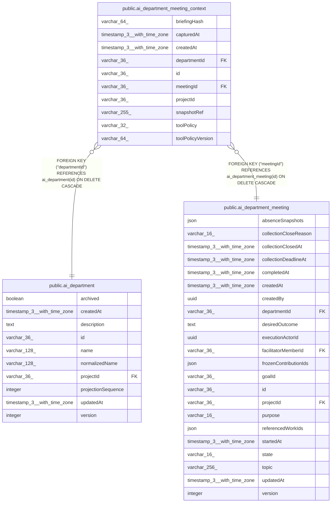

# public.ai_department_meeting_context

## Columns

| Name | Type | Default | Nullable | Children | Parents | Comment |
| ---- | ---- | ------- | -------- | -------- | ------- | ------- |
| briefingHash | varchar(64) |  | false |  |  | SHA-256 hash of frozen meeting context |
| capturedAt | timestamp(3) with time zone |  | false |  |  |  |
| createdAt | timestamp(3) with time zone | CURRENT_TIMESTAMP(3) | false |  |  |  |
| departmentId | varchar(36) |  | false |  | [public.ai_department](public.ai_department.md) |  |
| id | varchar(36) |  | false |  |  |  |
| meetingId | varchar(36) |  | false |  | [public.ai_department_meeting](public.ai_department_meeting.md) |  |
| projectId | varchar(36) |  | false |  |  |  |
| snapshotRef | varchar(255) |  | false |  |  | Opaque reference owned by the source reader |
| toolPolicy | varchar(32) |  | false |  |  | The enforced Agent tool policy for this meeting |
| toolPolicyVersion | varchar(64) |  | true |  |  | Version of the Agents-owned tool policy |

## Constraints

| Name | Type | Definition |
| ---- | ---- | ---------- |
| CHK_ai_department_meeting_context_toolPolicy | CHECK | CHECK ((("toolPolicy")::text = ANY ((ARRAY['supplied-material-only'::character varying, 'verified-read-only'::character varying])::text[]))) |
| FK_1fece2bcba498fad9b7a93897a4 | FOREIGN KEY | FOREIGN KEY ("meetingId") REFERENCES ai_department_meeting(id) ON DELETE CASCADE |
| FK_b7c512a3fbac082c84190ec18a5 | FOREIGN KEY | FOREIGN KEY ("departmentId") REFERENCES ai_department(id) ON DELETE CASCADE |
| PK_683c643e5af8a75e8ca5d3ca084 | PRIMARY KEY | PRIMARY KEY (id) |
| ai_department_meeting_context_briefingHash_not_null | n | NOT NULL "briefingHash" |
| ai_department_meeting_context_capturedAt_not_null | n | NOT NULL "capturedAt" |
| ai_department_meeting_context_createdAt_not_null | n | NOT NULL "createdAt" |
| ai_department_meeting_context_departmentId_not_null | n | NOT NULL "departmentId" |
| ai_department_meeting_context_id_not_null | n | NOT NULL id |
| ai_department_meeting_context_meetingId_not_null | n | NOT NULL "meetingId" |
| ai_department_meeting_context_projectId_not_null | n | NOT NULL "projectId" |
| ai_department_meeting_context_snapshotRef_not_null | n | NOT NULL "snapshotRef" |
| ai_department_meeting_context_toolPolicy_not_null | n | NOT NULL "toolPolicy" |

## Indexes

| Name | Definition |
| ---- | ---------- |
| IDX_1b27549d38002e08047befc142 | CREATE UNIQUE INDEX "IDX_1b27549d38002e08047befc142" ON public.ai_department_meeting_context USING btree ("projectId", "departmentId", "meetingId") |
| PK_683c643e5af8a75e8ca5d3ca084 | CREATE UNIQUE INDEX "PK_683c643e5af8a75e8ca5d3ca084" ON public.ai_department_meeting_context USING btree (id) |

## Relations

---

> Generated by [tbls](https://github.com/k1LoW/tbls)
