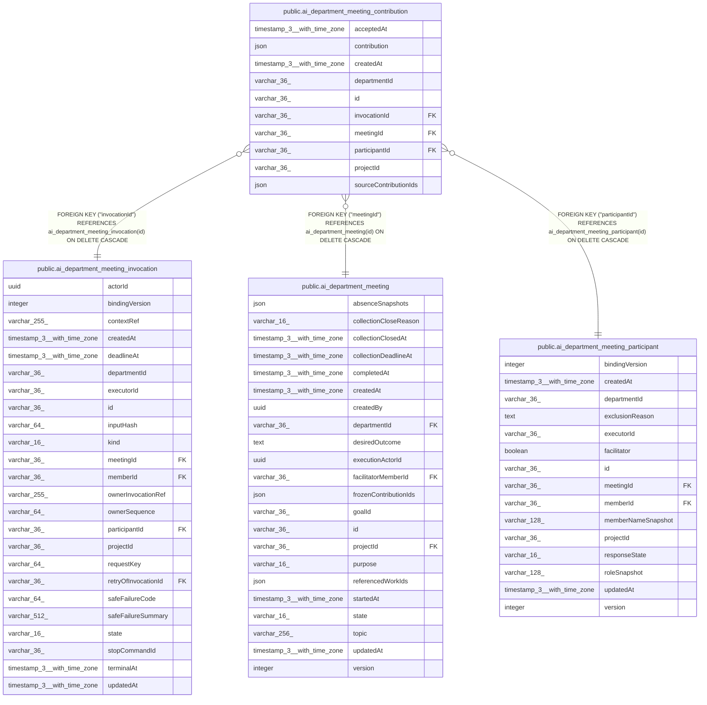

# public.ai_department_meeting_contribution

## Columns

| Name | Type | Default | Nullable | Children | Parents | Comment |
| ---- | ---- | ------- | -------- | -------- | ------- | ------- |
| acceptedAt | timestamp(3) with time zone |  | false |  |  |  |
| contribution | json |  | false |  |  | Bounded structured contribution accepted from the Agents owner |
| createdAt | timestamp(3) with time zone | CURRENT_TIMESTAMP(3) | false |  |  |  |
| departmentId | varchar(36) |  | false |  |  |  |
| id | varchar(36) |  | false |  |  |  |
| invocationId | varchar(36) |  | false |  | [public.ai_department_meeting_invocation](public.ai_department_meeting_invocation.md) |  |
| meetingId | varchar(36) |  | false |  | [public.ai_department_meeting](public.ai_department_meeting.md) |  |
| participantId | varchar(36) |  | false |  | [public.ai_department_meeting_participant](public.ai_department_meeting_participant.md) |  |
| projectId | varchar(36) |  | false |  |  |  |
| sourceContributionIds | json |  | false |  |  | Source references for the contribution |

## Constraints

| Name | Type | Definition |
| ---- | ---- | ---------- |
| FK_582c9d2b071d59a3c2323c533ad | FOREIGN KEY | FOREIGN KEY ("meetingId") REFERENCES ai_department_meeting(id) ON DELETE CASCADE |
| FK_c6784c2453dbe66c77d9dd8123e | FOREIGN KEY | FOREIGN KEY ("invocationId") REFERENCES ai_department_meeting_invocation(id) ON DELETE CASCADE |
| FK_e28a2d62fbbaf976bbaab52bcaf | FOREIGN KEY | FOREIGN KEY ("participantId") REFERENCES ai_department_meeting_participant(id) ON DELETE CASCADE |
| PK_4b0148f368ce2245ab8a16ef6c9 | PRIMARY KEY | PRIMARY KEY (id) |
| ai_department_meeting_contributi_sourceContributionIds_not_null | n | NOT NULL "sourceContributionIds" |
| ai_department_meeting_contribution_acceptedAt_not_null | n | NOT NULL "acceptedAt" |
| ai_department_meeting_contribution_contribution_not_null | n | NOT NULL contribution |
| ai_department_meeting_contribution_createdAt_not_null | n | NOT NULL "createdAt" |
| ai_department_meeting_contribution_departmentId_not_null | n | NOT NULL "departmentId" |
| ai_department_meeting_contribution_id_not_null | n | NOT NULL id |
| ai_department_meeting_contribution_invocationId_not_null | n | NOT NULL "invocationId" |
| ai_department_meeting_contribution_meetingId_not_null | n | NOT NULL "meetingId" |
| ai_department_meeting_contribution_participantId_not_null | n | NOT NULL "participantId" |
| ai_department_meeting_contribution_projectId_not_null | n | NOT NULL "projectId" |

## Indexes

| Name | Definition |
| ---- | ---------- |
| IDX_a9e22fdc440fb1fd00dd9f3d9d | CREATE INDEX "IDX_a9e22fdc440fb1fd00dd9f3d9d" ON public.ai_department_meeting_contribution USING btree ("projectId", "meetingId") |
| IDX_c6784c2453dbe66c77d9dd8123 | CREATE UNIQUE INDEX "IDX_c6784c2453dbe66c77d9dd8123" ON public.ai_department_meeting_contribution USING btree ("invocationId") |
| IDX_e28a2d62fbbaf976bbaab52bca | CREATE UNIQUE INDEX "IDX_e28a2d62fbbaf976bbaab52bca" ON public.ai_department_meeting_contribution USING btree ("participantId") |
| PK_4b0148f368ce2245ab8a16ef6c9 | CREATE UNIQUE INDEX "PK_4b0148f368ce2245ab8a16ef6c9" ON public.ai_department_meeting_contribution USING btree (id) |

## Relations

---

> Generated by [tbls](https://github.com/k1LoW/tbls)
