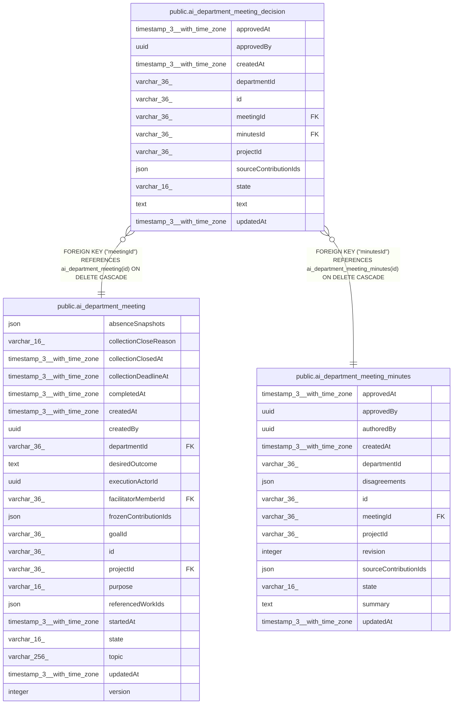

# public.ai_department_meeting_decision

## Columns

| Name | Type | Default | Nullable | Children | Parents | Comment |
| ---- | ---- | ------- | -------- | -------- | ------- | ------- |
| approvedAt | timestamp(3) with time zone |  | true |  |  |  |
| approvedBy | uuid |  | true |  |  |  |
| createdAt | timestamp(3) with time zone | CURRENT_TIMESTAMP(3) | false |  |  |  |
| departmentId | varchar(36) |  | false |  |  |  |
| id | varchar(36) |  | false |  |  |  |
| meetingId | varchar(36) |  | false |  | [public.ai_department_meeting](public.ai_department_meeting.md) |  |
| minutesId | varchar(36) |  | false |  | [public.ai_department_meeting_minutes](public.ai_department_meeting_minutes.md) |  |
| projectId | varchar(36) |  | false |  |  |  |
| sourceContributionIds | json |  | false |  |  | Contribution references supporting the decision |
| state | varchar(16) | 'proposed'::character varying | false |  |  | Agent decisions remain proposed until coordinator approval |
| text | text |  | false |  |  |  |
| updatedAt | timestamp(3) with time zone | CURRENT_TIMESTAMP(3) | false |  |  |  |

## Constraints

| Name | Type | Definition |
| ---- | ---- | ---------- |
| CHK_ai_department_meeting_decision_state | CHECK | CHECK (((state)::text = ANY ((ARRAY['proposed'::character varying, 'approved'::character varying])::text[]))) |
| FK_81bf62b39be5a42783fc6dcfa51 | FOREIGN KEY | FOREIGN KEY ("minutesId") REFERENCES ai_department_meeting_minutes(id) ON DELETE CASCADE |
| FK_e8486cbb9829ac2968ca05d30f6 | FOREIGN KEY | FOREIGN KEY ("meetingId") REFERENCES ai_department_meeting(id) ON DELETE CASCADE |
| PK_98f0b607437dadb93816db5d60f | PRIMARY KEY | PRIMARY KEY (id) |
| ai_department_meeting_decision_createdAt_not_null | n | NOT NULL "createdAt" |
| ai_department_meeting_decision_departmentId_not_null | n | NOT NULL "departmentId" |
| ai_department_meeting_decision_id_not_null | n | NOT NULL id |
| ai_department_meeting_decision_meetingId_not_null | n | NOT NULL "meetingId" |
| ai_department_meeting_decision_minutesId_not_null | n | NOT NULL "minutesId" |
| ai_department_meeting_decision_projectId_not_null | n | NOT NULL "projectId" |
| ai_department_meeting_decision_sourceContributionIds_not_null | n | NOT NULL "sourceContributionIds" |
| ai_department_meeting_decision_state_not_null | n | NOT NULL state |
| ai_department_meeting_decision_text_not_null | n | NOT NULL text |
| ai_department_meeting_decision_updatedAt_not_null | n | NOT NULL "updatedAt" |

## Indexes

| Name | Definition |
| ---- | ---------- |
| IDX_81bf62b39be5a42783fc6dcfa5 | CREATE INDEX "IDX_81bf62b39be5a42783fc6dcfa5" ON public.ai_department_meeting_decision USING btree ("minutesId") |
| IDX_d3323d6d9a6aa654cb37229794 | CREATE INDEX "IDX_d3323d6d9a6aa654cb37229794" ON public.ai_department_meeting_decision USING btree ("projectId", "meetingId") |
| PK_98f0b607437dadb93816db5d60f | CREATE UNIQUE INDEX "PK_98f0b607437dadb93816db5d60f" ON public.ai_department_meeting_decision USING btree (id) |

## Relations

---

> Generated by [tbls](https://github.com/k1LoW/tbls)
