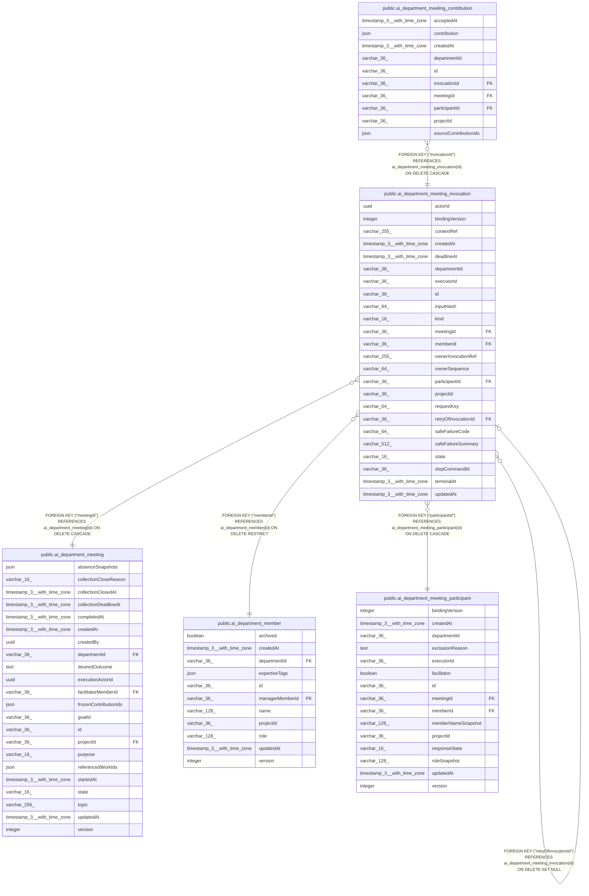

# public.ai_department_meeting_invocation

## Columns

| Name | Type | Default | Nullable | Children | Parents | Comment |
| ---- | ---- | ------- | -------- | -------- | ------- | ------- |
| actorId | uuid |  | false |  |  |  |
| bindingVersion | integer |  | false |  |  |  |
| contextRef | varchar(255) |  | false |  |  | Opaque immutable context reference resolved by the owner |
| createdAt | timestamp(3) with time zone | CURRENT_TIMESTAMP(3) | false |  |  |  |
| deadlineAt | timestamp(3) with time zone |  | true |  |  |  |
| departmentId | varchar(36) |  | false |  |  |  |
| executorId | varchar(36) |  | false |  |  |  |
| id | varchar(36) |  | false | [public.ai_department_meeting_contribution](public.ai_department_meeting_contribution.md) [public.ai_department_meeting_invocation](public.ai_department_meeting_invocation.md) |  |  |
| inputHash | varchar(64) |  | false |  |  | Hash bound to the owner invocation request |
| kind | varchar(16) |  | false |  |  | The meeting operation requested from the Agents owner |
| meetingId | varchar(36) |  | false |  | [public.ai_department_meeting](public.ai_department_meeting.md) |  |
| memberId | varchar(36) |  | false |  | [public.ai_department_member](public.ai_department_member.md) |  |
| ownerInvocationRef | varchar(255) |  | true |  |  | Opaque execution reference owned by Agents |
| ownerSequence | varchar(64) |  | true |  |  | Monotonic sequence supplied by Agents |
| participantId | varchar(36) |  | false |  | [public.ai_department_meeting_participant](public.ai_department_meeting_participant.md) |  |
| projectId | varchar(36) |  | false |  |  |  |
| requestKey | varchar(64) |  | false |  |  | Stable Agents owner idempotency key |
| retryOfInvocationId | varchar(36) |  | true |  | [public.ai_department_meeting_invocation](public.ai_department_meeting_invocation.md) | Prior terminal invocation ID for a retry |
| safeFailureCode | varchar(64) |  | true |  |  |  |
| safeFailureSummary | varchar(512) |  | true |  |  |  |
| state | varchar(16) | 'reserved'::character varying | false |  |  | The owner-confirmed lifecycle state of the invocation |
| stopCommandId | varchar(36) |  | true |  |  |  |
| terminalAt | timestamp(3) with time zone |  | true |  |  |  |
| updatedAt | timestamp(3) with time zone | CURRENT_TIMESTAMP(3) | false |  |  |  |

## Constraints

| Name | Type | Definition |
| ---- | ---- | ---------- |
| CHK_ai_department_meeting_invocation_kind | CHECK | CHECK (((kind)::text = ANY ((ARRAY['contribution'::character varying, 'synthesis'::character varying])::text[]))) |
| CHK_ai_department_meeting_invocation_state | CHECK | CHECK (((state)::text = ANY ((ARRAY['reserved'::character varying, 'queued'::character varying, 'running'::character varying, 'succeeded'::character varying, 'failed'::character varying, 'unavailable'::character varying, 'stop_pending'::character varying, 'unknown'::character varying, 'cancelled'::character varying])::text[]))) |
| FK_2c9f4d891bed0e65da0b88a8916 | FOREIGN KEY | FOREIGN KEY ("meetingId") REFERENCES ai_department_meeting(id) ON DELETE CASCADE |
| FK_64a80305a7e6474a76e8364452f | FOREIGN KEY | FOREIGN KEY ("retryOfInvocationId") REFERENCES ai_department_meeting_invocation(id) ON DELETE SET NULL |
| FK_d20cad967ce17c86a99e81d1252 | FOREIGN KEY | FOREIGN KEY ("memberId") REFERENCES ai_department_member(id) ON DELETE RESTRICT |
| FK_e6b22cfb2a751c3df243472068d | FOREIGN KEY | FOREIGN KEY ("participantId") REFERENCES ai_department_meeting_participant(id) ON DELETE CASCADE |
| PK_6ec6418b3013fbade822d38c9e0 | PRIMARY KEY | PRIMARY KEY (id) |
| ai_department_meeting_invocation_actorId_not_null | n | NOT NULL "actorId" |
| ai_department_meeting_invocation_bindingVersion_not_null | n | NOT NULL "bindingVersion" |
| ai_department_meeting_invocation_contextRef_not_null | n | NOT NULL "contextRef" |
| ai_department_meeting_invocation_createdAt_not_null | n | NOT NULL "createdAt" |
| ai_department_meeting_invocation_departmentId_not_null | n | NOT NULL "departmentId" |
| ai_department_meeting_invocation_executorId_not_null | n | NOT NULL "executorId" |
| ai_department_meeting_invocation_id_not_null | n | NOT NULL id |
| ai_department_meeting_invocation_inputHash_not_null | n | NOT NULL "inputHash" |
| ai_department_meeting_invocation_kind_not_null | n | NOT NULL kind |
| ai_department_meeting_invocation_meetingId_not_null | n | NOT NULL "meetingId" |
| ai_department_meeting_invocation_memberId_not_null | n | NOT NULL "memberId" |
| ai_department_meeting_invocation_participantId_not_null | n | NOT NULL "participantId" |
| ai_department_meeting_invocation_projectId_not_null | n | NOT NULL "projectId" |
| ai_department_meeting_invocation_requestKey_not_null | n | NOT NULL "requestKey" |
| ai_department_meeting_invocation_state_not_null | n | NOT NULL state |
| ai_department_meeting_invocation_updatedAt_not_null | n | NOT NULL "updatedAt" |

## Indexes

| Name | Definition |
| ---- | ---------- |
| IDX_3c3a9cedc16ffb2d6fb67f868d | CREATE INDEX "IDX_3c3a9cedc16ffb2d6fb67f868d" ON public.ai_department_meeting_invocation USING btree ("projectId", "meetingId", kind, state) |
| IDX_7135c943ad91118ac9d160f0d9 | CREATE UNIQUE INDEX "IDX_7135c943ad91118ac9d160f0d9" ON public.ai_department_meeting_invocation USING btree ("projectId", "requestKey") |
| IDX_e21e5aa79d96bdaa055cd48a69 | CREATE INDEX "IDX_e21e5aa79d96bdaa055cd48a69" ON public.ai_department_meeting_invocation USING btree ("projectId", "ownerInvocationRef") |
| PK_6ec6418b3013fbade822d38c9e0 | CREATE UNIQUE INDEX "PK_6ec6418b3013fbade822d38c9e0" ON public.ai_department_meeting_invocation USING btree (id) |

## Relations

---

> Generated by [tbls](https://github.com/k1LoW/tbls)
