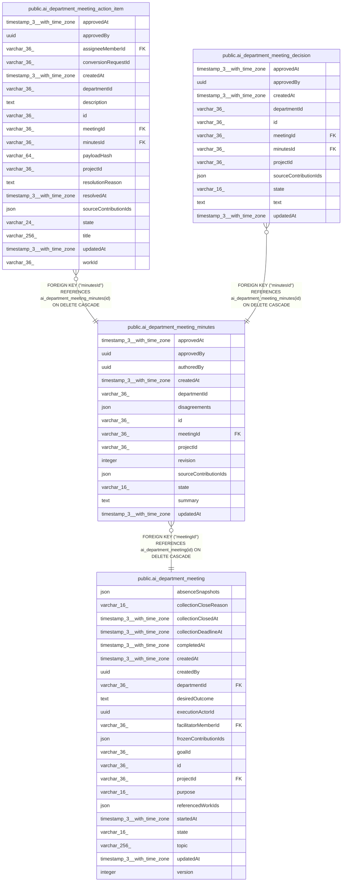

# public.ai_department_meeting_minutes

## Columns

| Name | Type | Default | Nullable | Children | Parents | Comment |
| ---- | ---- | ------- | -------- | -------- | ------- | ------- |
| approvedAt | timestamp(3) with time zone |  | true |  |  |  |
| approvedBy | uuid |  | true |  |  |  |
| authoredBy | uuid |  | false |  |  |  |
| createdAt | timestamp(3) with time zone | CURRENT_TIMESTAMP(3) | false |  |  |  |
| departmentId | varchar(36) |  | false |  |  |  |
| disagreements | json |  | false |  |  | Attributed opposing positions preserved by the minutes |
| id | varchar(36) |  | false | [public.ai_department_meeting_action_item](public.ai_department_meeting_action_item.md) [public.ai_department_meeting_decision](public.ai_department_meeting_decision.md) |  |  |
| meetingId | varchar(36) |  | false |  | [public.ai_department_meeting](public.ai_department_meeting.md) |  |
| projectId | varchar(36) |  | false |  |  |  |
| revision | integer |  | false |  |  |  |
| sourceContributionIds | json |  | false |  |  | Contribution references used by the minutes |
| state | varchar(16) | 'draft'::character varying | false |  |  | Whether the minutes revision is a draft or approved |
| summary | text |  | false |  |  |  |
| updatedAt | timestamp(3) with time zone | CURRENT_TIMESTAMP(3) | false |  |  |  |

## Constraints

| Name | Type | Definition |
| ---- | ---- | ---------- |
| CHK_ai_department_meeting_minutes_state | CHECK | CHECK (((state)::text = ANY ((ARRAY['draft'::character varying, 'approved'::character varying])::text[]))) |
| FK_1f619caf8a4e889327368a4daf6 | FOREIGN KEY | FOREIGN KEY ("meetingId") REFERENCES ai_department_meeting(id) ON DELETE CASCADE |
| PK_04fb132f583027da3a62532b862 | PRIMARY KEY | PRIMARY KEY (id) |
| ai_department_meeting_minutes_authoredBy_not_null | n | NOT NULL "authoredBy" |
| ai_department_meeting_minutes_createdAt_not_null | n | NOT NULL "createdAt" |
| ai_department_meeting_minutes_departmentId_not_null | n | NOT NULL "departmentId" |
| ai_department_meeting_minutes_disagreements_not_null | n | NOT NULL disagreements |
| ai_department_meeting_minutes_id_not_null | n | NOT NULL id |
| ai_department_meeting_minutes_meetingId_not_null | n | NOT NULL "meetingId" |
| ai_department_meeting_minutes_projectId_not_null | n | NOT NULL "projectId" |
| ai_department_meeting_minutes_revision_not_null | n | NOT NULL revision |
| ai_department_meeting_minutes_sourceContributionIds_not_null | n | NOT NULL "sourceContributionIds" |
| ai_department_meeting_minutes_state_not_null | n | NOT NULL state |
| ai_department_meeting_minutes_summary_not_null | n | NOT NULL summary |
| ai_department_meeting_minutes_updatedAt_not_null | n | NOT NULL "updatedAt" |

## Indexes

| Name | Definition |
| ---- | ---------- |
| IDX_6bff6f4fe7ef7470c4c48dff80 | CREATE UNIQUE INDEX "IDX_6bff6f4fe7ef7470c4c48dff80" ON public.ai_department_meeting_minutes USING btree ("meetingId", revision) |
| IDX_c581979371ed89c49cbfaafd46 | CREATE INDEX "IDX_c581979371ed89c49cbfaafd46" ON public.ai_department_meeting_minutes USING btree ("projectId", "meetingId", state) |
| PK_04fb132f583027da3a62532b862 | CREATE UNIQUE INDEX "PK_04fb132f583027da3a62532b862" ON public.ai_department_meeting_minutes USING btree (id) |

## Relations

---

> Generated by [tbls](https://github.com/k1LoW/tbls)
