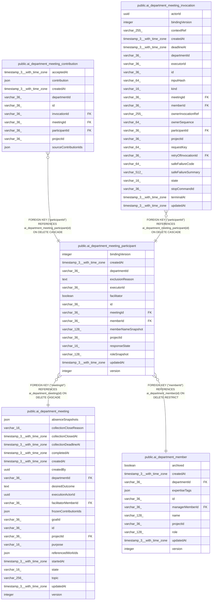

# public.ai_department_meeting_participant

## Columns

| Name | Type | Default | Nullable | Children | Parents | Comment |
| ---- | ---- | ------- | -------- | -------- | ------- | ------- |
| bindingVersion | integer |  | true |  |  |  |
| createdAt | timestamp(3) with time zone | CURRENT_TIMESTAMP(3) | false |  |  |  |
| departmentId | varchar(36) |  | false |  |  |  |
| exclusionReason | text |  | true |  |  |  |
| executorId | varchar(36) |  | true |  |  |  |
| facilitator | boolean | false | false |  |  |  |
| id | varchar(36) |  | false | [public.ai_department_meeting_contribution](public.ai_department_meeting_contribution.md) [public.ai_department_meeting_invocation](public.ai_department_meeting_invocation.md) |  |  |
| meetingId | varchar(36) |  | false |  | [public.ai_department_meeting](public.ai_department_meeting.md) |  |
| memberId | varchar(36) |  | false |  | [public.ai_department_member](public.ai_department_member.md) |  |
| memberNameSnapshot | varchar(128) |  | false |  |  |  |
| projectId | varchar(36) |  | false |  |  |  |
| responseState | varchar(16) | 'pending'::character varying | false |  |  | The department-owned response state of the participant |
| roleSnapshot | varchar(128) |  | false |  |  |  |
| updatedAt | timestamp(3) with time zone | CURRENT_TIMESTAMP(3) | false |  |  |  |
| version | integer | 1 | false |  |  |  |

## Constraints

| Name | Type | Definition |
| ---- | ---- | ---------- |
| CHK_ai_department_meeting_participant_responseState | CHECK | CHECK ((("responseState")::text = ANY ((ARRAY['pending'::character varying, 'queued'::character varying, 'running'::character varying, 'submitted'::character varying, 'failed'::character varying, 'unavailable'::character varying, 'stop_pending'::character varying, 'unknown'::character varying, 'excluded'::character varying])::text[]))) |
| FK_0b535f07f412fb11017e4d54e7c | FOREIGN KEY | FOREIGN KEY ("meetingId") REFERENCES ai_department_meeting(id) ON DELETE CASCADE |
| FK_cc4509fb12beb11004df7348379 | FOREIGN KEY | FOREIGN KEY ("memberId") REFERENCES ai_department_member(id) ON DELETE RESTRICT |
| PK_7d0845a600946694e70a2e255e9 | PRIMARY KEY | PRIMARY KEY (id) |
| ai_department_meeting_participant_createdAt_not_null | n | NOT NULL "createdAt" |
| ai_department_meeting_participant_departmentId_not_null | n | NOT NULL "departmentId" |
| ai_department_meeting_participant_facilitator_not_null | n | NOT NULL facilitator |
| ai_department_meeting_participant_id_not_null | n | NOT NULL id |
| ai_department_meeting_participant_meetingId_not_null | n | NOT NULL "meetingId" |
| ai_department_meeting_participant_memberId_not_null | n | NOT NULL "memberId" |
| ai_department_meeting_participant_memberNameSnapshot_not_null | n | NOT NULL "memberNameSnapshot" |
| ai_department_meeting_participant_projectId_not_null | n | NOT NULL "projectId" |
| ai_department_meeting_participant_responseState_not_null | n | NOT NULL "responseState" |
| ai_department_meeting_participant_roleSnapshot_not_null | n | NOT NULL "roleSnapshot" |
| ai_department_meeting_participant_updatedAt_not_null | n | NOT NULL "updatedAt" |
| ai_department_meeting_participant_version_not_null | n | NOT NULL version |

## Indexes

| Name | Definition |
| ---- | ---------- |
| IDX_b86090d9b77ded810ab05237e8 | CREATE INDEX "IDX_b86090d9b77ded810ab05237e8" ON public.ai_department_meeting_participant USING btree ("projectId", "departmentId", "memberId", "meetingId") |
| IDX_c72bbf9f44830ab23ef2007eb2 | CREATE UNIQUE INDEX "IDX_c72bbf9f44830ab23ef2007eb2" ON public.ai_department_meeting_participant USING btree ("meetingId", "memberId") |
| PK_7d0845a600946694e70a2e255e9 | CREATE UNIQUE INDEX "PK_7d0845a600946694e70a2e255e9" ON public.ai_department_meeting_participant USING btree (id) |

## Relations

---

> Generated by [tbls](https://github.com/k1LoW/tbls)
