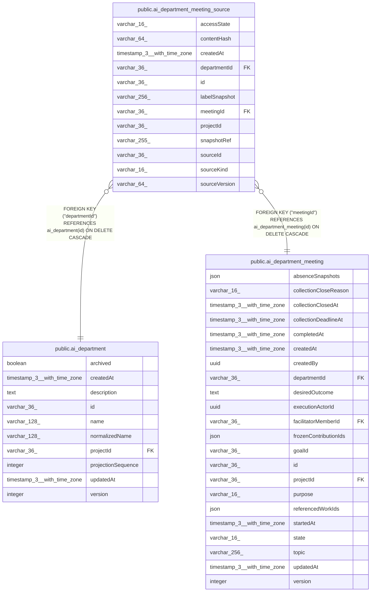

# public.ai_department_meeting_source

## Columns

| Name | Type | Default | Nullable | Children | Parents | Comment |
| ---- | ---- | ------- | -------- | -------- | ------- | ------- |
| accessState | varchar(16) | 'available'::character varying | false |  |  | Current access state for this frozen source version |
| contentHash | varchar(64) |  | false |  |  | Hash of the authorized source version |
| createdAt | timestamp(3) with time zone | CURRENT_TIMESTAMP(3) | false |  |  |  |
| departmentId | varchar(36) |  | false |  | [public.ai_department](public.ai_department.md) |  |
| id | varchar(36) |  | false |  |  |  |
| labelSnapshot | varchar(256) |  | true |  |  |  |
| meetingId | varchar(36) |  | false |  | [public.ai_department_meeting](public.ai_department_meeting.md) |  |
| projectId | varchar(36) |  | false |  |  |  |
| snapshotRef | varchar(255) |  | false |  |  | Opaque versioned reference owned by the source reader |
| sourceId | varchar(36) |  | false |  |  | Opaque ID owned by the source service |
| sourceKind | varchar(16) |  | false |  |  | The source owner type |
| sourceVersion | varchar(64) |  | false |  |  | Version token owned by the source service |

## Constraints

| Name | Type | Definition |
| ---- | ---- | ---------- |
| CHK_ai_department_meeting_source_accessState | CHECK | CHECK ((("accessState")::text = ANY ((ARRAY['available'::character varying, 'denied'::character varying, 'expired'::character varying])::text[]))) |
| CHK_ai_department_meeting_source_sourceKind | CHECK | CHECK ((("sourceKind")::text = ANY ((ARRAY['goal'::character varying, 'work'::character varying, 'decision'::character varying])::text[]))) |
| FK_8e107707863d6aad87cba8a2cec | FOREIGN KEY | FOREIGN KEY ("departmentId") REFERENCES ai_department(id) ON DELETE CASCADE |
| FK_f81edc40a46209594be963e5bd0 | FOREIGN KEY | FOREIGN KEY ("meetingId") REFERENCES ai_department_meeting(id) ON DELETE CASCADE |
| PK_d88a6e8e7945dc943927144e65a | PRIMARY KEY | PRIMARY KEY (id) |
| ai_department_meeting_source_accessState_not_null | n | NOT NULL "accessState" |
| ai_department_meeting_source_contentHash_not_null | n | NOT NULL "contentHash" |
| ai_department_meeting_source_createdAt_not_null | n | NOT NULL "createdAt" |
| ai_department_meeting_source_departmentId_not_null | n | NOT NULL "departmentId" |
| ai_department_meeting_source_id_not_null | n | NOT NULL id |
| ai_department_meeting_source_meetingId_not_null | n | NOT NULL "meetingId" |
| ai_department_meeting_source_projectId_not_null | n | NOT NULL "projectId" |
| ai_department_meeting_source_snapshotRef_not_null | n | NOT NULL "snapshotRef" |
| ai_department_meeting_source_sourceId_not_null | n | NOT NULL "sourceId" |
| ai_department_meeting_source_sourceKind_not_null | n | NOT NULL "sourceKind" |
| ai_department_meeting_source_sourceVersion_not_null | n | NOT NULL "sourceVersion" |

## Indexes

| Name | Definition |
| ---- | ---------- |
| IDX_73dae097e2f53c7dbc3ee42456 | CREATE UNIQUE INDEX "IDX_73dae097e2f53c7dbc3ee42456" ON public.ai_department_meeting_source USING btree ("projectId", "departmentId", "meetingId", "sourceKind", "sourceId") |
| IDX_a55e48924d5415fe24427468f4 | CREATE INDEX "IDX_a55e48924d5415fe24427468f4" ON public.ai_department_meeting_source USING btree ("projectId", "departmentId", "meetingId") |
| PK_d88a6e8e7945dc943927144e65a | CREATE UNIQUE INDEX "PK_d88a6e8e7945dc943927144e65a" ON public.ai_department_meeting_source USING btree (id) |

## Relations

---

> Generated by [tbls](https://github.com/k1LoW/tbls)
