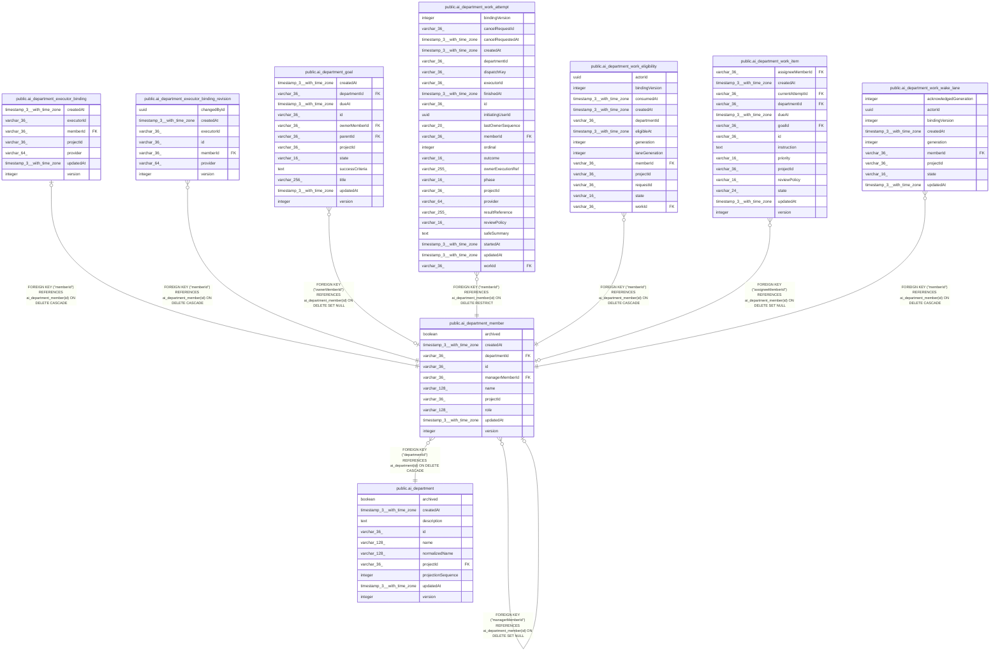

# public.ai_department_member

## Columns

| Name | Type | Default | Nullable | Children | Parents | Comment |
| ---- | ---- | ------- | -------- | -------- | ------- | ------- |
| archived | boolean | false | false |  |  |  |
| createdAt | timestamp(3) with time zone | CURRENT_TIMESTAMP(3) | false |  |  |  |
| departmentId | varchar(36) |  | false |  | [public.ai_department](public.ai_department.md) |  |
| id | varchar(36) |  | false | [public.ai_department_executor_binding](public.ai_department_executor_binding.md) [public.ai_department_executor_binding_revision](public.ai_department_executor_binding_revision.md) [public.ai_department_goal](public.ai_department_goal.md) [public.ai_department_member](public.ai_department_member.md) [public.ai_department_work_attempt](public.ai_department_work_attempt.md) [public.ai_department_work_eligibility](public.ai_department_work_eligibility.md) [public.ai_department_work_item](public.ai_department_work_item.md) [public.ai_department_work_wake_lane](public.ai_department_work_wake_lane.md) |  |  |
| managerMemberId | varchar(36) |  | true |  | [public.ai_department_member](public.ai_department_member.md) |  |
| name | varchar(128) |  | false |  |  |  |
| projectId | varchar(36) |  | false |  |  |  |
| role | varchar(128) |  | false |  |  |  |
| updatedAt | timestamp(3) with time zone | CURRENT_TIMESTAMP(3) | false |  |  |  |
| version | integer | 1 | false |  |  |  |

## Constraints

| Name | Type | Definition |
| ---- | ---- | ---------- |
| FK_84eb0c6d25f8fe9c0c162709aa9 | FOREIGN KEY | FOREIGN KEY ("departmentId") REFERENCES ai_department(id) ON DELETE CASCADE |
| FK_fa0f5c02be840bec0749cbd91fc | FOREIGN KEY | FOREIGN KEY ("managerMemberId") REFERENCES ai_department_member(id) ON DELETE SET NULL |
| PK_7ca6178c90aa4b0de14573c891e | PRIMARY KEY | PRIMARY KEY (id) |
| ai_department_member_archived_not_null | n | NOT NULL archived |
| ai_department_member_createdAt_not_null | n | NOT NULL "createdAt" |
| ai_department_member_departmentId_not_null | n | NOT NULL "departmentId" |
| ai_department_member_id_not_null | n | NOT NULL id |
| ai_department_member_name_not_null | n | NOT NULL name |
| ai_department_member_projectId_not_null | n | NOT NULL "projectId" |
| ai_department_member_role_not_null | n | NOT NULL role |
| ai_department_member_updatedAt_not_null | n | NOT NULL "updatedAt" |
| ai_department_member_version_not_null | n | NOT NULL version |

## Indexes

| Name | Definition |
| ---- | ---------- |
| IDX_98883d6605d592793363a319f4 | CREATE INDEX "IDX_98883d6605d592793363a319f4" ON public.ai_department_member USING btree ("projectId", "departmentId") |
| IDX_ai_department_member_projectId_id | CREATE UNIQUE INDEX "IDX_ai_department_member_projectId_id" ON public.ai_department_member USING btree ("projectId", id) |
| PK_7ca6178c90aa4b0de14573c891e | CREATE UNIQUE INDEX "PK_7ca6178c90aa4b0de14573c891e" ON public.ai_department_member USING btree (id) |

## Relations

---

> Generated by [tbls](https://github.com/k1LoW/tbls)
