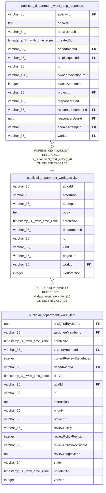

# public.ai_department_work_activity

## Columns

| Name | Type | Default | Nullable | Children | Parents | Comment |
| ---- | ---- | ------- | -------- | -------- | ------- | ------- |
| actorId | varchar(36) |  | false |  |  |  |
| actorKind | varchar(16) |  | false |  |  | The actor that wrote this entry |
| attemptId | varchar(36) |  | true |  |  |  |
| body | text |  | true |  |  |  |
| createdAt | timestamp(3) with time zone |  | false |  |  |  |
| departmentId | varchar(36) |  | false |  |  |  |
| id | varchar(36) |  | false | [public.ai_department_work_help_response](public.ai_department_work_help_response.md) |  |  |
| kind | varchar(32) |  | false |  |  |  |
| projectId | varchar(36) |  | false |  |  |  |
| workId | varchar(36) |  | false |  | [public.ai_department_work_item](public.ai_department_work_item.md) |  |
| workVersion | integer |  | false |  |  |  |

## Constraints

| Name | Type | Definition |
| ---- | ---- | ---------- |
| CHK_ai_department_work_activity_actorKind | CHECK | CHECK ((("actorKind")::text = ANY ((ARRAY['agent'::character varying, 'user'::character varying, 'system'::character varying])::text[]))) |
| FK_a56629fd3a337f391938bb20162 | FOREIGN KEY | FOREIGN KEY ("workId") REFERENCES ai_department_work_item(id) ON DELETE CASCADE |
| PK_a79af531e38192fe80e95468b75 | PRIMARY KEY | PRIMARY KEY (id) |
| ai_department_work_activity_actorId_not_null | n | NOT NULL "actorId" |
| ai_department_work_activity_actorKind_not_null | n | NOT NULL "actorKind" |
| ai_department_work_activity_createdAt_not_null | n | NOT NULL "createdAt" |
| ai_department_work_activity_departmentId_not_null | n | NOT NULL "departmentId" |
| ai_department_work_activity_id_not_null | n | NOT NULL id |
| ai_department_work_activity_kind_not_null | n | NOT NULL kind |
| ai_department_work_activity_projectId_not_null | n | NOT NULL "projectId" |
| ai_department_work_activity_workId_not_null | n | NOT NULL "workId" |
| ai_department_work_activity_workVersion_not_null | n | NOT NULL "workVersion" |

## Indexes

| Name | Definition |
| ---- | ---------- |
| IDX_ai_department_work_activity_projectId_departmentId_createdA | CREATE INDEX "IDX_ai_department_work_activity_projectId_departmentId_createdA" ON public.ai_department_work_activity USING btree ("projectId", "departmentId", "createdAt") |
| IDX_ai_department_work_activity_projectId_workId_attemptId_kind | CREATE INDEX "IDX_ai_department_work_activity_projectId_workId_attemptId_kind" ON public.ai_department_work_activity USING btree ("projectId", "workId", "attemptId", kind) |
| IDX_ai_department_work_activity_projectId_workId_workVersion | CREATE UNIQUE INDEX "IDX_ai_department_work_activity_projectId_workId_workVersion" ON public.ai_department_work_activity USING btree ("projectId", "workId", "workVersion") |
| PK_a79af531e38192fe80e95468b75 | CREATE UNIQUE INDEX "PK_a79af531e38192fe80e95468b75" ON public.ai_department_work_activity USING btree (id) |

## Relations

---

> Generated by [tbls](https://github.com/k1LoW/tbls)
