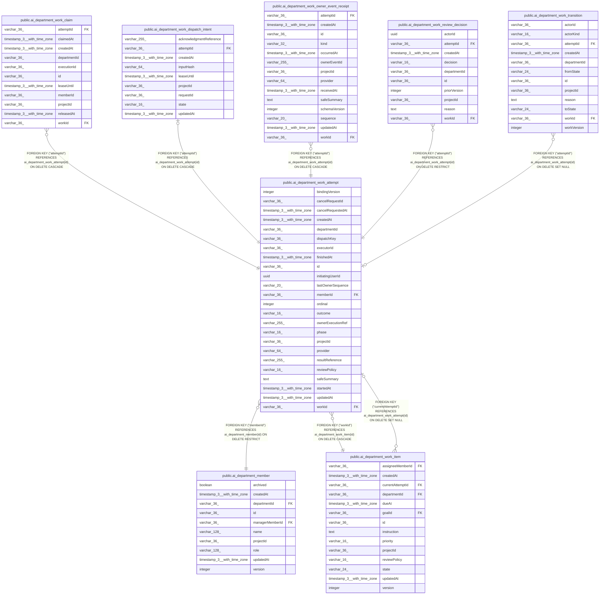

# public.ai_department_work_attempt

## Columns

| Name | Type | Default | Nullable | Children | Parents | Comment |
| ---- | ---- | ------- | -------- | -------- | ------- | ------- |
| bindingVersion | integer |  | false |  |  |  |
| cancelRequestId | varchar(36) |  | true |  |  |  |
| cancelRequestedAt | timestamp(3) with time zone |  | true |  |  |  |
| createdAt | timestamp(3) with time zone | CURRENT_TIMESTAMP(3) | false |  |  |  |
| departmentId | varchar(36) |  | false |  |  |  |
| dispatchKey | varchar(36) |  | false |  |  |  |
| executorId | varchar(36) |  | false |  |  |  |
| finishedAt | timestamp(3) with time zone |  | true |  |  |  |
| id | varchar(36) |  | false | [public.ai_department_work_claim](public.ai_department_work_claim.md) [public.ai_department_work_dispatch_intent](public.ai_department_work_dispatch_intent.md) [public.ai_department_work_item](public.ai_department_work_item.md) [public.ai_department_work_owner_event_receipt](public.ai_department_work_owner_event_receipt.md) [public.ai_department_work_review_decision](public.ai_department_work_review_decision.md) [public.ai_department_work_transition](public.ai_department_work_transition.md) |  |  |
| initiatingUserId | uuid |  | false |  |  |  |
| lastOwnerSequence | varchar(20) | '0'::character varying | false |  |  |  |
| memberId | varchar(36) |  | false |  | [public.ai_department_member](public.ai_department_member.md) |  |
| ordinal | integer |  | false |  |  |  |
| outcome | varchar(16) |  | true |  |  |  |
| ownerExecutionRef | varchar(255) |  | true |  |  |  |
| phase | varchar(16) | 'dispatching'::character varying | false |  |  |  |
| projectId | varchar(36) |  | false |  |  |  |
| provider | varchar(64) |  | false |  |  |  |
| resultReference | varchar(255) |  | true |  |  |  |
| reviewPolicy | varchar(16) |  | false |  |  |  |
| safeSummary | text |  | true |  |  |  |
| startedAt | timestamp(3) with time zone |  | true |  |  |  |
| updatedAt | timestamp(3) with time zone | CURRENT_TIMESTAMP(3) | false |  |  |  |
| workId | varchar(36) |  | false |  | [public.ai_department_work_item](public.ai_department_work_item.md) |  |

## Constraints

| Name | Type | Definition |
| ---- | ---- | ---------- |
| FK_5309258bca2a1c885c316032c0c | FOREIGN KEY | FOREIGN KEY ("workId") REFERENCES ai_department_work_item(id) ON DELETE CASCADE |
| FK_b60f947d4504eb8a209ccfde774 | FOREIGN KEY | FOREIGN KEY ("memberId") REFERENCES ai_department_member(id) ON DELETE RESTRICT |
| PK_f2f542821002f1df2bdbf3fd2af | PRIMARY KEY | PRIMARY KEY (id) |
| ai_department_work_attempt_bindingVersion_not_null | n | NOT NULL "bindingVersion" |
| ai_department_work_attempt_createdAt_not_null | n | NOT NULL "createdAt" |
| ai_department_work_attempt_departmentId_not_null | n | NOT NULL "departmentId" |
| ai_department_work_attempt_dispatchKey_not_null | n | NOT NULL "dispatchKey" |
| ai_department_work_attempt_executorId_not_null | n | NOT NULL "executorId" |
| ai_department_work_attempt_id_not_null | n | NOT NULL id |
| ai_department_work_attempt_initiatingUserId_not_null | n | NOT NULL "initiatingUserId" |
| ai_department_work_attempt_lastOwnerSequence_not_null | n | NOT NULL "lastOwnerSequence" |
| ai_department_work_attempt_memberId_not_null | n | NOT NULL "memberId" |
| ai_department_work_attempt_ordinal_not_null | n | NOT NULL ordinal |
| ai_department_work_attempt_phase_not_null | n | NOT NULL phase |
| ai_department_work_attempt_projectId_not_null | n | NOT NULL "projectId" |
| ai_department_work_attempt_provider_not_null | n | NOT NULL provider |
| ai_department_work_attempt_reviewPolicy_not_null | n | NOT NULL "reviewPolicy" |
| ai_department_work_attempt_updatedAt_not_null | n | NOT NULL "updatedAt" |
| ai_department_work_attempt_workId_not_null | n | NOT NULL "workId" |

## Indexes

| Name | Definition |
| ---- | ---------- |
| IDX_2d26d020c5e04c2feb6496e220 | CREATE INDEX "IDX_2d26d020c5e04c2feb6496e220" ON public.ai_department_work_attempt USING btree ("projectId", "ownerExecutionRef") |
| IDX_8db4b87f1e4763acda979f491e | CREATE UNIQUE INDEX "IDX_8db4b87f1e4763acda979f491e" ON public.ai_department_work_attempt USING btree ("dispatchKey") |
| IDX_ai_department_work_attempt_projectId_id | CREATE UNIQUE INDEX "IDX_ai_department_work_attempt_projectId_id" ON public.ai_department_work_attempt USING btree ("projectId", id) |
| IDX_ai_department_work_attempt_workId | CREATE UNIQUE INDEX "IDX_ai_department_work_attempt_workId" ON public.ai_department_work_attempt USING btree ("workId") WHERE ((phase)::text = ANY ((ARRAY['dispatching'::character varying, 'active'::character varying, 'suspended'::character varying])::text[])) |
| IDX_cd463cb86ef4858e2594a516ed | CREATE UNIQUE INDEX "IDX_cd463cb86ef4858e2594a516ed" ON public.ai_department_work_attempt USING btree ("workId", ordinal) |
| PK_f2f542821002f1df2bdbf3fd2af | CREATE UNIQUE INDEX "PK_f2f542821002f1df2bdbf3fd2af" ON public.ai_department_work_attempt USING btree (id) |

## Relations

---

> Generated by [tbls](https://github.com/k1LoW/tbls)
