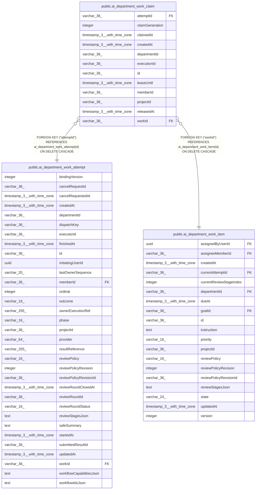

# public.ai_department_work_claim

## Columns

| Name | Type | Default | Nullable | Children | Parents | Comment |
| ---- | ---- | ------- | -------- | -------- | ------- | ------- |
| attemptId | varchar(36) |  | false |  | [public.ai_department_work_attempt](public.ai_department_work_attempt.md) |  |
| claimGeneration | integer |  | false |  |  | Monotonic claim generation for a work attempt |
| claimedAt | timestamp(3) with time zone |  | false |  |  |  |
| createdAt | timestamp(3) with time zone |  | false |  |  |  |
| departmentId | varchar(36) |  | false |  |  |  |
| executionId | varchar(36) |  | false |  |  |  |
| id | varchar(36) |  | false |  |  |  |
| leaseUntil | timestamp(3) with time zone |  | false |  |  |  |
| memberId | varchar(36) |  | false |  |  |  |
| projectId | varchar(36) |  | false |  |  |  |
| releasedAt | timestamp(3) with time zone |  | true |  |  |  |
| workId | varchar(36) |  | false |  | [public.ai_department_work_item](public.ai_department_work_item.md) |  |

## Constraints

| Name | Type | Definition |
| ---- | ---- | ---------- |
| FK_12d565e193f00309068099aa06f | FOREIGN KEY | FOREIGN KEY ("workId") REFERENCES ai_department_work_item(id) ON DELETE CASCADE |
| FK_e7c655c16404da78a88f3b2f3c6 | FOREIGN KEY | FOREIGN KEY ("attemptId") REFERENCES ai_department_work_attempt(id) ON DELETE CASCADE |
| PK_6520173b1b41bffae9c67936006 | PRIMARY KEY | PRIMARY KEY (id) |
| ai_department_work_claim_attemptId_not_null | n | NOT NULL "attemptId" |
| ai_department_work_claim_claimGeneration_not_null | n | NOT NULL "claimGeneration" |
| ai_department_work_claim_claimedAt_not_null | n | NOT NULL "claimedAt" |
| ai_department_work_claim_createdAt_not_null | n | NOT NULL "createdAt" |
| ai_department_work_claim_departmentId_not_null | n | NOT NULL "departmentId" |
| ai_department_work_claim_executionId_not_null | n | NOT NULL "executionId" |
| ai_department_work_claim_id_not_null | n | NOT NULL id |
| ai_department_work_claim_leaseUntil_not_null | n | NOT NULL "leaseUntil" |
| ai_department_work_claim_memberId_not_null | n | NOT NULL "memberId" |
| ai_department_work_claim_projectId_not_null | n | NOT NULL "projectId" |
| ai_department_work_claim_workId_not_null | n | NOT NULL "workId" |

## Indexes

| Name | Definition |
| ---- | ---------- |
| IDX_ai_department_work_claim_attemptId | CREATE UNIQUE INDEX "IDX_ai_department_work_claim_attemptId" ON public.ai_department_work_claim USING btree ("attemptId") |
| PK_6520173b1b41bffae9c67936006 | CREATE UNIQUE INDEX "PK_6520173b1b41bffae9c67936006" ON public.ai_department_work_claim USING btree (id) |

## Relations

---

> Generated by [tbls](https://github.com/k1LoW/tbls)
