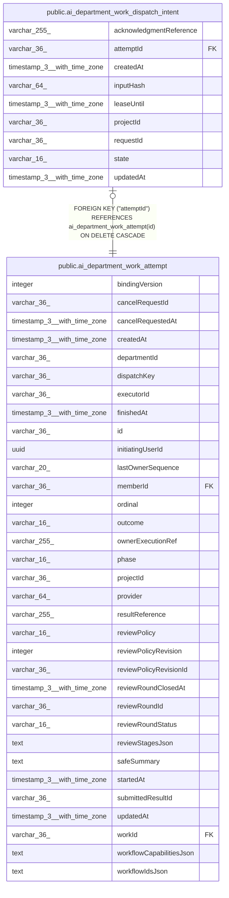

# public.ai_department_work_dispatch_intent

## Columns

| Name | Type | Default | Nullable | Children | Parents | Comment |
| ---- | ---- | ------- | -------- | -------- | ------- | ------- |
| acknowledgmentReference | varchar(255) |  | true |  |  |  |
| attemptId | varchar(36) |  | false |  | [public.ai_department_work_attempt](public.ai_department_work_attempt.md) |  |
| createdAt | timestamp(3) with time zone | CURRENT_TIMESTAMP(3) | false |  |  |  |
| inputHash | varchar(64) |  | false |  |  |  |
| leaseUntil | timestamp(3) with time zone |  | true |  |  |  |
| projectId | varchar(36) |  | false |  |  |  |
| requestId | varchar(36) |  | false |  |  |  |
| state | varchar(16) | 'pending'::character varying | false |  |  |  |
| updatedAt | timestamp(3) with time zone | CURRENT_TIMESTAMP(3) | false |  |  |  |

## Constraints

| Name | Type | Definition |
| ---- | ---- | ---------- |
| FK_d64978aab6915ed4e346ea37fa4 | FOREIGN KEY | FOREIGN KEY ("attemptId") REFERENCES ai_department_work_attempt(id) ON DELETE CASCADE |
| PK_d64978aab6915ed4e346ea37fa4 | PRIMARY KEY | PRIMARY KEY ("attemptId") |
| ai_department_work_dispatch_intent_attemptId_not_null | n | NOT NULL "attemptId" |
| ai_department_work_dispatch_intent_createdAt_not_null | n | NOT NULL "createdAt" |
| ai_department_work_dispatch_intent_inputHash_not_null | n | NOT NULL "inputHash" |
| ai_department_work_dispatch_intent_projectId_not_null | n | NOT NULL "projectId" |
| ai_department_work_dispatch_intent_requestId_not_null | n | NOT NULL "requestId" |
| ai_department_work_dispatch_intent_state_not_null | n | NOT NULL state |
| ai_department_work_dispatch_intent_updatedAt_not_null | n | NOT NULL "updatedAt" |

## Indexes

| Name | Definition |
| ---- | ---------- |
| PK_d64978aab6915ed4e346ea37fa4 | CREATE UNIQUE INDEX "PK_d64978aab6915ed4e346ea37fa4" ON public.ai_department_work_dispatch_intent USING btree ("attemptId") |

## Relations

---

> Generated by [tbls](https://github.com/k1LoW/tbls)
