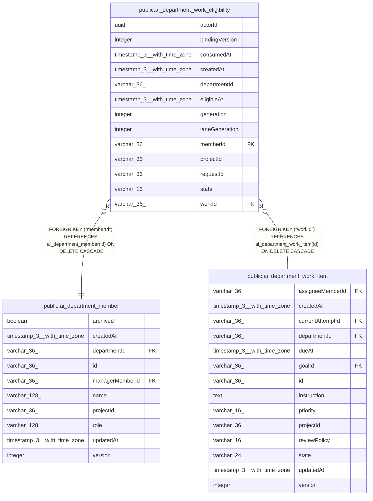

# public.ai_department_work_eligibility

## Columns

| Name | Type | Default | Nullable | Children | Parents | Comment |
| ---- | ---- | ------- | -------- | -------- | ------- | ------- |
| actorId | uuid |  | false |  |  |  |
| bindingVersion | integer |  | true |  |  |  |
| consumedAt | timestamp(3) with time zone |  | true |  |  |  |
| createdAt | timestamp(3) with time zone | CURRENT_TIMESTAMP(3) | false |  |  |  |
| departmentId | varchar(36) |  | false |  |  |  |
| eligibleAt | timestamp(3) with time zone |  | false |  |  |  |
| generation | integer |  | false |  |  |  |
| laneGeneration | integer |  | false |  |  |  |
| memberId | varchar(36) |  | false |  | [public.ai_department_member](public.ai_department_member.md) |  |
| projectId | varchar(36) |  | false |  |  |  |
| requestId | varchar(36) |  | false |  |  |  |
| state | varchar(16) |  | false |  |  | The lifecycle state of this durable work eligibility |
| workId | varchar(36) |  | false |  | [public.ai_department_work_item](public.ai_department_work_item.md) |  |

## Constraints

| Name | Type | Definition |
| ---- | ---- | ---------- |
| CHK_ai_department_work_eligibility_state | CHECK | CHECK (((state)::text = ANY ((ARRAY['pending'::character varying, 'reserved'::character varying, 'consumed'::character varying, 'cancelled'::character varying])::text[]))) |
| FK_30464d9c45a497150624ccb5e95 | FOREIGN KEY | FOREIGN KEY ("workId") REFERENCES ai_department_work_item(id) ON DELETE CASCADE |
| FK_44acfb40cae17273b8f0cf45c85 | FOREIGN KEY | FOREIGN KEY ("memberId") REFERENCES ai_department_member(id) ON DELETE CASCADE |
| PK_556145637a22d64d48f53710c56 | PRIMARY KEY | PRIMARY KEY ("workId", generation) |
| ai_department_work_eligibility_actorId_not_null | n | NOT NULL "actorId" |
| ai_department_work_eligibility_createdAt_not_null | n | NOT NULL "createdAt" |
| ai_department_work_eligibility_departmentId_not_null | n | NOT NULL "departmentId" |
| ai_department_work_eligibility_eligibleAt_not_null | n | NOT NULL "eligibleAt" |
| ai_department_work_eligibility_generation_not_null | n | NOT NULL generation |
| ai_department_work_eligibility_laneGeneration_not_null | n | NOT NULL "laneGeneration" |
| ai_department_work_eligibility_memberId_not_null | n | NOT NULL "memberId" |
| ai_department_work_eligibility_projectId_not_null | n | NOT NULL "projectId" |
| ai_department_work_eligibility_requestId_not_null | n | NOT NULL "requestId" |
| ai_department_work_eligibility_state_not_null | n | NOT NULL state |
| ai_department_work_eligibility_workId_not_null | n | NOT NULL "workId" |

## Indexes

| Name | Definition |
| ---- | ---------- |
| IDX_ai_department_work_eligibility_projectId_memberId_actorId_b | CREATE INDEX "IDX_ai_department_work_eligibility_projectId_memberId_actorId_b" ON public.ai_department_work_eligibility USING btree ("projectId", "memberId", "actorId", "bindingVersion", state, "eligibleAt", "workId") |
| IDX_ai_department_work_eligibility_requestId | CREATE INDEX "IDX_ai_department_work_eligibility_requestId" ON public.ai_department_work_eligibility USING btree ("requestId") |
| PK_556145637a22d64d48f53710c56 | CREATE UNIQUE INDEX "PK_556145637a22d64d48f53710c56" ON public.ai_department_work_eligibility USING btree ("workId", generation) |

## Relations

---

> Generated by [tbls](https://github.com/k1LoW/tbls)
