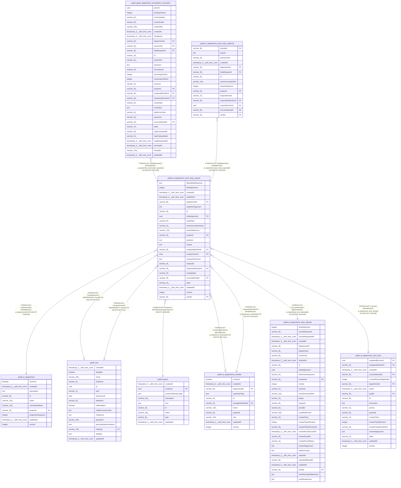

# public.ai_department_work_help_request

## Columns

| Name | Type | Default | Nullable | Children | Parents | Comment |
| ---- | ---- | ------- | -------- | -------- | ------- | ------- |
| attemptedStepsJson | text |  | false |  |  | Bounded help request steps |
| bindingVersion | integer |  | true |  |  | Executor binding revision used for routing |
| createdAt | timestamp(3) with time zone | CURRENT_TIMESTAMP(3) | false |  |  |  |
| deadlineAt | timestamp(3) with time zone |  | true |  |  |  |
| departmentId | varchar(36) |  | false |  | [public.ai_department](public.ai_department.md) |  |
| expertiseTagsJson | text |  | false |  |  | Normalized routing tags |
| id | varchar(36) |  | false | [public.agent_department_consultation_invocation](public.agent_department_consultation_invocation.md) [public.ai_department_work_help_response](public.ai_department_work_help_response.md) |  |  |
| initiatingUserId | uuid |  | true |  | [public.user](public.user.md) | User who initiated the help request |
| inputHash | varchar(64) |  | false |  |  |  |
| ownerInvocationHash | varchar(64) |  | true |  |  |  |
| ownerReference | varchar(128) |  | true |  |  |  |
| projectId | varchar(36) |  | false |  | [public.project](public.project.md) |  |
| question | text |  | false |  |  |  |
| reason | text |  | false |  |  |  |
| recipientMemberId | varchar(36) |  | true |  | [public.ai_department_member](public.ai_department_member.md) |  |
| recipientUserId | uuid |  | true |  | [public.user](public.user.md) |  |
| requestChainJson | text |  | false |  |  | Recipient and request chain state |
| requestId | varchar(36) |  | false |  |  |  |
| requesterMemberId | varchar(36) |  | false |  | [public.ai_department_member](public.ai_department_member.md) |  |
| routingState | varchar(32) |  | false |  |  | Selected deterministic routing stage |
| sourceAttemptId | varchar(36) |  | false |  | [public.ai_department_work_attempt](public.ai_department_work_attempt.md) |  |
| state | varchar(24) | 'pending_stop'::character varying | false |  |  | Help request lifecycle state |
| updatedAt | timestamp(3) with time zone | CURRENT_TIMESTAMP(3) | false |  |  |  |
| version | integer | 1 | false |  |  |  |
| workId | varchar(36) |  | false |  | [public.ai_department_work_item](public.ai_department_work_item.md) |  |

## Constraints

| Name | Type | Definition |
| ---- | ---- | ---------- |
| CHK_ai_department_work_help_request_routingState | CHECK | CHECK ((("routingState")::text = ANY ((ARRAY['specialist'::character varying, 'manager_fallback'::character varying, 'assignment_actor_fallback'::character varying, 'unresolved'::character varying])::text[]))) |
| CHK_ai_department_work_help_request_state | CHECK | CHECK (((state)::text = ANY ((ARRAY['pending_stop'::character varying, 'queued'::character varying, 'awaiting_answer'::character varying, 'answered'::character varying, 'escalating'::character varying, 'expired'::character varying, 'failed'::character varying, 'cancelled'::character varying])::text[]))) |
| FK_41cca1db9e76943cd6f93e9c573 | FOREIGN KEY | FOREIGN KEY ("projectId") REFERENCES project(id) ON DELETE CASCADE |
| FK_4a9ec7855d9d1a848feec1cc7f6 | FOREIGN KEY | FOREIGN KEY ("recipientMemberId") REFERENCES ai_department_member(id) ON DELETE SET NULL |
| FK_4df918e1c6ffc1f3e35f450ec75 | FOREIGN KEY | FOREIGN KEY ("workId") REFERENCES ai_department_work_item(id) ON DELETE CASCADE |
| FK_5ddfbc0ddd7cdcc59bd6c5d887c | FOREIGN KEY | FOREIGN KEY ("initiatingUserId") REFERENCES "user"(id) ON DELETE SET NULL |
| FK_94c0e6a11cbf26dda4a6a9f58c5 | FOREIGN KEY | FOREIGN KEY ("requesterMemberId") REFERENCES ai_department_member(id) ON DELETE CASCADE |
| FK_d746422a09ac94b8c2129babb58 | FOREIGN KEY | FOREIGN KEY ("sourceAttemptId") REFERENCES ai_department_work_attempt(id) ON DELETE CASCADE |
| FK_dbacd08ca0466c626113bf49027 | FOREIGN KEY | FOREIGN KEY ("departmentId") REFERENCES ai_department(id) ON DELETE CASCADE |
| PK_dd81dee2c11df7d3a46c6b34e08 | PRIMARY KEY | PRIMARY KEY (id) |
| ai_department_work_help_request_attemptedStepsJson_not_null | n | NOT NULL "attemptedStepsJson" |
| ai_department_work_help_request_createdAt_not_null | n | NOT NULL "createdAt" |
| ai_department_work_help_request_departmentId_not_null | n | NOT NULL "departmentId" |
| ai_department_work_help_request_expertiseTagsJson_not_null | n | NOT NULL "expertiseTagsJson" |
| ai_department_work_help_request_id_not_null | n | NOT NULL id |
| ai_department_work_help_request_inputHash_not_null | n | NOT NULL "inputHash" |
| ai_department_work_help_request_projectId_not_null | n | NOT NULL "projectId" |
| ai_department_work_help_request_question_not_null | n | NOT NULL question |
| ai_department_work_help_request_reason_not_null | n | NOT NULL reason |
| ai_department_work_help_request_recipientUserId_fkey | FOREIGN KEY | FOREIGN KEY ("recipientUserId") REFERENCES "user"(id) ON DELETE SET NULL |
| ai_department_work_help_request_requestChainJson_not_null | n | NOT NULL "requestChainJson" |
| ai_department_work_help_request_requestId_not_null | n | NOT NULL "requestId" |
| ai_department_work_help_request_requesterMemberId_not_null | n | NOT NULL "requesterMemberId" |
| ai_department_work_help_request_routingState_not_null | n | NOT NULL "routingState" |
| ai_department_work_help_request_sourceAttemptId_not_null | n | NOT NULL "sourceAttemptId" |
| ai_department_work_help_request_state_not_null | n | NOT NULL state |
| ai_department_work_help_request_updatedAt_not_null | n | NOT NULL "updatedAt" |
| ai_department_work_help_request_version_not_null | n | NOT NULL version |
| ai_department_work_help_request_workId_not_null | n | NOT NULL "workId" |

## Indexes

| Name | Definition |
| ---- | ---------- |
| IDX_63eb193a370876c6b357d5a51f | CREATE INDEX "IDX_63eb193a370876c6b357d5a51f" ON public.ai_department_work_help_request USING btree ("projectId", "departmentId", "workId", "createdAt") |
| IDX_763f82fe1b9e605925747d52bf | CREATE UNIQUE INDEX "IDX_763f82fe1b9e605925747d52bf" ON public.ai_department_work_help_request USING btree ("projectId", "initiatingUserId", "requestId") |
| IDX_f3a13473c2e6d7fd4b0cf63928 | CREATE INDEX "IDX_f3a13473c2e6d7fd4b0cf63928" ON public.ai_department_work_help_request USING btree ("projectId", "departmentId", state, "deadlineAt") |
| PK_dd81dee2c11df7d3a46c6b34e08 | CREATE UNIQUE INDEX "PK_dd81dee2c11df7d3a46c6b34e08" ON public.ai_department_work_help_request USING btree (id) |

## Relations

---

> Generated by [tbls](https://github.com/k1LoW/tbls)
