# public.ai_department_work_help_response

## Columns

| Name | Type | Default | Nullable | Children | Parents | Comment |
| ---- | ---- | ------- | -------- | -------- | ------- | ------- |
| activityId | varchar(36) |  | false |  | [public.ai_department_work_activity](public.ai_department_work_activity.md) |  |
| answer | text |  | false |  |  |  |
| answerHash | varchar(64) |  | false |  |  |  |
| createdAt | timestamp(3) with time zone |  | false |  |  |  |
| departmentId | varchar(36) |  | false |  | [public.ai_department](public.ai_department.md) |  |
| helpRequestId | varchar(36) |  | false |  | [public.ai_department_work_help_request](public.ai_department_work_help_request.md) |  |
| id | varchar(36) |  | false |  |  |  |
| ownerInvocationRef | varchar(128) |  | true |  |  |  |
| ownerSequence | integer |  | true |  |  |  |
| projectId | varchar(36) |  | false |  | [public.project](public.project.md) |  |
| responderKind | varchar(16) |  | false |  |  | Kind of responder |
| responderMemberId | varchar(36) |  | true |  | [public.ai_department_member](public.ai_department_member.md) |  |
| responderUserId | uuid |  | true |  | [public.user](public.user.md) |  |
| sourceAttemptId | varchar(36) |  | true |  | [public.ai_department_work_attempt](public.ai_department_work_attempt.md) |  |
| workId | varchar(36) |  | false |  | [public.ai_department_work_item](public.ai_department_work_item.md) |  |

## Constraints

| Name | Type | Definition |
| ---- | ---- | ---------- |
| CHK_ai_department_work_help_response_responderKind | CHECK | CHECK ((("responderKind")::text = ANY ((ARRAY['user'::character varying, 'agent'::character varying])::text[]))) |
| FK_1cf32b1cc1424438c2d9b9e9b26 | FOREIGN KEY | FOREIGN KEY ("responderMemberId") REFERENCES ai_department_member(id) ON DELETE SET NULL |
| FK_2f879e4adbaac647d00507ac72d | FOREIGN KEY | FOREIGN KEY ("sourceAttemptId") REFERENCES ai_department_work_attempt(id) ON DELETE SET NULL |
| FK_31151f91b6c43a74e4c3c548e21 | FOREIGN KEY | FOREIGN KEY ("departmentId") REFERENCES ai_department(id) ON DELETE CASCADE |
| FK_318d7cfc4e34dbdf0e1e7550157 | FOREIGN KEY | FOREIGN KEY ("activityId") REFERENCES ai_department_work_activity(id) ON DELETE CASCADE |
| FK_34aec2eb6b29baee25919fe6bc8 | FOREIGN KEY | FOREIGN KEY ("helpRequestId") REFERENCES ai_department_work_help_request(id) ON DELETE CASCADE |
| FK_3be648eee23ccd8d49d3755958b | FOREIGN KEY | FOREIGN KEY ("responderUserId") REFERENCES "user"(id) ON DELETE SET NULL |
| FK_54d036e5951ad0f0b254375132c | FOREIGN KEY | FOREIGN KEY ("workId") REFERENCES ai_department_work_item(id) ON DELETE CASCADE |
| FK_a2301dca31c8341a0712eb636ff | FOREIGN KEY | FOREIGN KEY ("projectId") REFERENCES project(id) ON DELETE CASCADE |
| PK_dd06e1d247eb08378098837cb1e | PRIMARY KEY | PRIMARY KEY (id) |
| ai_department_work_help_response_activityId_not_null | n | NOT NULL "activityId" |
| ai_department_work_help_response_answerHash_not_null | n | NOT NULL "answerHash" |
| ai_department_work_help_response_answer_not_null | n | NOT NULL answer |
| ai_department_work_help_response_createdAt_not_null | n | NOT NULL "createdAt" |
| ai_department_work_help_response_departmentId_not_null | n | NOT NULL "departmentId" |
| ai_department_work_help_response_helpRequestId_not_null | n | NOT NULL "helpRequestId" |
| ai_department_work_help_response_id_not_null | n | NOT NULL id |
| ai_department_work_help_response_projectId_not_null | n | NOT NULL "projectId" |
| ai_department_work_help_response_responderKind_not_null | n | NOT NULL "responderKind" |
| ai_department_work_help_response_workId_not_null | n | NOT NULL "workId" |

## Indexes

| Name | Definition |
| ---- | ---------- |
| IDX_1cb384b008fc84483a4a7064b6 | CREATE INDEX "IDX_1cb384b008fc84483a4a7064b6" ON public.ai_department_work_help_response USING btree ("projectId", "workId", "createdAt") |
| IDX_34aec2eb6b29baee25919fe6bc | CREATE UNIQUE INDEX "IDX_34aec2eb6b29baee25919fe6bc" ON public.ai_department_work_help_response USING btree ("helpRequestId") |
| PK_dd06e1d247eb08378098837cb1e | CREATE UNIQUE INDEX "PK_dd06e1d247eb08378098837cb1e" ON public.ai_department_work_help_response USING btree (id) |

## Relations

```mermaid
erDiagram

"public.ai_department_work_help_response" }o--|| "public.ai_department_work_activity" : "FOREIGN KEY (#quot;activityId#quot;) REFERENCES ai_department_work_activity(id) ON DELETE CASCADE"
"public.ai_department_work_help_response" }o--|| "public.ai_department" : "FOREIGN KEY (#quot;departmentId#quot;) REFERENCES ai_department(id) ON DELETE CASCADE"
"public.ai_department_work_help_response" }o--|| "public.ai_department_work_help_request" : "FOREIGN KEY (#quot;helpRequestId#quot;) REFERENCES ai_department_work_help_request(id) ON DELETE CASCADE"
"public.ai_department_work_help_response" }o--|| "public.project" : "FOREIGN KEY (#quot;projectId#quot;) REFERENCES project(id) ON DELETE CASCADE"
"public.ai_department_work_help_response" }o--o| "public.ai_department_member" : "FOREIGN KEY (#quot;responderMemberId#quot;) REFERENCES ai_department_member(id) ON DELETE SET NULL"
"public.ai_department_work_help_response" }o--o| "public.user" : "FOREIGN KEY (#quot;responderUserId#quot;) REFERENCES #quot;user#quot;(id) ON DELETE SET NULL"
"public.ai_department_work_help_response" }o--o| "public.ai_department_work_attempt" : "FOREIGN KEY (#quot;sourceAttemptId#quot;) REFERENCES ai_department_work_attempt(id) ON DELETE SET NULL"
"public.ai_department_work_help_response" }o--|| "public.ai_department_work_item" : "FOREIGN KEY (#quot;workId#quot;) REFERENCES ai_department_work_item(id) ON DELETE CASCADE"

"public.ai_department_work_help_response" {
  varchar_36_ activityId FK
  text answer
  varchar_64_ answerHash
  timestamp_3__with_time_zone createdAt
  varchar_36_ departmentId FK
  varchar_36_ helpRequestId FK
  varchar_36_ id
  varchar_128_ ownerInvocationRef
  integer ownerSequence
  varchar_36_ projectId FK
  varchar_16_ responderKind
  varchar_36_ responderMemberId FK
  uuid responderUserId FK
  varchar_36_ sourceAttemptId FK
  varchar_36_ workId FK
}
"public.ai_department_work_activity" {
  varchar_36_ actorId
  varchar_16_ actorKind
  varchar_36_ attemptId
  text body
  timestamp_3__with_time_zone createdAt
  varchar_36_ departmentId
  varchar_36_ id
  varchar_32_ kind
  varchar_36_ projectId
  varchar_36_ workId FK
  integer workVersion
}
"public.ai_department" {
  boolean archived
  timestamp_3__with_time_zone createdAt
  text description
  varchar_36_ id
  varchar_128_ name
  varchar_128_ normalizedName
  varchar_36_ projectId FK
  integer projectionSequence
  timestamp_3__with_time_zone updatedAt
  integer version
}
"public.ai_department_work_help_request" {
  text attemptedStepsJson
  integer bindingVersion
  timestamp_3__with_time_zone createdAt
  timestamp_3__with_time_zone deadlineAt
  varchar_36_ departmentId FK
  text expertiseTagsJson
  varchar_36_ id
  uuid initiatingUserId FK
  varchar_64_ inputHash
  varchar_64_ ownerInvocationHash
  varchar_128_ ownerReference
  varchar_36_ projectId FK
  text question
  text reason
  varchar_36_ recipientMemberId FK
  uuid recipientUserId FK
  text requestChainJson
  varchar_36_ requestId
  varchar_36_ requesterMemberId FK
  varchar_32_ routingState
  varchar_36_ sourceAttemptId FK
  varchar_24_ state
  timestamp_3__with_time_zone updatedAt
  integer version
  varchar_36_ workId FK
}
"public.project" {
  timestamp_3__with_time_zone createdAt
  uuid creatorId FK
  json customTelemetryTags
  varchar_512_ description
  json icon
  varchar_36_ id
  varchar_255_ name
  varchar_36_ type
  timestamp_3__with_time_zone updatedAt
}
"public.ai_department_member" {
  boolean archived
  timestamp_3__with_time_zone createdAt
  varchar_36_ departmentId FK
  json expertiseTags
  varchar_36_ id
  varchar_36_ managerMemberId FK
  varchar_128_ name
  varchar_36_ projectId
  varchar_128_ role
  timestamp_3__with_time_zone updatedAt
  integer version
}
"public.user" {
  timestamp_3__with_time_zone createdAt
  boolean disabled
  varchar_255_ email
  varchar_32_ firstName
  uuid id
  varchar_16_ kind
  date lastActiveAt
  varchar_32_ lastName
  boolean mfaEnabled
  text mfaRecoveryCodes
  text mfaSecret
  varchar_255_ password
  json personalizationAnswers
  varchar_128_ roleSlug FK
  json settings
  timestamp_3__with_time_zone updatedAt
}
"public.ai_department_work_attempt" {
  integer bindingVersion
  varchar_36_ cancelRequestId
  timestamp_3__with_time_zone cancelRequestedAt
  timestamp_3__with_time_zone createdAt
  varchar_36_ departmentId
  varchar_36_ dispatchKey
  varchar_36_ executorId
  timestamp_3__with_time_zone finishedAt
  varchar_36_ id
  uuid initiatingUserId
  varchar_20_ lastOwnerSequence
  varchar_36_ memberId FK
  integer ordinal
  varchar_16_ outcome
  varchar_255_ ownerExecutionRef
  varchar_16_ phase
  varchar_36_ projectId
  varchar_64_ provider
  varchar_255_ resultReference
  varchar_16_ reviewPolicy
  integer reviewPolicyRevision
  varchar_36_ reviewPolicyRevisionId
  timestamp_3__with_time_zone reviewRoundClosedAt
  varchar_36_ reviewRoundId
  varchar_16_ reviewRoundStatus
  text reviewStagesJson
  text safeSummary
  timestamp_3__with_time_zone startedAt
  varchar_36_ submittedResultId
  timestamp_3__with_time_zone updatedAt
  varchar_36_ workId FK
  text workflowCapabilitiesJson
  text workflowIdsJson
}
"public.ai_department_work_item" {
  uuid assignedByUserId FK
  varchar_36_ assigneeMemberId FK
  timestamp_3__with_time_zone createdAt
  varchar_36_ currentAttemptId FK
  integer currentReviewStageIndex
  varchar_36_ departmentId FK
  timestamp_3__with_time_zone dueAt
  varchar_36_ goalId FK
  varchar_36_ id
  text instruction
  varchar_16_ priority
  varchar_36_ projectId
  varchar_16_ reviewPolicy
  integer reviewPolicyRevision
  varchar_36_ reviewPolicyRevisionId
  text reviewStagesJson
  varchar_24_ state
  timestamp_3__with_time_zone updatedAt
  integer version
}
```

---

> Generated by [tbls](https://github.com/k1LoW/tbls)
