# public.ai_department_work_item

## Columns

| Name | Type | Default | Nullable | Children | Parents | Comment |
| ---- | ---- | ------- | -------- | -------- | ------- | ------- |
| assignedByUserId | uuid |  | true |  | [public.user](public.user.md) |  |
| assigneeMemberId | varchar(36) |  | true |  | [public.ai_department_member](public.ai_department_member.md) |  |
| createdAt | timestamp(3) with time zone | CURRENT_TIMESTAMP(3) | false |  |  |  |
| currentAttemptId | varchar(36) |  | true |  | [public.ai_department_work_attempt](public.ai_department_work_attempt.md) |  |
| currentReviewStageIndex | integer | 0 | false |  |  |  |
| departmentId | varchar(36) |  | false |  | [public.ai_department](public.ai_department.md) |  |
| dueAt | timestamp(3) with time zone |  | true |  |  |  |
| goalId | varchar(36) |  | true |  | [public.ai_department_goal](public.ai_department_goal.md) |  |
| id | varchar(36) |  | false | [public.ai_department_work_activity](public.ai_department_work_activity.md) [public.ai_department_work_attempt](public.ai_department_work_attempt.md) [public.ai_department_work_claim](public.ai_department_work_claim.md) [public.ai_department_work_eligibility](public.ai_department_work_eligibility.md) [public.ai_department_work_handoff_intent](public.ai_department_work_handoff_intent.md) [public.ai_department_work_help_request](public.ai_department_work_help_request.md) [public.ai_department_work_help_response](public.ai_department_work_help_response.md) [public.ai_department_work_owner_event_receipt](public.ai_department_work_owner_event_receipt.md) [public.ai_department_work_relationship](public.ai_department_work_relationship.md) [public.ai_department_work_release_intent](public.ai_department_work_release_intent.md) [public.ai_department_work_review_decision](public.ai_department_work_review_decision.md) [public.ai_department_work_review_policy_revision](public.ai_department_work_review_policy_revision.md) [public.ai_department_work_review_round](public.ai_department_work_review_round.md) [public.ai_department_work_submitted_result](public.ai_department_work_submitted_result.md) [public.ai_department_work_transition](public.ai_department_work_transition.md) [public.ai_department_work_wake_intent](public.ai_department_work_wake_intent.md) [public.ai_department_workflow_invocation](public.ai_department_workflow_invocation.md) |  |  |
| instruction | text |  | false |  |  |  |
| priority | varchar(16) | 'normal'::character varying | false |  |  |  |
| projectId | varchar(36) |  | false |  |  |  |
| reviewPolicy | varchar(16) | 'required'::character varying | false |  |  |  |
| reviewPolicyRevision | integer | 1 | false |  |  |  |
| reviewPolicyRevisionId | varchar(36) |  | true |  |  |  |
| reviewStagesJson | text |  | true |  |  |  |
| state | varchar(24) | 'backlog'::character varying | false |  |  |  |
| updatedAt | timestamp(3) with time zone | CURRENT_TIMESTAMP(3) | false |  |  |  |
| version | integer | 1 | false |  |  |  |

## Constraints

| Name | Type | Definition |
| ---- | ---- | ---------- |
| FK_5446b8332dd1ed2c5215313cf07 | FOREIGN KEY | FOREIGN KEY ("currentAttemptId") REFERENCES ai_department_work_attempt(id) ON DELETE SET NULL |
| FK_8b7a3a6a9de05459733d15b0dfe | FOREIGN KEY | FOREIGN KEY ("goalId") REFERENCES ai_department_goal(id) ON DELETE SET NULL |
| FK_ac5c0333adade30f4a8b620f6c1 | FOREIGN KEY | FOREIGN KEY ("assigneeMemberId") REFERENCES ai_department_member(id) ON DELETE SET NULL |
| FK_db8bce2588b750616a00afd904b | FOREIGN KEY | FOREIGN KEY ("departmentId") REFERENCES ai_department(id) ON DELETE CASCADE |
| PK_d07aaef1e81a3ff6386efb5f3a6 | PRIMARY KEY | PRIMARY KEY (id) |
| ai_department_work_item_assignedByUserId_fkey | FOREIGN KEY | FOREIGN KEY ("assignedByUserId") REFERENCES "user"(id) ON DELETE SET NULL |
| ai_department_work_item_createdAt_not_null | n | NOT NULL "createdAt" |
| ai_department_work_item_currentReviewStageIndex_not_null | n | NOT NULL "currentReviewStageIndex" |
| ai_department_work_item_departmentId_not_null | n | NOT NULL "departmentId" |
| ai_department_work_item_id_not_null | n | NOT NULL id |
| ai_department_work_item_instruction_not_null | n | NOT NULL instruction |
| ai_department_work_item_priority_not_null | n | NOT NULL priority |
| ai_department_work_item_projectId_not_null | n | NOT NULL "projectId" |
| ai_department_work_item_reviewPolicyRevision_not_null | n | NOT NULL "reviewPolicyRevision" |
| ai_department_work_item_reviewPolicy_not_null | n | NOT NULL "reviewPolicy" |
| ai_department_work_item_state_not_null | n | NOT NULL state |
| ai_department_work_item_updatedAt_not_null | n | NOT NULL "updatedAt" |
| ai_department_work_item_version_not_null | n | NOT NULL version |

## Indexes

| Name | Definition |
| ---- | ---------- |
| IDX_0e4fcacec2474277bd92fba21a | CREATE INDEX "IDX_0e4fcacec2474277bd92fba21a" ON public.ai_department_work_item USING btree ("projectId", "departmentId", state, "createdAt") |
| IDX_43fdd5829ee99e93399c20d422 | CREATE INDEX "IDX_43fdd5829ee99e93399c20d422" ON public.ai_department_work_item USING btree ("departmentId", "assigneeMemberId", state) |
| IDX_6976a655c17e8e13951ce28388 | CREATE INDEX "IDX_6976a655c17e8e13951ce28388" ON public.ai_department_work_item USING btree ("departmentId", "goalId") |
| IDX_ai_department_work_item_currentAttemptId | CREATE INDEX "IDX_ai_department_work_item_currentAttemptId" ON public.ai_department_work_item USING btree ("currentAttemptId") |
| IDX_ai_department_work_item_projectId_id | CREATE UNIQUE INDEX "IDX_ai_department_work_item_projectId_id" ON public.ai_department_work_item USING btree ("projectId", id) |
| PK_d07aaef1e81a3ff6386efb5f3a6 | CREATE UNIQUE INDEX "PK_d07aaef1e81a3ff6386efb5f3a6" ON public.ai_department_work_item USING btree (id) |

## Relations

```mermaid
erDiagram

"public.ai_department_work_item" }o--o| "public.user" : "FOREIGN KEY (#quot;assignedByUserId#quot;) REFERENCES #quot;user#quot;(id) ON DELETE SET NULL"
"public.ai_department_work_item" }o--o| "public.ai_department_member" : "FOREIGN KEY (#quot;assigneeMemberId#quot;) REFERENCES ai_department_member(id) ON DELETE SET NULL"
"public.ai_department_work_item" }o--o| "public.ai_department_work_attempt" : "FOREIGN KEY (#quot;currentAttemptId#quot;) REFERENCES ai_department_work_attempt(id) ON DELETE SET NULL"
"public.ai_department_work_item" }o--|| "public.ai_department" : "FOREIGN KEY (#quot;departmentId#quot;) REFERENCES ai_department(id) ON DELETE CASCADE"
"public.ai_department_work_item" }o--o| "public.ai_department_goal" : "FOREIGN KEY (#quot;goalId#quot;) REFERENCES ai_department_goal(id) ON DELETE SET NULL"
"public.ai_department_work_activity" }o--|| "public.ai_department_work_item" : "FOREIGN KEY (#quot;workId#quot;) REFERENCES ai_department_work_item(id) ON DELETE CASCADE"
"public.ai_department_work_attempt" }o--|| "public.ai_department_work_item" : "FOREIGN KEY (#quot;workId#quot;) REFERENCES ai_department_work_item(id) ON DELETE CASCADE"
"public.ai_department_work_claim" }o--|| "public.ai_department_work_item" : "FOREIGN KEY (#quot;workId#quot;) REFERENCES ai_department_work_item(id) ON DELETE CASCADE"
"public.ai_department_work_eligibility" }o--|| "public.ai_department_work_item" : "FOREIGN KEY (#quot;workId#quot;) REFERENCES ai_department_work_item(id) ON DELETE CASCADE"
"public.ai_department_work_handoff_intent" }o--|| "public.ai_department_work_item" : "FOREIGN KEY (#quot;workId#quot;) REFERENCES ai_department_work_item(id) ON DELETE CASCADE"
"public.ai_department_work_help_request" }o--|| "public.ai_department_work_item" : "FOREIGN KEY (#quot;workId#quot;) REFERENCES ai_department_work_item(id) ON DELETE CASCADE"
"public.ai_department_work_help_response" }o--|| "public.ai_department_work_item" : "FOREIGN KEY (#quot;workId#quot;) REFERENCES ai_department_work_item(id) ON DELETE CASCADE"
"public.ai_department_work_owner_event_receipt" }o--|| "public.ai_department_work_item" : "FOREIGN KEY (#quot;workId#quot;) REFERENCES ai_department_work_item(id) ON DELETE CASCADE"
"public.ai_department_work_relationship" }o--|| "public.ai_department_work_item" : "FOREIGN KEY (#quot;relatedWorkId#quot;) REFERENCES ai_department_work_item(id) ON DELETE CASCADE"
"public.ai_department_work_relationship" }o--|| "public.ai_department_work_item" : "FOREIGN KEY (#quot;workId#quot;) REFERENCES ai_department_work_item(id) ON DELETE CASCADE"
"public.ai_department_work_release_intent" }o--|| "public.ai_department_work_item" : "FOREIGN KEY (#quot;workId#quot;) REFERENCES ai_department_work_item(id) ON DELETE CASCADE"
"public.ai_department_work_review_decision" }o--|| "public.ai_department_work_item" : "FOREIGN KEY (#quot;workId#quot;) REFERENCES ai_department_work_item(id) ON DELETE CASCADE"
"public.ai_department_work_review_policy_revision" }o--|| "public.ai_department_work_item" : "FOREIGN KEY (#quot;workId#quot;) REFERENCES ai_department_work_item(id) ON DELETE CASCADE"
"public.ai_department_work_review_round" }o--|| "public.ai_department_work_item" : "FOREIGN KEY (#quot;workId#quot;) REFERENCES ai_department_work_item(id) ON DELETE CASCADE"
"public.ai_department_work_submitted_result" }o--|| "public.ai_department_work_item" : "FOREIGN KEY (#quot;workId#quot;) REFERENCES ai_department_work_item(id) ON DELETE CASCADE"
"public.ai_department_work_transition" }o--|| "public.ai_department_work_item" : "FOREIGN KEY (#quot;workId#quot;) REFERENCES ai_department_work_item(id) ON DELETE CASCADE"
"public.ai_department_work_wake_intent" |o--|| "public.ai_department_work_item" : "FOREIGN KEY (#quot;workId#quot;) REFERENCES ai_department_work_item(id) ON DELETE CASCADE"
"public.ai_department_workflow_invocation" }o--|| "public.ai_department_work_item" : "FOREIGN KEY (#quot;workId#quot;) REFERENCES ai_department_work_item(id) ON DELETE CASCADE"

"public.ai_department_work_item" {
  uuid assignedByUserId FK
  varchar_36_ assigneeMemberId FK
  timestamp_3__with_time_zone createdAt
  varchar_36_ currentAttemptId FK
  integer currentReviewStageIndex
  varchar_36_ departmentId FK
  timestamp_3__with_time_zone dueAt
  varchar_36_ goalId FK
  varchar_36_ id
  text instruction
  varchar_16_ priority
  varchar_36_ projectId
  varchar_16_ reviewPolicy
  integer reviewPolicyRevision
  varchar_36_ reviewPolicyRevisionId
  text reviewStagesJson
  varchar_24_ state
  timestamp_3__with_time_zone updatedAt
  integer version
}
"public.user" {
  timestamp_3__with_time_zone createdAt
  boolean disabled
  varchar_255_ email
  varchar_32_ firstName
  uuid id
  varchar_16_ kind
  date lastActiveAt
  varchar_32_ lastName
  boolean mfaEnabled
  text mfaRecoveryCodes
  text mfaSecret
  varchar_255_ password
  json personalizationAnswers
  varchar_128_ roleSlug FK
  json settings
  timestamp_3__with_time_zone updatedAt
}
"public.ai_department_member" {
  boolean archived
  timestamp_3__with_time_zone createdAt
  varchar_36_ departmentId FK
  json expertiseTags
  varchar_36_ id
  varchar_36_ managerMemberId FK
  varchar_128_ name
  varchar_36_ projectId
  varchar_128_ role
  timestamp_3__with_time_zone updatedAt
  integer version
}
"public.ai_department_work_attempt" {
  integer bindingVersion
  varchar_36_ cancelRequestId
  timestamp_3__with_time_zone cancelRequestedAt
  timestamp_3__with_time_zone createdAt
  varchar_36_ departmentId
  varchar_36_ dispatchKey
  varchar_36_ executorId
  timestamp_3__with_time_zone finishedAt
  varchar_36_ id
  uuid initiatingUserId
  varchar_20_ lastOwnerSequence
  varchar_36_ memberId FK
  integer ordinal
  varchar_16_ outcome
  varchar_255_ ownerExecutionRef
  varchar_16_ phase
  varchar_36_ projectId
  varchar_64_ provider
  varchar_255_ resultReference
  varchar_16_ reviewPolicy
  integer reviewPolicyRevision
  varchar_36_ reviewPolicyRevisionId
  timestamp_3__with_time_zone reviewRoundClosedAt
  varchar_36_ reviewRoundId
  varchar_16_ reviewRoundStatus
  text reviewStagesJson
  text safeSummary
  timestamp_3__with_time_zone startedAt
  varchar_36_ submittedResultId
  timestamp_3__with_time_zone updatedAt
  varchar_36_ workId FK
  text workflowCapabilitiesJson
  text workflowIdsJson
}
"public.ai_department" {
  boolean archived
  timestamp_3__with_time_zone createdAt
  text description
  varchar_36_ id
  varchar_128_ name
  varchar_128_ normalizedName
  varchar_36_ projectId FK
  integer projectionSequence
  timestamp_3__with_time_zone updatedAt
  integer version
}
"public.ai_department_goal" {
  timestamp_3__with_time_zone createdAt
  varchar_36_ departmentId FK
  timestamp_3__with_time_zone dueAt
  varchar_36_ id
  varchar_36_ ownerMemberId FK
  varchar_36_ parentId FK
  varchar_36_ projectId
  varchar_16_ state
  text successCriteria
  varchar_256_ title
  timestamp_3__with_time_zone updatedAt
  integer version
}
"public.ai_department_work_activity" {
  varchar_36_ actorId
  varchar_16_ actorKind
  varchar_36_ attemptId
  text body
  timestamp_3__with_time_zone createdAt
  varchar_36_ departmentId
  varchar_36_ id
  varchar_32_ kind
  varchar_36_ projectId
  varchar_36_ workId FK
  integer workVersion
}
"public.ai_department_work_claim" {
  varchar_36_ attemptId FK
  integer claimGeneration
  timestamp_3__with_time_zone claimedAt
  timestamp_3__with_time_zone createdAt
  varchar_36_ departmentId
  varchar_36_ executionId
  varchar_36_ id
  timestamp_3__with_time_zone leaseUntil
  varchar_36_ memberId
  varchar_36_ projectId
  timestamp_3__with_time_zone releasedAt
  varchar_36_ workId FK
}
"public.ai_department_work_eligibility" {
  uuid actorId
  integer bindingVersion
  timestamp_3__with_time_zone consumedAt
  timestamp_3__with_time_zone createdAt
  varchar_36_ departmentId
  timestamp_3__with_time_zone eligibleAt
  integer generation
  integer laneGeneration
  varchar_36_ memberId FK
  varchar_36_ projectId
  varchar_36_ requestId
  varchar_16_ state
  varchar_36_ workId FK
}
"public.ai_department_work_handoff_intent" {
  uuid authorizedByUserId
  timestamp_3__with_time_zone completedAt
  timestamp_3__with_time_zone createdAt
  varchar_36_ departmentId
  integer destinationBindingVersion
  varchar_36_ destinationMemberId
  integer expectedWorkVersion
  varchar_36_ id
  varchar_36_ projectId
  text reason
  varchar_36_ requestId
  uuid requestedByActorId
  varchar_36_ requestedByMemberId
  varchar_36_ sourceAttemptId
  varchar_36_ sourceMemberId
  varchar_16_ state
  varchar_36_ stopCommandId
  varchar_36_ workId FK
}
"public.ai_department_work_help_request" {
  text attemptedStepsJson
  integer bindingVersion
  timestamp_3__with_time_zone createdAt
  timestamp_3__with_time_zone deadlineAt
  varchar_36_ departmentId FK
  text expertiseTagsJson
  varchar_36_ id
  uuid initiatingUserId FK
  varchar_64_ inputHash
  varchar_64_ ownerInvocationHash
  varchar_128_ ownerReference
  varchar_36_ projectId FK
  text question
  text reason
  varchar_36_ recipientMemberId FK
  uuid recipientUserId FK
  text requestChainJson
  varchar_36_ requestId
  varchar_36_ requesterMemberId FK
  varchar_32_ routingState
  varchar_36_ sourceAttemptId FK
  varchar_24_ state
  timestamp_3__with_time_zone updatedAt
  integer version
  varchar_36_ workId FK
}
"public.ai_department_work_help_response" {
  varchar_36_ activityId FK
  text answer
  varchar_64_ answerHash
  timestamp_3__with_time_zone createdAt
  varchar_36_ departmentId FK
  varchar_36_ helpRequestId FK
  varchar_36_ id
  varchar_128_ ownerInvocationRef
  integer ownerSequence
  varchar_36_ projectId FK
  varchar_16_ responderKind
  varchar_36_ responderMemberId FK
  uuid responderUserId FK
  varchar_36_ sourceAttemptId FK
  varchar_36_ workId FK
}
"public.ai_department_work_owner_event_receipt" {
  varchar_36_ attemptId FK
  timestamp_3__with_time_zone createdAt
  varchar_36_ id
  varchar_32_ kind
  timestamp_3__with_time_zone occurredAt
  varchar_255_ ownerEventId
  varchar_36_ projectId
  varchar_64_ provider
  timestamp_3__with_time_zone receivedAt
  text safeSummary
  integer schemaVersion
  varchar_20_ sequence
  timestamp_3__with_time_zone updatedAt
  varchar_36_ workId FK
}
"public.ai_department_work_relationship" {
  timestamp_3__with_time_zone createdAt
  varchar_36_ departmentId FK
  varchar_36_ id
  varchar_16_ kind
  varchar_36_ projectId
  varchar_36_ relatedWorkId FK
  timestamp_3__with_time_zone updatedAt
  varchar_36_ workId FK
}
"public.ai_department_work_release_intent" {
  timestamp_3__with_time_zone confirmedAt
  timestamp_3__with_time_zone createdAt
  varchar_36_ departmentId
  varchar_36_ id
  varchar_36_ projectId
  text reason
  varchar_36_ requestId
  uuid requestedByActorId
  varchar_36_ sourceAttemptId
  varchar_16_ state
  varchar_36_ stopCommandId
  boolean waitingForChildren
  varchar_36_ workId FK
}
"public.ai_department_work_review_decision" {
  uuid actorId
  varchar_36_ attemptId FK
  timestamp_3__with_time_zone createdAt
  varchar_16_ decision
  varchar_36_ departmentId
  varchar_36_ id
  integer priorVersion
  varchar_36_ projectId
  text reason
  varchar_36_ resultId
  varchar_36_ reviewRoundId
  varchar_64_ stageId
  varchar_36_ workId FK
}
"public.ai_department_work_review_policy_revision" {
  timestamp_3__with_time_zone createdAt
  uuid createdByUserId
  varchar_36_ departmentId
  varchar_36_ id
  varchar_16_ mode
  varchar_36_ projectId
  integer revision
  text stagesJson
  varchar_36_ workId FK
}
"public.ai_department_work_review_round" {
  varchar_64_ activeStageId
  varchar_36_ attemptId FK
  timestamp_3__with_time_zone closedAt
  timestamp_3__with_time_zone createdAt
  varchar_36_ departmentId
  varchar_36_ id
  integer ordinal
  varchar_36_ policyRevisionId FK
  varchar_36_ projectId
  uuid requesterId
  varchar_16_ requesterKind
  varchar_36_ resultId FK
  varchar_16_ status
  integer version
  varchar_36_ workId FK
}
"public.ai_department_work_submitted_result" {
  varchar_36_ attemptId FK
  timestamp_3__with_time_zone createdAt
  varchar_36_ departmentId
  varchar_36_ id
  varchar_36_ projectId
  varchar_255_ reference
  text safeSummary
  timestamp_3__with_time_zone submittedAt
  uuid submittedByUserId
  timestamp_3__with_time_zone updatedAt
  varchar_36_ workId FK
}
"public.ai_department_work_transition" {
  varchar_36_ actorId
  varchar_16_ actorKind
  varchar_36_ attemptId FK
  timestamp_3__with_time_zone createdAt
  varchar_36_ departmentId
  varchar_24_ fromState
  varchar_36_ id
  varchar_36_ projectId
  text reason
  varchar_24_ toState
  varchar_36_ workId FK
  integer workVersion
}
"public.ai_department_work_wake_intent" {
  uuid actorId
  timestamp_3__with_time_zone createdAt
  timestamp_3__with_time_zone deliveredAt
  varchar_36_ departmentId
  varchar_36_ projectId
  varchar_36_ requestId
  timestamp_3__with_time_zone retryAt
  varchar_36_ workId FK
}
"public.ai_department_workflow_invocation" {
  varchar_36_ actualWorkflowVersion
  varchar_36_ attemptId FK
  timestamp_3__with_time_zone cancelRequestedAt
  varchar_36_ capabilityId FK
  integer capabilityVersion
  varchar_16_ childState
  integer claimGeneration
  timestamp_3__with_time_zone createdAt
  varchar_16_ dispatchState
  varchar_36_ expectedWorkflowVersion
  varchar_36_ id
  varchar_64_ inputHash
  varchar_255_ inputsRef
  varchar_36_ memberId
  varchar_255_ ownerExecutionRef
  varchar_64_ ownerInvocationKey
  varchar_36_ projectId
  varchar_128_ requestId
  varchar_255_ safeErrorReference
  varchar_255_ safeResultReference
  timestamp_3__with_time_zone updatedAt
  integer version
  varchar_36_ workId FK
}
```

---

> Generated by [tbls](https://github.com/k1LoW/tbls)
