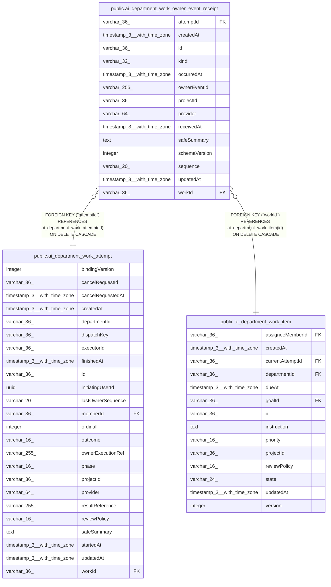

# public.ai_department_work_owner_event_receipt

## Columns

| Name | Type | Default | Nullable | Children | Parents | Comment |
| ---- | ---- | ------- | -------- | -------- | ------- | ------- |
| attemptId | varchar(36) |  | false |  | [public.ai_department_work_attempt](public.ai_department_work_attempt.md) |  |
| createdAt | timestamp(3) with time zone | CURRENT_TIMESTAMP(3) | false |  |  |  |
| id | varchar(36) |  | false |  |  |  |
| kind | varchar(32) |  | false |  |  |  |
| occurredAt | timestamp(3) with time zone |  | false |  |  |  |
| ownerEventId | varchar(255) |  | false |  |  |  |
| projectId | varchar(36) |  | false |  |  |  |
| provider | varchar(64) |  | false |  |  |  |
| receivedAt | timestamp(3) with time zone |  | false |  |  |  |
| safeSummary | text |  | true |  |  |  |
| schemaVersion | integer |  | false |  |  |  |
| sequence | varchar(20) |  | false |  |  |  |
| updatedAt | timestamp(3) with time zone | CURRENT_TIMESTAMP(3) | false |  |  |  |
| workId | varchar(36) |  | false |  | [public.ai_department_work_item](public.ai_department_work_item.md) |  |

## Constraints

| Name | Type | Definition |
| ---- | ---- | ---------- |
| FK_154cb04a1b1b1f6a5c6cefc8c42 | FOREIGN KEY | FOREIGN KEY ("attemptId") REFERENCES ai_department_work_attempt(id) ON DELETE CASCADE |
| FK_7e78b6903b1c94c1454f2a12510 | FOREIGN KEY | FOREIGN KEY ("workId") REFERENCES ai_department_work_item(id) ON DELETE CASCADE |
| PK_c57fa6c37de2a2807fd3ef4036f | PRIMARY KEY | PRIMARY KEY (id) |
| ai_department_work_owner_event_receipt_attemptId_not_null | n | NOT NULL "attemptId" |
| ai_department_work_owner_event_receipt_createdAt_not_null | n | NOT NULL "createdAt" |
| ai_department_work_owner_event_receipt_id_not_null | n | NOT NULL id |
| ai_department_work_owner_event_receipt_kind_not_null | n | NOT NULL kind |
| ai_department_work_owner_event_receipt_occurredAt_not_null | n | NOT NULL "occurredAt" |
| ai_department_work_owner_event_receipt_ownerEventId_not_null | n | NOT NULL "ownerEventId" |
| ai_department_work_owner_event_receipt_projectId_not_null | n | NOT NULL "projectId" |
| ai_department_work_owner_event_receipt_provider_not_null | n | NOT NULL provider |
| ai_department_work_owner_event_receipt_receivedAt_not_null | n | NOT NULL "receivedAt" |
| ai_department_work_owner_event_receipt_schemaVersion_not_null | n | NOT NULL "schemaVersion" |
| ai_department_work_owner_event_receipt_sequence_not_null | n | NOT NULL sequence |
| ai_department_work_owner_event_receipt_updatedAt_not_null | n | NOT NULL "updatedAt" |
| ai_department_work_owner_event_receipt_workId_not_null | n | NOT NULL "workId" |

## Indexes

| Name | Definition |
| ---- | ---------- |
| IDX_82da34d3bf25cb50f08d68f027 | CREATE UNIQUE INDEX "IDX_82da34d3bf25cb50f08d68f027" ON public.ai_department_work_owner_event_receipt USING btree ("attemptId", sequence) |
| IDX_df048bb1d2ab29f9c32edcf368 | CREATE UNIQUE INDEX "IDX_df048bb1d2ab29f9c32edcf368" ON public.ai_department_work_owner_event_receipt USING btree (provider, "ownerEventId") |
| PK_c57fa6c37de2a2807fd3ef4036f | CREATE UNIQUE INDEX "PK_c57fa6c37de2a2807fd3ef4036f" ON public.ai_department_work_owner_event_receipt USING btree (id) |

## Relations

---

> Generated by [tbls](https://github.com/k1LoW/tbls)
