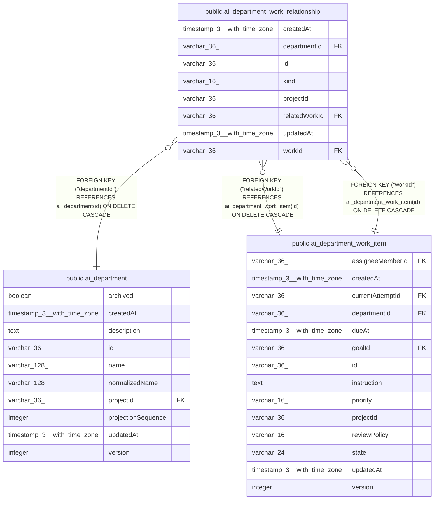

# public.ai_department_work_relationship

## Columns

| Name | Type | Default | Nullable | Children | Parents | Comment |
| ---- | ---- | ------- | -------- | -------- | ------- | ------- |
| createdAt | timestamp(3) with time zone | CURRENT_TIMESTAMP(3) | false |  |  |  |
| departmentId | varchar(36) |  | false |  | [public.ai_department](public.ai_department.md) |  |
| id | varchar(36) |  | false |  |  |  |
| kind | varchar(16) |  | false |  |  |  |
| projectId | varchar(36) |  | false |  |  |  |
| relatedWorkId | varchar(36) |  | false |  | [public.ai_department_work_item](public.ai_department_work_item.md) |  |
| updatedAt | timestamp(3) with time zone | CURRENT_TIMESTAMP(3) | false |  |  |  |
| workId | varchar(36) |  | false |  | [public.ai_department_work_item](public.ai_department_work_item.md) |  |

## Constraints

| Name | Type | Definition |
| ---- | ---- | ---------- |
| CHK_ai_department_work_relationship_kind | CHECK | CHECK (((kind)::text = ANY ((ARRAY['parent'::character varying, 'blocks'::character varying])::text[]))) |
| FK_66b4c27b8ccfb1a6106fc39f339 | FOREIGN KEY | FOREIGN KEY ("departmentId") REFERENCES ai_department(id) ON DELETE CASCADE |
| FK_bd6ba681fb8cb280adb017ac131 | FOREIGN KEY | FOREIGN KEY ("relatedWorkId") REFERENCES ai_department_work_item(id) ON DELETE CASCADE |
| FK_f12521432d0605cb54dcfbe17d5 | FOREIGN KEY | FOREIGN KEY ("workId") REFERENCES ai_department_work_item(id) ON DELETE CASCADE |
| PK_d141bb960d5cfc78b99b93d9db0 | PRIMARY KEY | PRIMARY KEY (id) |
| ai_department_work_relationship_createdAt_not_null | n | NOT NULL "createdAt" |
| ai_department_work_relationship_departmentId_not_null | n | NOT NULL "departmentId" |
| ai_department_work_relationship_id_not_null | n | NOT NULL id |
| ai_department_work_relationship_kind_not_null | n | NOT NULL kind |
| ai_department_work_relationship_projectId_not_null | n | NOT NULL "projectId" |
| ai_department_work_relationship_relatedWorkId_not_null | n | NOT NULL "relatedWorkId" |
| ai_department_work_relationship_updatedAt_not_null | n | NOT NULL "updatedAt" |
| ai_department_work_relationship_workId_not_null | n | NOT NULL "workId" |

## Indexes

| Name | Definition |
| ---- | ---------- |
| IDX_ai_dept_work_rel_project_related_kind | CREATE INDEX "IDX_ai_dept_work_rel_project_related_kind" ON public.ai_department_work_relationship USING btree ("projectId", "departmentId", "relatedWorkId", kind) |
| IDX_ai_dept_work_rel_project_work_kind | CREATE INDEX "IDX_ai_dept_work_rel_project_work_kind" ON public.ai_department_work_relationship USING btree ("projectId", "departmentId", "workId", kind) |
| IDX_ai_dept_work_rel_work_related_kind | CREATE UNIQUE INDEX "IDX_ai_dept_work_rel_work_related_kind" ON public.ai_department_work_relationship USING btree ("workId", "relatedWorkId", kind) |
| PK_d141bb960d5cfc78b99b93d9db0 | CREATE UNIQUE INDEX "PK_d141bb960d5cfc78b99b93d9db0" ON public.ai_department_work_relationship USING btree (id) |

## Relations

---

> Generated by [tbls](https://github.com/k1LoW/tbls)
