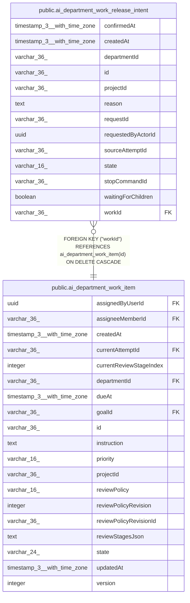

# public.ai_department_work_release_intent

## Columns

| Name | Type | Default | Nullable | Children | Parents | Comment |
| ---- | ---- | ------- | -------- | -------- | ------- | ------- |
| confirmedAt | timestamp(3) with time zone |  | true |  |  |  |
| createdAt | timestamp(3) with time zone |  | false |  |  |  |
| departmentId | varchar(36) |  | false |  |  |  |
| id | varchar(36) |  | false |  |  |  |
| projectId | varchar(36) |  | false |  |  |  |
| reason | text |  | false |  |  |  |
| requestId | varchar(36) |  | false |  |  |  |
| requestedByActorId | uuid |  | false |  |  |  |
| sourceAttemptId | varchar(36) |  | false |  |  |  |
| state | varchar(16) |  | false |  |  |  |
| stopCommandId | varchar(36) |  | false |  |  |  |
| waitingForChildren | boolean | false | false |  |  |  |
| workId | varchar(36) |  | false |  | [public.ai_department_work_item](public.ai_department_work_item.md) |  |

## Constraints

| Name | Type | Definition |
| ---- | ---- | ---------- |
| CHK_ai_department_work_release_intent_state | CHECK | CHECK (((state)::text = ANY ((ARRAY['awaiting_stop'::character varying, 'confirmed'::character varying])::text[]))) |
| FK_229d8fd9c0ce0c374c17f85a230 | FOREIGN KEY | FOREIGN KEY ("workId") REFERENCES ai_department_work_item(id) ON DELETE CASCADE |
| PK_c7cab86baa157ab372a7238d6c1 | PRIMARY KEY | PRIMARY KEY (id) |
| ai_department_work_release_intent_createdAt_not_null | n | NOT NULL "createdAt" |
| ai_department_work_release_intent_departmentId_not_null | n | NOT NULL "departmentId" |
| ai_department_work_release_intent_id_not_null | n | NOT NULL id |
| ai_department_work_release_intent_projectId_not_null | n | NOT NULL "projectId" |
| ai_department_work_release_intent_reason_not_null | n | NOT NULL reason |
| ai_department_work_release_intent_requestId_not_null | n | NOT NULL "requestId" |
| ai_department_work_release_intent_requestedByActorId_not_null | n | NOT NULL "requestedByActorId" |
| ai_department_work_release_intent_sourceAttemptId_not_null | n | NOT NULL "sourceAttemptId" |
| ai_department_work_release_intent_state_not_null | n | NOT NULL state |
| ai_department_work_release_intent_stopCommandId_not_null | n | NOT NULL "stopCommandId" |
| ai_department_work_release_intent_waitingForChildren_not_null | n | NOT NULL "waitingForChildren" |
| ai_department_work_release_intent_workId_not_null | n | NOT NULL "workId" |

## Indexes

| Name | Definition |
| ---- | ---------- |
| IDX_ai_department_work_release_intent_projectId_sourceAttemptId | CREATE INDEX "IDX_ai_department_work_release_intent_projectId_sourceAttemptId" ON public.ai_department_work_release_intent USING btree ("projectId", "sourceAttemptId", state) |
| IDX_ai_department_work_release_intent_projectId_workId_state | CREATE INDEX "IDX_ai_department_work_release_intent_projectId_workId_state" ON public.ai_department_work_release_intent USING btree ("projectId", "workId", state) |
| PK_c7cab86baa157ab372a7238d6c1 | CREATE UNIQUE INDEX "PK_c7cab86baa157ab372a7238d6c1" ON public.ai_department_work_release_intent USING btree (id) |

## Relations

---

> Generated by [tbls](https://github.com/k1LoW/tbls)
