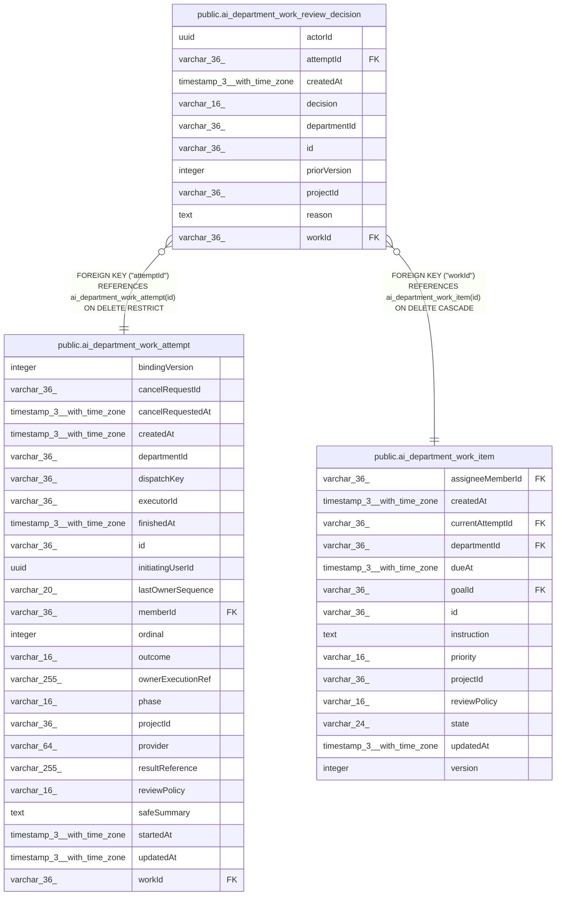

# public.ai_department_work_review_decision

## Columns

| Name | Type | Default | Nullable | Children | Parents | Comment |
| ---- | ---- | ------- | -------- | -------- | ------- | ------- |
| actorId | uuid |  | false |  |  |  |
| attemptId | varchar(36) |  | false |  | [public.ai_department_work_attempt](public.ai_department_work_attempt.md) |  |
| createdAt | timestamp(3) with time zone |  | false |  |  |  |
| decision | varchar(16) |  | false |  |  |  |
| departmentId | varchar(36) |  | false |  |  |  |
| id | varchar(36) |  | false |  |  |  |
| priorVersion | integer |  | false |  |  |  |
| projectId | varchar(36) |  | false |  |  |  |
| reason | text |  | true |  |  |  |
| workId | varchar(36) |  | false |  | [public.ai_department_work_item](public.ai_department_work_item.md) |  |

## Constraints

| Name | Type | Definition |
| ---- | ---- | ---------- |
| FK_10ed63817d599a4f4e4c9a4514f | FOREIGN KEY | FOREIGN KEY ("workId") REFERENCES ai_department_work_item(id) ON DELETE CASCADE |
| FK_2ae54882867478e2e1e63c94348 | FOREIGN KEY | FOREIGN KEY ("attemptId") REFERENCES ai_department_work_attempt(id) ON DELETE RESTRICT |
| PK_54e0db632252489c22e78ef7267 | PRIMARY KEY | PRIMARY KEY (id) |
| ai_department_work_review_decision_actorId_not_null | n | NOT NULL "actorId" |
| ai_department_work_review_decision_attemptId_not_null | n | NOT NULL "attemptId" |
| ai_department_work_review_decision_createdAt_not_null | n | NOT NULL "createdAt" |
| ai_department_work_review_decision_decision_not_null | n | NOT NULL decision |
| ai_department_work_review_decision_departmentId_not_null | n | NOT NULL "departmentId" |
| ai_department_work_review_decision_id_not_null | n | NOT NULL id |
| ai_department_work_review_decision_priorVersion_not_null | n | NOT NULL "priorVersion" |
| ai_department_work_review_decision_projectId_not_null | n | NOT NULL "projectId" |
| ai_department_work_review_decision_workId_not_null | n | NOT NULL "workId" |

## Indexes

| Name | Definition |
| ---- | ---------- |
| IDX_c4fbe39d433757e56eac83943e | CREATE UNIQUE INDEX "IDX_c4fbe39d433757e56eac83943e" ON public.ai_department_work_review_decision USING btree ("workId", "priorVersion") |
| PK_54e0db632252489c22e78ef7267 | CREATE UNIQUE INDEX "PK_54e0db632252489c22e78ef7267" ON public.ai_department_work_review_decision USING btree (id) |

## Relations

---

> Generated by [tbls](https://github.com/k1LoW/tbls)
