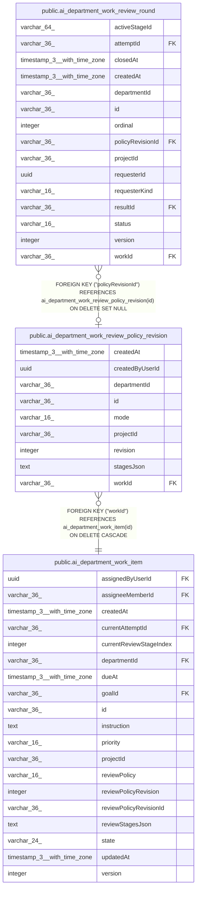

# public.ai_department_work_review_policy_revision

## Columns

| Name | Type | Default | Nullable | Children | Parents | Comment |
| ---- | ---- | ------- | -------- | -------- | ------- | ------- |
| createdAt | timestamp(3) with time zone |  | false |  |  |  |
| createdByUserId | uuid |  | false |  |  |  |
| departmentId | varchar(36) |  | false |  |  |  |
| id | varchar(36) |  | false | [public.ai_department_work_review_round](public.ai_department_work_review_round.md) |  |  |
| mode | varchar(16) |  | false |  |  |  |
| projectId | varchar(36) |  | false |  |  |  |
| revision | integer |  | false |  |  |  |
| stagesJson | text |  | false |  |  |  |
| workId | varchar(36) |  | false |  | [public.ai_department_work_item](public.ai_department_work_item.md) |  |

## Constraints

| Name | Type | Definition |
| ---- | ---- | ---------- |
| CHK_ai_department_work_review_policy_revision_mode | CHECK | CHECK (((mode)::text = ANY ((ARRAY['required'::character varying, 'automatic'::character varying])::text[]))) |
| FK_07c8d764f095f70e8d018fb6ab0 | FOREIGN KEY | FOREIGN KEY ("workId") REFERENCES ai_department_work_item(id) ON DELETE CASCADE |
| PK_305d847a26f7f122177d0fe67fb | PRIMARY KEY | PRIMARY KEY (id) |
| ai_department_work_review_policy_revis_createdByUserId_not_null | n | NOT NULL "createdByUserId" |
| ai_department_work_review_policy_revision_createdAt_not_null | n | NOT NULL "createdAt" |
| ai_department_work_review_policy_revision_departmentId_not_null | n | NOT NULL "departmentId" |
| ai_department_work_review_policy_revision_id_not_null | n | NOT NULL id |
| ai_department_work_review_policy_revision_mode_not_null | n | NOT NULL mode |
| ai_department_work_review_policy_revision_projectId_not_null | n | NOT NULL "projectId" |
| ai_department_work_review_policy_revision_revision_not_null | n | NOT NULL revision |
| ai_department_work_review_policy_revision_stagesJson_not_null | n | NOT NULL "stagesJson" |
| ai_department_work_review_policy_revision_workId_not_null | n | NOT NULL "workId" |

## Indexes

| Name | Definition |
| ---- | ---------- |
| IDX_ai_department_work_review_policy_revision_projectId_workId_ | CREATE UNIQUE INDEX "IDX_ai_department_work_review_policy_revision_projectId_workId_" ON public.ai_department_work_review_policy_revision USING btree ("projectId", "workId", revision) |
| PK_305d847a26f7f122177d0fe67fb | CREATE UNIQUE INDEX "PK_305d847a26f7f122177d0fe67fb" ON public.ai_department_work_review_policy_revision USING btree (id) |

## Relations

---

> Generated by [tbls](https://github.com/k1LoW/tbls)
