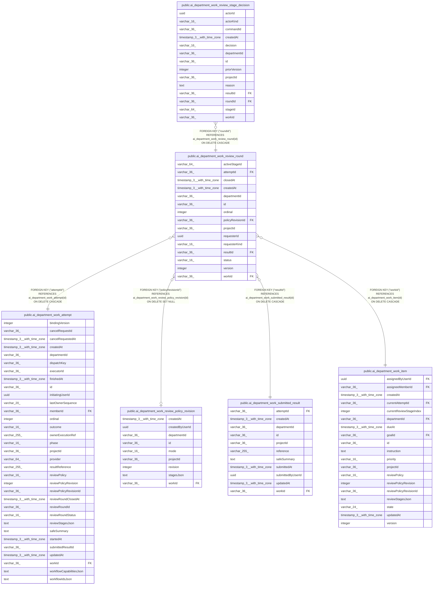

# public.ai_department_work_review_round

## Columns

| Name | Type | Default | Nullable | Children | Parents | Comment |
| ---- | ---- | ------- | -------- | -------- | ------- | ------- |
| activeStageId | varchar(64) |  | true |  |  |  |
| attemptId | varchar(36) |  | false |  | [public.ai_department_work_attempt](public.ai_department_work_attempt.md) |  |
| closedAt | timestamp(3) with time zone |  | true |  |  |  |
| createdAt | timestamp(3) with time zone |  | false |  |  |  |
| departmentId | varchar(36) |  | false |  |  |  |
| id | varchar(36) |  | false | [public.ai_department_work_review_stage_decision](public.ai_department_work_review_stage_decision.md) |  |  |
| ordinal | integer |  | false |  |  |  |
| policyRevisionId | varchar(36) |  | true |  | [public.ai_department_work_review_policy_revision](public.ai_department_work_review_policy_revision.md) |  |
| projectId | varchar(36) |  | false |  |  |  |
| requesterId | uuid |  | false |  |  |  |
| requesterKind | varchar(16) |  | false |  |  |  |
| resultId | varchar(36) |  | false |  | [public.ai_department_work_submitted_result](public.ai_department_work_submitted_result.md) |  |
| status | varchar(16) |  | false |  |  |  |
| version | integer | 1 | false |  |  |  |
| workId | varchar(36) |  | false |  | [public.ai_department_work_item](public.ai_department_work_item.md) |  |

## Constraints

| Name | Type | Definition |
| ---- | ---- | ---------- |
| CHK_ai_department_work_review_round_requesterKind | CHECK | CHECK ((("requesterKind")::text = 'user'::text)) |
| CHK_ai_department_work_review_round_status | CHECK | CHECK (((status)::text = ANY ((ARRAY['open'::character varying, 'accepted'::character varying, 'returned'::character varying, 'reopened'::character varying])::text[]))) |
| FK_0807d77e959e57e48ddccca88dc | FOREIGN KEY | FOREIGN KEY ("policyRevisionId") REFERENCES ai_department_work_review_policy_revision(id) ON DELETE SET NULL |
| FK_379061c674004637ddba7597a76 | FOREIGN KEY | FOREIGN KEY ("attemptId") REFERENCES ai_department_work_attempt(id) ON DELETE CASCADE |
| FK_638c2ddcd7999f652940a56ab18 | FOREIGN KEY | FOREIGN KEY ("resultId") REFERENCES ai_department_work_submitted_result(id) ON DELETE CASCADE |
| FK_eb0b4abfb12cf4ee87c399974fa | FOREIGN KEY | FOREIGN KEY ("workId") REFERENCES ai_department_work_item(id) ON DELETE CASCADE |
| PK_832d0e7f9d473c2a302837654dd | PRIMARY KEY | PRIMARY KEY (id) |
| ai_department_work_review_round_attemptId_not_null | n | NOT NULL "attemptId" |
| ai_department_work_review_round_createdAt_not_null | n | NOT NULL "createdAt" |
| ai_department_work_review_round_departmentId_not_null | n | NOT NULL "departmentId" |
| ai_department_work_review_round_id_not_null | n | NOT NULL id |
| ai_department_work_review_round_ordinal_not_null | n | NOT NULL ordinal |
| ai_department_work_review_round_projectId_not_null | n | NOT NULL "projectId" |
| ai_department_work_review_round_requesterId_not_null | n | NOT NULL "requesterId" |
| ai_department_work_review_round_requesterKind_not_null | n | NOT NULL "requesterKind" |
| ai_department_work_review_round_resultId_not_null | n | NOT NULL "resultId" |
| ai_department_work_review_round_status_not_null | n | NOT NULL status |
| ai_department_work_review_round_version_not_null | n | NOT NULL version |
| ai_department_work_review_round_workId_not_null | n | NOT NULL "workId" |

## Indexes

| Name | Definition |
| ---- | ---------- |
| IDX_ai_department_work_review_round_attemptId | CREATE UNIQUE INDEX "IDX_ai_department_work_review_round_attemptId" ON public.ai_department_work_review_round USING btree ("attemptId") |
| IDX_ai_department_work_review_round_workId_ordinal | CREATE UNIQUE INDEX "IDX_ai_department_work_review_round_workId_ordinal" ON public.ai_department_work_review_round USING btree ("workId", ordinal) |
| PK_832d0e7f9d473c2a302837654dd | CREATE UNIQUE INDEX "PK_832d0e7f9d473c2a302837654dd" ON public.ai_department_work_review_round USING btree (id) |

## Relations

---

> Generated by [tbls](https://github.com/k1LoW/tbls)
