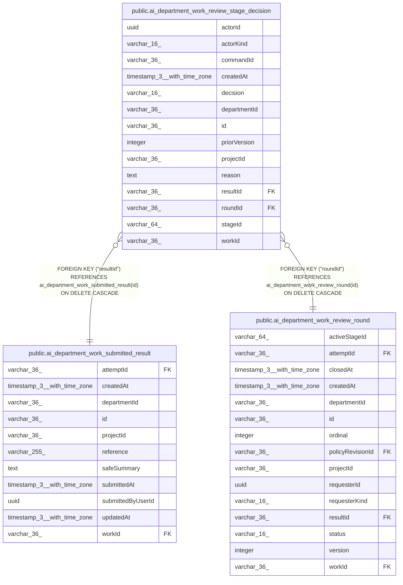

# public.ai_department_work_review_stage_decision

## Columns

| Name | Type | Default | Nullable | Children | Parents | Comment |
| ---- | ---- | ------- | -------- | -------- | ------- | ------- |
| actorId | uuid |  | false |  |  |  |
| actorKind | varchar(16) |  | false |  |  |  |
| commandId | varchar(36) |  | false |  |  |  |
| createdAt | timestamp(3) with time zone |  | false |  |  |  |
| decision | varchar(16) |  | false |  |  |  |
| departmentId | varchar(36) |  | false |  |  |  |
| id | varchar(36) |  | false |  |  |  |
| priorVersion | integer |  | false |  |  |  |
| projectId | varchar(36) |  | false |  |  |  |
| reason | text |  | true |  |  |  |
| resultId | varchar(36) |  | false |  | [public.ai_department_work_submitted_result](public.ai_department_work_submitted_result.md) |  |
| roundId | varchar(36) |  | false |  | [public.ai_department_work_review_round](public.ai_department_work_review_round.md) |  |
| stageId | varchar(64) |  | false |  |  |  |
| workId | varchar(36) |  | false |  |  |  |

## Constraints

| Name | Type | Definition |
| ---- | ---- | ---------- |
| CHK_ai_department_work_review_stage_decision_actorKind | CHECK | CHECK ((("actorKind")::text = 'user'::text)) |
| CHK_ai_department_work_review_stage_decision_decision | CHECK | CHECK (((decision)::text = ANY ((ARRAY['accept'::character varying, 'return'::character varying])::text[]))) |
| FK_1cd3a396957863e5482e2f32dc9 | FOREIGN KEY | FOREIGN KEY ("resultId") REFERENCES ai_department_work_submitted_result(id) ON DELETE CASCADE |
| FK_86492c7f6cb75d0c019f61a7af3 | FOREIGN KEY | FOREIGN KEY ("roundId") REFERENCES ai_department_work_review_round(id) ON DELETE CASCADE |
| PK_b07c2c63760e18e6aadb2c2bd20 | PRIMARY KEY | PRIMARY KEY (id) |
| ai_department_work_review_stage_decision_actorId_not_null | n | NOT NULL "actorId" |
| ai_department_work_review_stage_decision_actorKind_not_null | n | NOT NULL "actorKind" |
| ai_department_work_review_stage_decision_commandId_not_null | n | NOT NULL "commandId" |
| ai_department_work_review_stage_decision_createdAt_not_null | n | NOT NULL "createdAt" |
| ai_department_work_review_stage_decision_decision_not_null | n | NOT NULL decision |
| ai_department_work_review_stage_decision_departmentId_not_null | n | NOT NULL "departmentId" |
| ai_department_work_review_stage_decision_id_not_null | n | NOT NULL id |
| ai_department_work_review_stage_decision_priorVersion_not_null | n | NOT NULL "priorVersion" |
| ai_department_work_review_stage_decision_projectId_not_null | n | NOT NULL "projectId" |
| ai_department_work_review_stage_decision_resultId_not_null | n | NOT NULL "resultId" |
| ai_department_work_review_stage_decision_roundId_not_null | n | NOT NULL "roundId" |
| ai_department_work_review_stage_decision_stageId_not_null | n | NOT NULL "stageId" |
| ai_department_work_review_stage_decision_workId_not_null | n | NOT NULL "workId" |

## Indexes

| Name | Definition |
| ---- | ---------- |
| IDX_ai_department_work_review_stage_decision_roundId_stageId | CREATE UNIQUE INDEX "IDX_ai_department_work_review_stage_decision_roundId_stageId" ON public.ai_department_work_review_stage_decision USING btree ("roundId", "stageId") |
| PK_b07c2c63760e18e6aadb2c2bd20 | CREATE UNIQUE INDEX "PK_b07c2c63760e18e6aadb2c2bd20" ON public.ai_department_work_review_stage_decision USING btree (id) |

## Relations

---

> Generated by [tbls](https://github.com/k1LoW/tbls)
