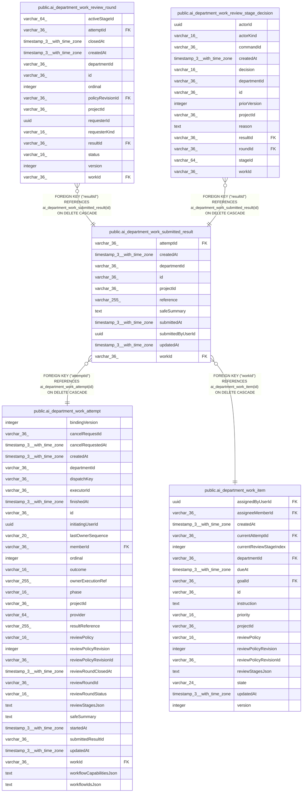

# public.ai_department_work_submitted_result

## Columns

| Name | Type | Default | Nullable | Children | Parents | Comment |
| ---- | ---- | ------- | -------- | -------- | ------- | ------- |
| attemptId | varchar(36) |  | false |  | [public.ai_department_work_attempt](public.ai_department_work_attempt.md) |  |
| createdAt | timestamp(3) with time zone |  | true |  |  |  |
| departmentId | varchar(36) |  | false |  |  |  |
| id | varchar(36) |  | false | [public.ai_department_work_review_round](public.ai_department_work_review_round.md) [public.ai_department_work_review_stage_decision](public.ai_department_work_review_stage_decision.md) |  |  |
| projectId | varchar(36) |  | false |  |  |  |
| reference | varchar(255) |  | true |  |  |  |
| safeSummary | text |  | true |  |  |  |
| submittedAt | timestamp(3) with time zone |  | false |  |  |  |
| submittedByUserId | uuid |  | false |  |  |  |
| updatedAt | timestamp(3) with time zone |  | true |  |  |  |
| workId | varchar(36) |  | false |  | [public.ai_department_work_item](public.ai_department_work_item.md) |  |

## Constraints

| Name | Type | Definition |
| ---- | ---- | ---------- |
| FK_138e1010f7611413e5c1ea414b9 | FOREIGN KEY | FOREIGN KEY ("attemptId") REFERENCES ai_department_work_attempt(id) ON DELETE CASCADE |
| FK_abf7dec02d5d6bc0c0f3d522c7a | FOREIGN KEY | FOREIGN KEY ("workId") REFERENCES ai_department_work_item(id) ON DELETE CASCADE |
| PK_7324a9d7863544e0a0040f41ed9 | PRIMARY KEY | PRIMARY KEY (id) |
| ai_department_work_submitted_result_attemptId_not_null | n | NOT NULL "attemptId" |
| ai_department_work_submitted_result_departmentId_not_null | n | NOT NULL "departmentId" |
| ai_department_work_submitted_result_id_not_null | n | NOT NULL id |
| ai_department_work_submitted_result_projectId_not_null | n | NOT NULL "projectId" |
| ai_department_work_submitted_result_submittedAt_not_null | n | NOT NULL "submittedAt" |
| ai_department_work_submitted_result_submittedByUserId_not_null | n | NOT NULL "submittedByUserId" |
| ai_department_work_submitted_result_workId_not_null | n | NOT NULL "workId" |

## Indexes

| Name | Definition |
| ---- | ---------- |
| IDX_ai_department_work_submitted_result_attemptId | CREATE UNIQUE INDEX "IDX_ai_department_work_submitted_result_attemptId" ON public.ai_department_work_submitted_result USING btree ("attemptId") |
| IDX_ai_department_work_submitted_result_projectId_workId_submit | CREATE INDEX "IDX_ai_department_work_submitted_result_projectId_workId_submit" ON public.ai_department_work_submitted_result USING btree ("projectId", "workId", "submittedAt") |
| PK_7324a9d7863544e0a0040f41ed9 | CREATE UNIQUE INDEX "PK_7324a9d7863544e0a0040f41ed9" ON public.ai_department_work_submitted_result USING btree (id) |

## Relations

---

> Generated by [tbls](https://github.com/k1LoW/tbls)
