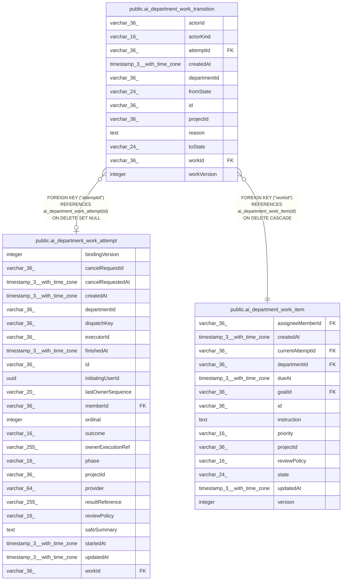

# public.ai_department_work_transition

## Columns

| Name | Type | Default | Nullable | Children | Parents | Comment |
| ---- | ---- | ------- | -------- | -------- | ------- | ------- |
| actorId | varchar(36) |  | true |  |  |  |
| actorKind | varchar(16) |  | false |  |  |  |
| attemptId | varchar(36) |  | true |  | [public.ai_department_work_attempt](public.ai_department_work_attempt.md) |  |
| createdAt | timestamp(3) with time zone |  | false |  |  |  |
| departmentId | varchar(36) |  | false |  |  |  |
| fromState | varchar(24) |  | true |  |  |  |
| id | varchar(36) |  | false |  |  |  |
| projectId | varchar(36) |  | false |  |  |  |
| reason | text |  | true |  |  |  |
| toState | varchar(24) |  | false |  |  |  |
| workId | varchar(36) |  | false |  | [public.ai_department_work_item](public.ai_department_work_item.md) |  |
| workVersion | integer |  | false |  |  |  |

## Constraints

| Name | Type | Definition |
| ---- | ---- | ---------- |
| FK_7691b6025988595a94ddbad31f5 | FOREIGN KEY | FOREIGN KEY ("attemptId") REFERENCES ai_department_work_attempt(id) ON DELETE SET NULL |
| FK_b4a1c3c548d9c35092b34341f9a | FOREIGN KEY | FOREIGN KEY ("workId") REFERENCES ai_department_work_item(id) ON DELETE CASCADE |
| PK_8191ed6f0e49c68ca5c4906ed4f | PRIMARY KEY | PRIMARY KEY (id) |
| ai_department_work_transition_actorKind_not_null | n | NOT NULL "actorKind" |
| ai_department_work_transition_createdAt_not_null | n | NOT NULL "createdAt" |
| ai_department_work_transition_departmentId_not_null | n | NOT NULL "departmentId" |
| ai_department_work_transition_id_not_null | n | NOT NULL id |
| ai_department_work_transition_projectId_not_null | n | NOT NULL "projectId" |
| ai_department_work_transition_toState_not_null | n | NOT NULL "toState" |
| ai_department_work_transition_workId_not_null | n | NOT NULL "workId" |
| ai_department_work_transition_workVersion_not_null | n | NOT NULL "workVersion" |

## Indexes

| Name | Definition |
| ---- | ---------- |
| IDX_157714953aceccfcc97d5fcaf1 | CREATE INDEX "IDX_157714953aceccfcc97d5fcaf1" ON public.ai_department_work_transition USING btree ("projectId", "departmentId", "createdAt") |
| IDX_efde086356536e622377aeffc7 | CREATE UNIQUE INDEX "IDX_efde086356536e622377aeffc7" ON public.ai_department_work_transition USING btree ("workId", "workVersion") |
| PK_8191ed6f0e49c68ca5c4906ed4f | CREATE UNIQUE INDEX "PK_8191ed6f0e49c68ca5c4906ed4f" ON public.ai_department_work_transition USING btree (id) |

## Relations

---

> Generated by [tbls](https://github.com/k1LoW/tbls)
