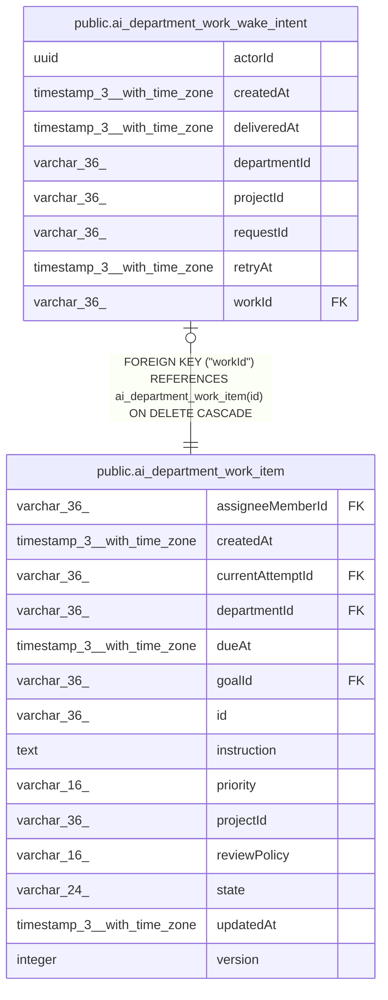

# public.ai_department_work_wake_intent

## Columns

| Name | Type | Default | Nullable | Children | Parents | Comment |
| ---- | ---- | ------- | -------- | -------- | ------- | ------- |
| actorId | uuid |  | false |  |  |  |
| createdAt | timestamp(3) with time zone |  | false |  |  |  |
| deliveredAt | timestamp(3) with time zone |  | true |  |  |  |
| departmentId | varchar(36) |  | false |  |  |  |
| projectId | varchar(36) |  | false |  |  |  |
| requestId | varchar(36) |  | false |  |  |  |
| retryAt | timestamp(3) with time zone |  | false |  |  |  |
| workId | varchar(36) |  | false |  | [public.ai_department_work_item](public.ai_department_work_item.md) |  |

## Constraints

| Name | Type | Definition |
| ---- | ---- | ---------- |
| FK_3763c8143e413d91e8933804890 | FOREIGN KEY | FOREIGN KEY ("workId") REFERENCES ai_department_work_item(id) ON DELETE CASCADE |
| PK_3763c8143e413d91e8933804890 | PRIMARY KEY | PRIMARY KEY ("workId") |
| ai_department_work_wake_intent_actorId_not_null | n | NOT NULL "actorId" |
| ai_department_work_wake_intent_createdAt_not_null | n | NOT NULL "createdAt" |
| ai_department_work_wake_intent_departmentId_not_null | n | NOT NULL "departmentId" |
| ai_department_work_wake_intent_projectId_not_null | n | NOT NULL "projectId" |
| ai_department_work_wake_intent_requestId_not_null | n | NOT NULL "requestId" |
| ai_department_work_wake_intent_retryAt_not_null | n | NOT NULL "retryAt" |
| ai_department_work_wake_intent_workId_not_null | n | NOT NULL "workId" |

## Indexes

| Name | Definition |
| ---- | ---------- |
| IDX_ai_department_work_wake_intent_deliveredAt_retryAt_createdA | CREATE INDEX "IDX_ai_department_work_wake_intent_deliveredAt_retryAt_createdA" ON public.ai_department_work_wake_intent USING btree ("deliveredAt", "retryAt", "createdAt", "workId") |
| PK_3763c8143e413d91e8933804890 | CREATE UNIQUE INDEX "PK_3763c8143e413d91e8933804890" ON public.ai_department_work_wake_intent USING btree ("workId") |

## Relations

---

> Generated by [tbls](https://github.com/k1LoW/tbls)
