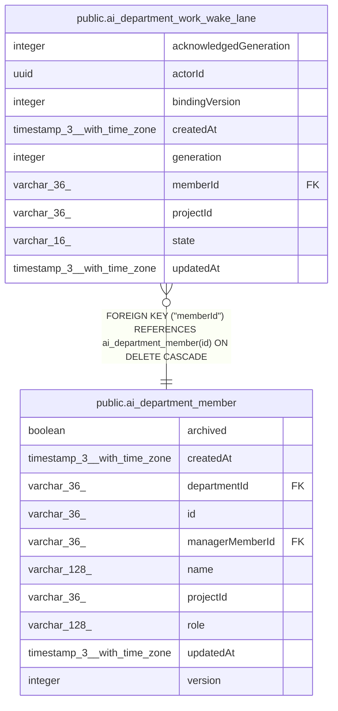

# public.ai_department_work_wake_lane

## Columns

| Name | Type | Default | Nullable | Children | Parents | Comment |
| ---- | ---- | ------- | -------- | -------- | ------- | ------- |
| acknowledgedGeneration | integer |  | false |  |  |  |
| actorId | uuid |  | false |  |  |  |
| bindingVersion | integer |  | false |  |  |  |
| createdAt | timestamp(3) with time zone | CURRENT_TIMESTAMP(3) | false |  |  |  |
| generation | integer |  | false |  |  |  |
| memberId | varchar(36) |  | false |  | [public.ai_department_member](public.ai_department_member.md) |  |
| projectId | varchar(36) |  | false |  |  |  |
| state | varchar(16) |  | false |  |  | The acknowledgment state for the latest lane wake |
| updatedAt | timestamp(3) with time zone |  | false |  |  |  |

## Constraints

| Name | Type | Definition |
| ---- | ---- | ---------- |
| CHK_ai_department_work_wake_lane_state | CHECK | CHECK (((state)::text = ANY ((ARRAY['pending'::character varying, 'accepted'::character varying, 'coalesced'::character varying, 'unknown'::character varying, 'delivered'::character varying, 'rejected'::character varying])::text[]))) |
| FK_246d2f6a6def9540f1e4dc9b823 | FOREIGN KEY | FOREIGN KEY ("memberId") REFERENCES ai_department_member(id) ON DELETE CASCADE |
| PK_7d991677c81671903351957cc21 | PRIMARY KEY | PRIMARY KEY ("projectId", "memberId", "actorId", "bindingVersion") |
| ai_department_work_wake_lane_acknowledgedGeneration_not_null | n | NOT NULL "acknowledgedGeneration" |
| ai_department_work_wake_lane_actorId_not_null | n | NOT NULL "actorId" |
| ai_department_work_wake_lane_bindingVersion_not_null | n | NOT NULL "bindingVersion" |
| ai_department_work_wake_lane_createdAt_not_null | n | NOT NULL "createdAt" |
| ai_department_work_wake_lane_generation_not_null | n | NOT NULL generation |
| ai_department_work_wake_lane_memberId_not_null | n | NOT NULL "memberId" |
| ai_department_work_wake_lane_projectId_not_null | n | NOT NULL "projectId" |
| ai_department_work_wake_lane_state_not_null | n | NOT NULL state |
| ai_department_work_wake_lane_updatedAt_not_null | n | NOT NULL "updatedAt" |

## Indexes

| Name | Definition |
| ---- | ---------- |
| IDX_ai_department_work_wake_lane_state_updatedAt | CREATE INDEX "IDX_ai_department_work_wake_lane_state_updatedAt" ON public.ai_department_work_wake_lane USING btree (state, "updatedAt") |
| PK_7d991677c81671903351957cc21 | CREATE UNIQUE INDEX "PK_7d991677c81671903351957cc21" ON public.ai_department_work_wake_lane USING btree ("projectId", "memberId", "actorId", "bindingVersion") |

## Relations

---

> Generated by [tbls](https://github.com/k1LoW/tbls)
