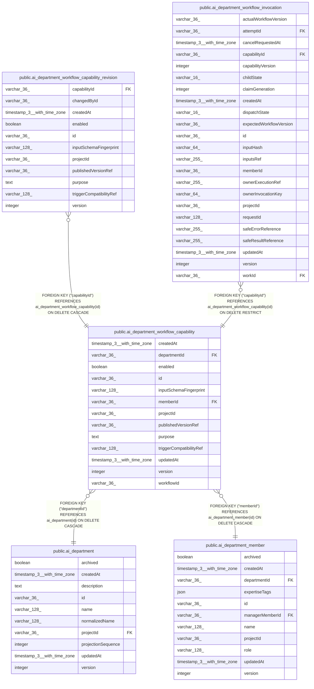

# public.ai_department_workflow_capability

## Columns

| Name | Type | Default | Nullable | Children | Parents | Comment |
| ---- | ---- | ------- | -------- | -------- | ------- | ------- |
| createdAt | timestamp(3) with time zone |  | false |  |  |  |
| departmentId | varchar(36) |  | false |  | [public.ai_department](public.ai_department.md) |  |
| enabled | boolean | false | false |  |  |  |
| id | varchar(36) |  | false | [public.ai_department_workflow_capability_revision](public.ai_department_workflow_capability_revision.md) [public.ai_department_workflow_invocation](public.ai_department_workflow_invocation.md) |  | Department workflow capability ID |
| inputSchemaFingerprint | varchar(128) |  | false |  |  | Fingerprint of the compatible workflow input schema |
| memberId | varchar(36) |  | false |  | [public.ai_department_member](public.ai_department_member.md) |  |
| projectId | varchar(36) |  | false |  |  | n8n project that owns the capability |
| publishedVersionRef | varchar(36) |  | false |  |  | Published workflow version selected by the coordinator |
| purpose | text |  | false |  |  |  |
| triggerCompatibilityRef | varchar(128) |  | false |  |  | Supported trigger type and version |
| updatedAt | timestamp(3) with time zone |  | false |  |  |  |
| version | integer | 1 | false |  |  |  |
| workflowId | varchar(36) |  | false |  |  | Reference to the n8n-owned workflow |

## Constraints

| Name | Type | Definition |
| ---- | ---- | ---------- |
| FK_35455323f69ca028c78307b449e | FOREIGN KEY | FOREIGN KEY ("memberId") REFERENCES ai_department_member(id) ON DELETE CASCADE |
| FK_4cee32cdb97d4f83f56e6890757 | FOREIGN KEY | FOREIGN KEY ("departmentId") REFERENCES ai_department(id) ON DELETE CASCADE |
| PK_00e0034dea5cae684ec3a210fbe | PRIMARY KEY | PRIMARY KEY (id) |
| ai_department_workflow_capabil_triggerCompatibilityRef_not_null | n | NOT NULL "triggerCompatibilityRef" |
| ai_department_workflow_capabili_inputSchemaFingerprint_not_null | n | NOT NULL "inputSchemaFingerprint" |
| ai_department_workflow_capability_createdAt_not_null | n | NOT NULL "createdAt" |
| ai_department_workflow_capability_departmentId_not_null | n | NOT NULL "departmentId" |
| ai_department_workflow_capability_enabled_not_null | n | NOT NULL enabled |
| ai_department_workflow_capability_id_not_null | n | NOT NULL id |
| ai_department_workflow_capability_memberId_not_null | n | NOT NULL "memberId" |
| ai_department_workflow_capability_projectId_not_null | n | NOT NULL "projectId" |
| ai_department_workflow_capability_publishedVersionRef_not_null | n | NOT NULL "publishedVersionRef" |
| ai_department_workflow_capability_purpose_not_null | n | NOT NULL purpose |
| ai_department_workflow_capability_updatedAt_not_null | n | NOT NULL "updatedAt" |
| ai_department_workflow_capability_version_not_null | n | NOT NULL version |
| ai_department_workflow_capability_workflowId_not_null | n | NOT NULL "workflowId" |

## Indexes

| Name | Definition |
| ---- | ---------- |
| IDX_ai_department_workflow_capability_projectId_departmentId_me | CREATE INDEX "IDX_ai_department_workflow_capability_projectId_departmentId_me" ON public.ai_department_workflow_capability USING btree ("projectId", "departmentId", "memberId", enabled) |
| IDX_ai_department_workflow_capability_projectId_memberId_workfl | CREATE UNIQUE INDEX "IDX_ai_department_workflow_capability_projectId_memberId_workfl" ON public.ai_department_workflow_capability USING btree ("projectId", "memberId", "workflowId") |
| PK_00e0034dea5cae684ec3a210fbe | CREATE UNIQUE INDEX "PK_00e0034dea5cae684ec3a210fbe" ON public.ai_department_workflow_capability USING btree (id) |

## Relations

---

> Generated by [tbls](https://github.com/k1LoW/tbls)
