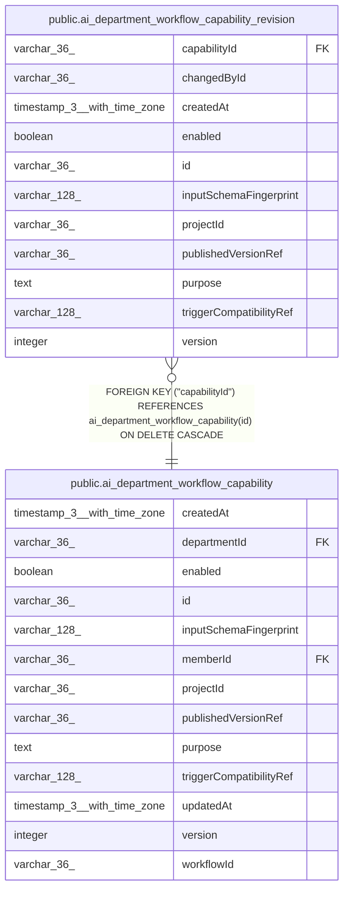

# public.ai_department_workflow_capability_revision

## Columns

| Name | Type | Default | Nullable | Children | Parents | Comment |
| ---- | ---- | ------- | -------- | -------- | ------- | ------- |
| capabilityId | varchar(36) |  | false |  | [public.ai_department_workflow_capability](public.ai_department_workflow_capability.md) |  |
| changedById | varchar(36) |  | false |  |  |  |
| createdAt | timestamp(3) with time zone |  | false |  |  |  |
| enabled | boolean |  | false |  |  |  |
| id | varchar(36) |  | false |  |  |  |
| inputSchemaFingerprint | varchar(128) |  | false |  |  |  |
| projectId | varchar(36) |  | false |  |  |  |
| publishedVersionRef | varchar(36) |  | false |  |  |  |
| purpose | text |  | false |  |  |  |
| triggerCompatibilityRef | varchar(128) |  | false |  |  |  |
| version | integer |  | false |  |  |  |

## Constraints

| Name | Type | Definition |
| ---- | ---- | ---------- |
| FK_d8bd43de8d11965fbfa172742c3 | FOREIGN KEY | FOREIGN KEY ("capabilityId") REFERENCES ai_department_workflow_capability(id) ON DELETE CASCADE |
| PK_b240802dbf4784ee75a0e7d6402 | PRIMARY KEY | PRIMARY KEY (id) |
| ai_department_workflow_capabi_triggerCompatibilityRef_not_null1 | n | NOT NULL "triggerCompatibilityRef" |
| ai_department_workflow_capabil_inputSchemaFingerprint_not_null1 | n | NOT NULL "inputSchemaFingerprint" |
| ai_department_workflow_capability__publishedVersionRef_not_null | n | NOT NULL "publishedVersionRef" |
| ai_department_workflow_capability_revisio_capabilityId_not_null | n | NOT NULL "capabilityId" |
| ai_department_workflow_capability_revision_changedById_not_null | n | NOT NULL "changedById" |
| ai_department_workflow_capability_revision_createdAt_not_null | n | NOT NULL "createdAt" |
| ai_department_workflow_capability_revision_enabled_not_null | n | NOT NULL enabled |
| ai_department_workflow_capability_revision_id_not_null | n | NOT NULL id |
| ai_department_workflow_capability_revision_projectId_not_null | n | NOT NULL "projectId" |
| ai_department_workflow_capability_revision_purpose_not_null | n | NOT NULL purpose |
| ai_department_workflow_capability_revision_version_not_null | n | NOT NULL version |

## Indexes

| Name | Definition |
| ---- | ---------- |
| IDX_ai_department_workflow_capability_revision_capabilityId_ver | CREATE UNIQUE INDEX "IDX_ai_department_workflow_capability_revision_capabilityId_ver" ON public.ai_department_workflow_capability_revision USING btree ("capabilityId", version) |
| PK_b240802dbf4784ee75a0e7d6402 | CREATE UNIQUE INDEX "PK_b240802dbf4784ee75a0e7d6402" ON public.ai_department_workflow_capability_revision USING btree (id) |

## Relations

---

> Generated by [tbls](https://github.com/k1LoW/tbls)
