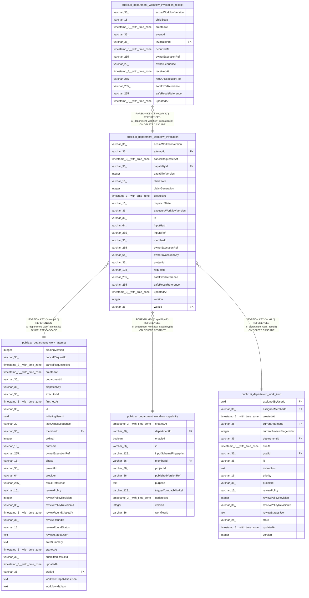

# public.ai_department_workflow_invocation

## Columns

| Name | Type | Default | Nullable | Children | Parents | Comment |
| ---- | ---- | ------- | -------- | -------- | ------- | ------- |
| actualWorkflowVersion | varchar(36) |  | true |  |  |  |
| attemptId | varchar(36) |  | false |  | [public.ai_department_work_attempt](public.ai_department_work_attempt.md) |  |
| cancelRequestedAt | timestamp(3) with time zone |  | true |  |  |  |
| capabilityId | varchar(36) |  | false |  | [public.ai_department_workflow_capability](public.ai_department_workflow_capability.md) |  |
| capabilityVersion | integer |  | false |  |  |  |
| childState | varchar(16) | 'pending'::character varying | false |  |  | Safe projection of the n8n-owned child execution state |
| claimGeneration | integer |  | false |  |  |  |
| createdAt | timestamp(3) with time zone |  | false |  |  |  |
| dispatchState | varchar(16) | 'pending'::character varying | false |  |  | Department dispatch acceptance state |
| expectedWorkflowVersion | varchar(36) |  | true |  |  |  |
| id | varchar(36) |  | false | [public.ai_department_workflow_invocation_receipt](public.ai_department_workflow_invocation_receipt.md) |  | Department workflow invocation ID |
| inputHash | varchar(64) |  | false |  |  | Hash of validated invocation inputs |
| inputsRef | varchar(255) |  | false |  |  | Reference to invocation inputs held by the authorized owner |
| memberId | varchar(36) |  | false |  |  |  |
| ownerExecutionRef | varchar(255) |  | true |  |  |  |
| ownerInvocationKey | varchar(64) |  | false |  |  | Stable native execution key accepted by the workflow owner |
| projectId | varchar(36) |  | false |  |  |  |
| requestId | varchar(128) |  | false |  |  | Stable idempotency key for this attempt |
| safeErrorReference | varchar(255) |  | true |  |  |  |
| safeResultReference | varchar(255) |  | true |  |  |  |
| updatedAt | timestamp(3) with time zone |  | false |  |  |  |
| version | integer | 1 | false |  |  |  |
| workId | varchar(36) |  | false |  | [public.ai_department_work_item](public.ai_department_work_item.md) |  |

## Constraints

| Name | Type | Definition |
| ---- | ---- | ---------- |
| CHK_ai_department_workflow_invocation_childState | CHECK | CHECK ((("childState")::text = ANY ((ARRAY['pending'::character varying, 'running'::character varying, 'waiting'::character varying, 'retrying'::character varying, 'succeeded'::character varying, 'failed'::character varying, 'cancelled'::character varying, 'unknown'::character varying])::text[]))) |
| CHK_ai_department_workflow_invocation_dispatchState | CHECK | CHECK ((("dispatchState")::text = ANY ((ARRAY['pending'::character varying, 'acknowledged'::character varying, 'unknown'::character varying, 'rejected'::character varying])::text[]))) |
| FK_045e2d67a4ff4be04d60a492bb6 | FOREIGN KEY | FOREIGN KEY ("attemptId") REFERENCES ai_department_work_attempt(id) ON DELETE CASCADE |
| FK_9ebffaf5c2d64057b365e864699 | FOREIGN KEY | FOREIGN KEY ("workId") REFERENCES ai_department_work_item(id) ON DELETE CASCADE |
| FK_b32b1a743970b5fc5b2dcaeb284 | FOREIGN KEY | FOREIGN KEY ("capabilityId") REFERENCES ai_department_workflow_capability(id) ON DELETE RESTRICT |
| PK_1b69a492e00f5509cd38bb4f54e | PRIMARY KEY | PRIMARY KEY (id) |
| ai_department_workflow_invocation_attemptId_not_null | n | NOT NULL "attemptId" |
| ai_department_workflow_invocation_capabilityId_not_null | n | NOT NULL "capabilityId" |
| ai_department_workflow_invocation_capabilityVersion_not_null | n | NOT NULL "capabilityVersion" |
| ai_department_workflow_invocation_childState_not_null | n | NOT NULL "childState" |
| ai_department_workflow_invocation_claimGeneration_not_null | n | NOT NULL "claimGeneration" |
| ai_department_workflow_invocation_createdAt_not_null | n | NOT NULL "createdAt" |
| ai_department_workflow_invocation_dispatchState_not_null | n | NOT NULL "dispatchState" |
| ai_department_workflow_invocation_id_not_null | n | NOT NULL id |
| ai_department_workflow_invocation_inputHash_not_null | n | NOT NULL "inputHash" |
| ai_department_workflow_invocation_inputsRef_not_null | n | NOT NULL "inputsRef" |
| ai_department_workflow_invocation_memberId_not_null | n | NOT NULL "memberId" |
| ai_department_workflow_invocation_ownerInvocationKey_not_null | n | NOT NULL "ownerInvocationKey" |
| ai_department_workflow_invocation_projectId_not_null | n | NOT NULL "projectId" |
| ai_department_workflow_invocation_requestId_not_null | n | NOT NULL "requestId" |
| ai_department_workflow_invocation_updatedAt_not_null | n | NOT NULL "updatedAt" |
| ai_department_workflow_invocation_version_not_null | n | NOT NULL version |
| ai_department_workflow_invocation_workId_not_null | n | NOT NULL "workId" |

## Indexes

| Name | Definition |
| ---- | ---------- |
| IDX_ai_department_workflow_invocation_attemptId_requestId | CREATE UNIQUE INDEX "IDX_ai_department_workflow_invocation_attemptId_requestId" ON public.ai_department_workflow_invocation USING btree ("attemptId", "requestId") |
| IDX_ai_department_workflow_invocation_projectId_ownerExecutionR | CREATE INDEX "IDX_ai_department_workflow_invocation_projectId_ownerExecutionR" ON public.ai_department_workflow_invocation USING btree ("projectId", "ownerExecutionRef") |
| IDX_ai_department_workflow_invocation_projectId_workId_attemptI | CREATE INDEX "IDX_ai_department_workflow_invocation_projectId_workId_attemptI" ON public.ai_department_workflow_invocation USING btree ("projectId", "workId", "attemptId", "createdAt") |
| PK_1b69a492e00f5509cd38bb4f54e | CREATE UNIQUE INDEX "PK_1b69a492e00f5509cd38bb4f54e" ON public.ai_department_workflow_invocation USING btree (id) |

## Relations

---

> Generated by [tbls](https://github.com/k1LoW/tbls)
