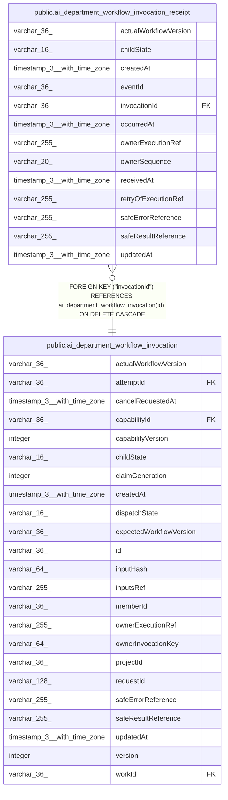

# public.ai_department_workflow_invocation_receipt

## Columns

| Name | Type | Default | Nullable | Children | Parents | Comment |
| ---- | ---- | ------- | -------- | -------- | ------- | ------- |
| actualWorkflowVersion | varchar(36) |  | true |  |  |  |
| childState | varchar(16) |  | false |  |  | Safe child execution state in this owner event |
| createdAt | timestamp(3) with time zone |  | false |  |  |  |
| eventId | varchar(36) |  | false |  |  | Stable n8n owner event ID |
| invocationId | varchar(36) |  | false |  | [public.ai_department_workflow_invocation](public.ai_department_workflow_invocation.md) |  |
| occurredAt | timestamp(3) with time zone |  | false |  |  |  |
| ownerExecutionRef | varchar(255) |  | true |  |  |  |
| ownerSequence | varchar(20) |  | false |  |  | Monotonic sequence from the owner |
| receivedAt | timestamp(3) with time zone |  | false |  |  |  |
| retryOfExecutionRef | varchar(255) |  | true |  |  |  |
| safeErrorReference | varchar(255) |  | true |  |  |  |
| safeResultReference | varchar(255) |  | true |  |  |  |
| updatedAt | timestamp(3) with time zone |  | false |  |  |  |

## Constraints

| Name | Type | Definition |
| ---- | ---- | ---------- |
| CHK_ai_department_workflow_invocation_receipt_childState | CHECK | CHECK ((("childState")::text = ANY ((ARRAY['pending'::character varying, 'running'::character varying, 'waiting'::character varying, 'retrying'::character varying, 'succeeded'::character varying, 'failed'::character varying, 'cancelled'::character varying, 'unknown'::character varying])::text[]))) |
| FK_c7d50579bb238ff2c5e6fcfd38c | FOREIGN KEY | FOREIGN KEY ("invocationId") REFERENCES ai_department_workflow_invocation(id) ON DELETE CASCADE |
| PK_bcaea2b2eb25b367a87028e9f6a | PRIMARY KEY | PRIMARY KEY ("eventId") |
| ai_department_workflow_invocation_receip_ownerSequence_not_null | n | NOT NULL "ownerSequence" |
| ai_department_workflow_invocation_receipt_childState_not_null | n | NOT NULL "childState" |
| ai_department_workflow_invocation_receipt_createdAt_not_null | n | NOT NULL "createdAt" |
| ai_department_workflow_invocation_receipt_eventId_not_null | n | NOT NULL "eventId" |
| ai_department_workflow_invocation_receipt_invocationId_not_null | n | NOT NULL "invocationId" |
| ai_department_workflow_invocation_receipt_occurredAt_not_null | n | NOT NULL "occurredAt" |
| ai_department_workflow_invocation_receipt_receivedAt_not_null | n | NOT NULL "receivedAt" |
| ai_department_workflow_invocation_receipt_updatedAt_not_null | n | NOT NULL "updatedAt" |

## Indexes

| Name | Definition |
| ---- | ---------- |
| IDX_ai_department_workflow_invocation_receipt_invocationId_owne | CREATE UNIQUE INDEX "IDX_ai_department_workflow_invocation_receipt_invocationId_owne" ON public.ai_department_workflow_invocation_receipt USING btree ("invocationId", "ownerSequence") |
| PK_bcaea2b2eb25b367a87028e9f6a | CREATE UNIQUE INDEX "PK_bcaea2b2eb25b367a87028e9f6a" ON public.ai_department_workflow_invocation_receipt USING btree ("eventId") |

## Relations

---

> Generated by [tbls](https://github.com/k1LoW/tbls)
