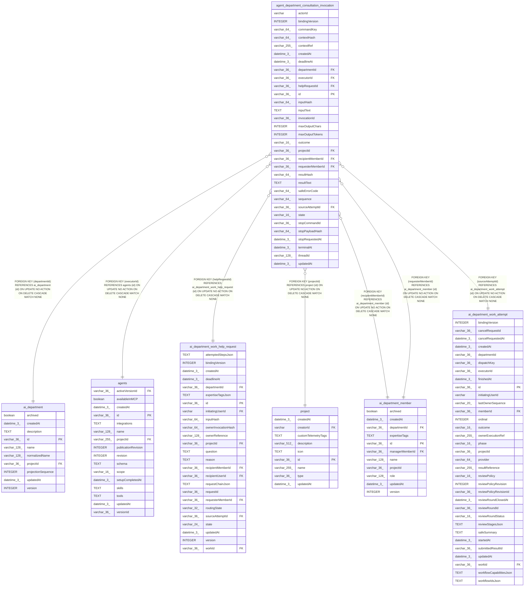

# agent_department_consultation_invocation

## Description

<details>
<summary><strong>Table Definition</strong></summary>

```sql
CREATE TABLE "agent_department_consultation_invocation" ("id" varchar(36) PRIMARY KEY NOT NULL, "projectId" varchar(36) NOT NULL, "departmentId" varchar(36) NOT NULL, "helpRequestId" varchar(36) NOT NULL, "invocationId" varchar(36) NOT NULL, "sourceAttemptId" varchar(36) NOT NULL, "requesterMemberId" varchar(36) NOT NULL, "recipientMemberId" varchar(36) NOT NULL, "actorId" varchar NOT NULL, "executorId" varchar(36) NOT NULL, "bindingVersion" integer NOT NULL, "commandKey" varchar(64) NOT NULL, "inputHash" varchar(64) NOT NULL, "contextRef" varchar(255) NOT NULL, "contextHash" varchar(64) NOT NULL, "inputText" text NOT NULL, "maxOutputChars" integer NOT NULL, "maxOutputTokens" integer NOT NULL, "threadId" varchar(128) NOT NULL, "state" varchar(16) NOT NULL DEFAULT ('reserved'), "outcome" varchar(16), "safeErrorCode" varchar(64), "deadlineAt" datetime(3) NOT NULL, "terminalAt" datetime(3), "sequence" varchar(64) NOT NULL DEFAULT ('0'), "resultText" text, "resultHash" varchar(64), "stopCommandId" varchar(36), "stopPayloadHash" varchar(64), "stopRequestedAt" datetime(3), "createdAt" datetime(3) NOT NULL, "updatedAt" datetime(3) NOT NULL, CONSTRAINT "CHK_agent_department_consultation_invocation_state" CHECK ("state" IN ('reserved', 'accepted', 'running', 'stopping', 'unknown', 'terminal')), CONSTRAINT "CHK_agent_department_consultation_invocation_outcome" CHECK ("outcome" IN ('succeeded', 'failed', 'cancelled')), CONSTRAINT "FK_46e1ae4526d1c01f442e243e888" FOREIGN KEY ("projectId") REFERENCES "project" ("id") ON DELETE CASCADE, CONSTRAINT "FK_ab82c09fef2d5816e43aabf4d84" FOREIGN KEY ("departmentId") REFERENCES "ai_department" ("id") ON DELETE CASCADE, CONSTRAINT "FK_cd27dd3ac6f933a28901758ac1f" FOREIGN KEY ("helpRequestId") REFERENCES "ai_department_work_help_request" ("id") ON DELETE CASCADE, CONSTRAINT "FK_a8b584491424b0120b4ba26fe18" FOREIGN KEY ("sourceAttemptId") REFERENCES "ai_department_work_attempt" ("id") ON DELETE CASCADE, CONSTRAINT "FK_328da9a2af891fb8268d81a0266" FOREIGN KEY ("requesterMemberId") REFERENCES "ai_department_member" ("id") ON DELETE CASCADE, CONSTRAINT "FK_b2ed8531e39fb0681f461d3b8e6" FOREIGN KEY ("recipientMemberId") REFERENCES "ai_department_member" ("id") ON DELETE CASCADE, CONSTRAINT "FK_f9dae826874fe11f1e690c88377" FOREIGN KEY ("executorId") REFERENCES "agents" ("id") ON DELETE CASCADE)
```

</details>

## Columns

| Name | Type | Default | Nullable | Children | Parents | Comment |
| ---- | ---- | ------- | -------- | -------- | ------- | ------- |
| actorId | varchar |  | false |  |  |  |
| bindingVersion | INTEGER |  | false |  |  |  |
| commandKey | varchar(64) |  | false |  |  |  |
| contextHash | varchar(64) |  | false |  |  |  |
| contextRef | varchar(255) |  | false |  |  |  |
| createdAt | datetime(3) |  | false |  |  |  |
| deadlineAt | datetime(3) |  | false |  |  |  |
| departmentId | varchar(36) |  | false |  | [ai_department](ai_department.md) |  |
| executorId | varchar(36) |  | false |  | [agents](agents.md) |  |
| helpRequestId | varchar(36) |  | false |  | [ai_department_work_help_request](ai_department_work_help_request.md) |  |
| id | varchar(36) |  | false |  |  |  |
| inputHash | varchar(64) |  | false |  |  |  |
| inputText | TEXT |  | false |  |  |  |
| invocationId | varchar(36) |  | false |  |  |  |
| maxOutputChars | INTEGER |  | false |  |  |  |
| maxOutputTokens | INTEGER |  | false |  |  |  |
| outcome | varchar(16) |  | true |  |  |  |
| projectId | varchar(36) |  | false |  | [project](project.md) |  |
| recipientMemberId | varchar(36) |  | false |  | [ai_department_member](ai_department_member.md) |  |
| requesterMemberId | varchar(36) |  | false |  | [ai_department_member](ai_department_member.md) |  |
| resultHash | varchar(64) |  | true |  |  |  |
| resultText | TEXT |  | true |  |  |  |
| safeErrorCode | varchar(64) |  | true |  |  |  |
| sequence | varchar(64) | '0' | false |  |  |  |
| sourceAttemptId | varchar(36) |  | false |  | [ai_department_work_attempt](ai_department_work_attempt.md) |  |
| state | varchar(16) | 'reserved' | false |  |  |  |
| stopCommandId | varchar(36) |  | true |  |  |  |
| stopPayloadHash | varchar(64) |  | true |  |  |  |
| stopRequestedAt | datetime(3) |  | true |  |  |  |
| terminalAt | datetime(3) |  | true |  |  |  |
| threadId | varchar(128) |  | false |  |  |  |
| updatedAt | datetime(3) |  | false |  |  |  |

## Constraints

| Name | Type | Definition |
| ---- | ---- | ---------- |
| - | CHECK | CHECK ("state" IN ('reserved', 'accepted', 'running', 'stopping', 'unknown', 'terminal')) |
| - | CHECK | CHECK ("outcome" IN ('succeeded', 'failed', 'cancelled')) |
| - (Foreign key ID: 0) | FOREIGN KEY | FOREIGN KEY (executorId) REFERENCES agents (id) ON UPDATE NO ACTION ON DELETE CASCADE MATCH NONE |
| - (Foreign key ID: 1) | FOREIGN KEY | FOREIGN KEY (recipientMemberId) REFERENCES ai_department_member (id) ON UPDATE NO ACTION ON DELETE CASCADE MATCH NONE |
| - (Foreign key ID: 2) | FOREIGN KEY | FOREIGN KEY (requesterMemberId) REFERENCES ai_department_member (id) ON UPDATE NO ACTION ON DELETE CASCADE MATCH NONE |
| - (Foreign key ID: 3) | FOREIGN KEY | FOREIGN KEY (sourceAttemptId) REFERENCES ai_department_work_attempt (id) ON UPDATE NO ACTION ON DELETE CASCADE MATCH NONE |
| - (Foreign key ID: 4) | FOREIGN KEY | FOREIGN KEY (helpRequestId) REFERENCES ai_department_work_help_request (id) ON UPDATE NO ACTION ON DELETE CASCADE MATCH NONE |
| - (Foreign key ID: 5) | FOREIGN KEY | FOREIGN KEY (departmentId) REFERENCES ai_department (id) ON UPDATE NO ACTION ON DELETE CASCADE MATCH NONE |
| - (Foreign key ID: 6) | FOREIGN KEY | FOREIGN KEY (projectId) REFERENCES project (id) ON UPDATE NO ACTION ON DELETE CASCADE MATCH NONE |
| id | PRIMARY KEY | PRIMARY KEY (id) |
| sqlite_autoindex_agent_department_consultation_invocation_1 | PRIMARY KEY | PRIMARY KEY (id) |

## Indexes

| Name | Definition |
| ---- | ---------- |
| IDX_agent_department_consultation_invocation_projectId_commandKey | CREATE UNIQUE INDEX "IDX_agent_department_consultation_invocation_projectId_commandKey" ON "agent_department_consultation_invocation" ("projectId", "commandKey")  |
| IDX_agent_department_consultation_invocation_projectId_departmentId_state | CREATE INDEX "IDX_agent_department_consultation_invocation_projectId_departmentId_state" ON "agent_department_consultation_invocation" ("projectId", "departmentId", "state")  |
| IDX_agent_department_consultation_invocation_projectId_helpRequestId | CREATE UNIQUE INDEX "IDX_agent_department_consultation_invocation_projectId_helpRequestId" ON "agent_department_consultation_invocation" ("projectId", "helpRequestId")  |
| IDX_agent_dept_consult_inv_id | CREATE UNIQUE INDEX "IDX_agent_dept_consult_inv_id" ON "agent_department_consultation_invocation" ("projectId", "invocationId")  |
| sqlite_autoindex_agent_department_consultation_invocation_1 | PRIMARY KEY (id) |

## Relations



---

> Generated by [tbls](https://github.com/k1LoW/tbls)
